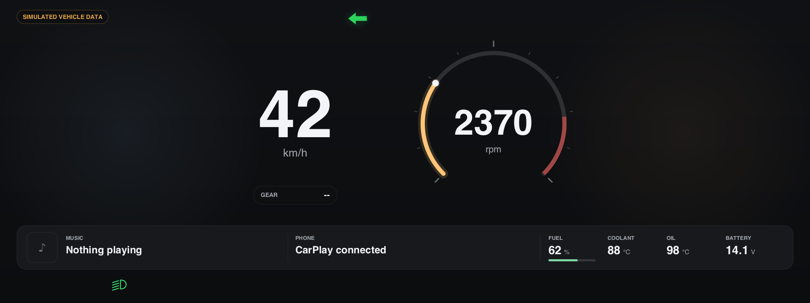

<!--
Author: gautch29
Notice date: 2026-11-23
Provided as is, without warranty. See NOTICE.md.
-->

# Linux Head Unit

**Dual-display receiver for CarPlay and CarPlay Ultra.**

Linux Head Unit is an experimental head unit for the Raspberry Pi Compute
Module 5. It drives a main touchscreen and a separate instrument cluster. The
native dashboard gives you Home, vehicle pages and instruments before the phone
connects and when it disconnects.

[Try it without a phone](#try-it-without-a-phone) ·
[Set up a CM5 bench](#set-up-a-cm5-bench) ·
[Documentation](docs/README.md) · [License](LICENSE)

## The two displays

| Main touchscreen | Instrument cluster |
| --- | --- |
|  |  |
| Native Home with no phone connected. | Native Sport layout with simulated vehicle and session data. |

Both images come from offline fixtures rendered by this repository.

## Development status

| Area | Evidence and remaining work |
| --- | --- |
| **Native dashboard** | Phone management, media controls, configurable gauges and trip statistics. The native cluster runs with simulated vehicle data. |
| **Wireless projection** | Earlier CM5 and iPhone runs exercised standard CarPlay, CarPlay Ultra on two panels, and Home/Back transitions. Repeated reconnection and physical touch timing remain open. |
| **Vehicle integration** | Dated observations and simulated Climate and settings. Physical sensors, HVAC and other actuators still need qualification. |
| **Camera** | Earlier CM5 runs exercised Ultra camera Punch-through and USB camera recovery. Full phone-side controls and session continuity still need live testing. |
| **Audio** | Component and silent-sink tests cover parts of playback, mixing and recovery. Audible output, microphone input and calls still need device tests. |

The current source has passed portable and native GTK checks on macOS. The
historical phone tests describe earlier bench generations. See the
[acceptance criteria](docs/GOAL.md) and [roadmap](docs/ROADMAP.md).

## Try it without a phone

The portable tools run on macOS and Linux. Start with CMake 3.20+, a C++20
compiler, Ninja, Python 3, pkg-config, OpenSSL 3, libplist, libarchive,
Cairo 1.18+ and libpng 1.6+. CMake fetches a pinned Luau revision.

<details>
<summary>Dependency setup</summary>

On macOS with Homebrew:

```sh
brew install cmake ninja pkgconf python openssl@3 libplist libarchive cairo libpng
```

On Raspberry Pi OS Trixie or Debian Trixie, follow the CM5 dependency list,
which also covers the GStreamer and Wayland components used on Linux.
[CM5 development dependencies](docs/CM5_BRINGUP.md#development-dependencies)

</details>

From the source directory, configure the build:

```sh
# Linux
cmake -S . -B build -G Ninja -DCMAKE_BUILD_TYPE=Debug

# macOS with Homebrew
cmake -S . -B build -G Ninja -DCMAKE_BUILD_TYPE=Debug \
  -DCMAKE_PREFIX_PATH="$(brew --prefix libarchive)" \
  -DOPENSSL_ROOT_DIR="$(brew --prefix openssl@3)"
```

Build and render the native Sport cluster:

```sh
cmake --build build --parallel 4
./build/headunit-native-cluster-snapshot build/cluster.ppm --center sport
ctest --test-dir build --output-on-failure
```

Open `build/cluster.ppm` in an image viewer. For the **main touchscreen**
preview, use a graphical session with GTK 4.14+ and Python bindings for
GTK. Use the Python interpreter that can import `gi`.

```sh
python3 tools/preview_native_home.py --empty --all-tabs --home-only \
  --output build/home-preview
```

The command writes `home.png` into a new output directory. Both demos use
local fixtures and need no phone, vehicle, pairing material or signed theme.

## Set up a CM5 bench

1. Install Raspberry Pi OS Lite (64-bit Trixie) and the compositor, GStreamer
   and receiver dependencies. A full GPU receiver build also needs the pinned
   Skia dependency. See [CM5 bring-up](docs/CM5_BRINGUP.md) and
   [GPU rendering](docs/GPU_RENDERING.md).
2. Copy the relevant examples from `config/` and set the actual Wayland
   outputs, physical panel sizes and touch transform. Start with simulated
   vehicle data. See [configuration](docs/CONFIGURATION.md).
3. For a live phone, supply your own authentication, network and pairing
   configuration. CarPlay Ultra also requires a compatible, independently
   supplied signed scene and its trust inputs. See
   [phone setup](docs/PHONE_PAIRING.md) and [asset verification](docs/ULTRA_ASSETS.md).
4. Run the release preflight and publish a sealed generation. The receiver,
   native cluster and compositor each have one owner. See
   [appliance releases](docs/APPLICATION_RELEASES.md).

## Code and contributions

`src/` and `include/headunit/` contain the receiver, vehicle model, audio
pipeline and native cluster. `src/theme/` contains the Ultra scene runtime and
renderers. `tools/` contains the GTK Home page and appliance tools. The
[architecture guide](docs/ARCHITECTURE.md) maps their runtime boundaries.

Use `tools/format.sh` with clang-format 19.1.7 for C++ changes. When reporting a
problem, include the source revision, OS, display modes and the smallest
reproduction you have. Keep credentials, pairing data, phone captures and
signed assets private. See the [local test matrix](docs/CI.md).

## License

Project-owned material is **source-available for noncommercial use** under the
[PolyForm Noncommercial License 1.0.0](LICENSE). It permits hobby use,
modification and redistribution under its terms. Commercial use requires
separate permission. Third-party components retain their own terms. See
[notices](NOTICE.md) and [source provenance](docs/PROVENANCE.md).

Linux Head Unit is independent and experimental. This distribution excludes
Apple and automaker files. The project has no Apple or automaker approval and
has no qualification as a vehicle's primary instrument cluster.
