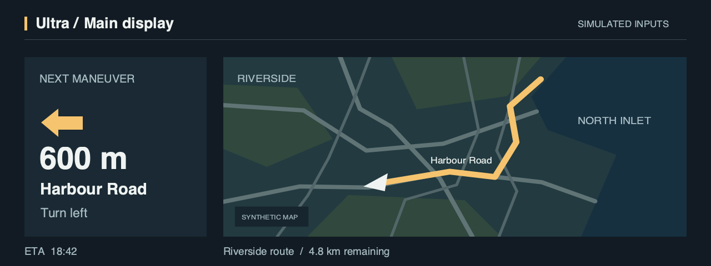
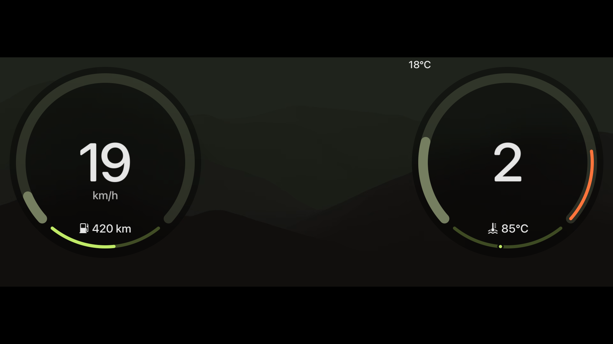
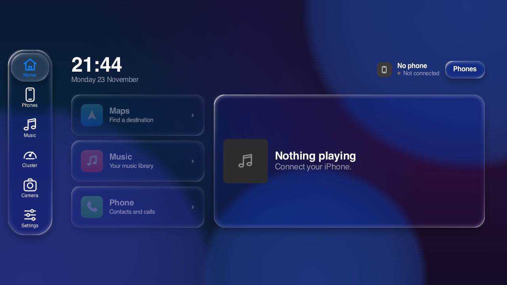

<!--
Author: gautch29
Notice date: 2026-11-23
Provided as is, without warranty. See NOTICE.md.
-->

# Linux Head Unit

**Wireless CarPlay Ultra receiver for Raspberry Pi Compute Module 5.**

Linux Head Unit brings CarPlay Ultra to a main touchscreen and a separate
instrument cluster. It renders the signed Ultra scenes locally, combines
separate iPhone video streams with vehicle data, and maps touchscreen input
back to the phone.

> **A compatible MFi authentication chip is required for the documented live
> iPhone setup.** Connect the MFi coprocessor to the CM5 over I²C.
> [MFi authentication](docs/MFI_COPROCESSOR.md)
>
> **One CarPlay Ultra asset package is supported today.** Use the signed
> package with identifier `44C9FA31EC` and accessory version `985`. Supply
> that package and its trust inputs separately. Other packages and versions
> are unqualified. [Signed assets](docs/ULTRA_ASSETS.md)

[CarPlay Ultra on the bench](#carplay-ultra-on-the-bench) ·
[CM5 setup](#set-up-a-cm5-bench) · [Offline demos](#try-it-without-a-phone) ·
[Documentation](docs/README.md) · [License](LICENSE)

## CarPlay Ultra on the bench

| Main display | Instrument cluster |
| --- | --- |
|  |  |

These are screenshots from the Ultra reference renderer with project-owned
scene artwork and synthetic video and vehicle data.
[How the previews were made](docs/PROVENANCE.md#ultra-preview-images)

Earlier CM5 bench generations ran CarPlay Ultra with a real iPhone. The main
display showed the Ultra interface with touch, while the cluster combined a
second phone stream with locally rendered gauges. Apple Maps appeared between
the gauges. [CarPlay Ultra integration guide](docs/CARPLAY_ULTRA_GUIDE.md)

| Feature | Bench evidence and remaining work |
| --- | --- |
| **Two displays and touch** | The main touchscreen and signed cluster ran together. Repeated wireless reconnect, physical touch timing and sustained full-resolution frame rates remain open. |
| **Vehicle data and Climate** | Local gauges and iPhone Climate and settings were exercised with simulated data. Physical sensors and actuators still need qualification. |
| **Camera Punch-through** | Earlier runs exercised camera video inside the signed main scene and USB camera recovery. Full phone-side camera controls and continuity still need live testing. |
| **Audio** | Component and silent-sink tests cover parts of playback, mixing and recovery. Audible output, microphone input and calls still need device tests. |

The project also supports standard CarPlay. Native Home and the native cluster
provide a fallback after disconnect. The current source has passed portable and
GTK checks on macOS. Live results above describe earlier bench generations.
[Acceptance criteria](docs/GOAL.md) · [Roadmap](docs/ROADMAP.md)

## Set up a CM5 bench

1. Start with a wireless Raspberry Pi Compute Module 5, a main display with
   touch input, a separate cluster display and a compatible **MFi authentication
   coprocessor on I²C**. The receiver uses the chip to authenticate with the
   iPhone. [Authentication hardware](docs/CM5_BRINGUP.md#authentication-hardware)
2. Install Raspberry Pi OS Lite (64-bit Trixie), the Wayland compositor and
   receiver dependencies. A full GPU build also needs the pinned Skia
   dependency. [CM5 bring-up](docs/CM5_BRINGUP.md) · [GPU rendering](docs/GPU_RENDERING.md)
3. Configure the two outputs, physical panel sizes and touchscreen transform.
   Start with simulated vehicle data. [Configuration](docs/CONFIGURATION.md)
4. Supply your private accessory identity, network and pairing configuration,
   along with the signed scene package and trust inputs for Ultra. Run preflight
   and publish a sealed generation. [Phone setup](docs/PHONE_PAIRING.md) ·
   [Asset verification](docs/ULTRA_ASSETS.md) · [Appliance releases](docs/APPLICATION_RELEASES.md)

Hardware authentication is the default and the path that reached full
Ultra readiness in the live tests. The experimental software provider reached
iAP2 authentication in a limited trial. Its end-to-end CarPlay path remains
unqualified. [Authentication trial](docs/MFI_COPROCESSOR.md#real-phone-trial--9-october-2026)

## Try it without a phone

The portable tools run on macOS and Linux. Start with CMake 3.20+, a C++20
compiler, Ninja, Python 3, pkg-config, OpenSSL 3, libplist, libarchive,
Cairo 1.18+ and libpng 1.6+. CMake fetches a pinned Luau revision.

<details>
<summary>Dependency setup</summary>

On macOS with Homebrew:

```sh
brew install cmake ninja pkgconf python openssl@3 libplist libarchive cairo libpng
```

On Raspberry Pi OS Trixie or Debian Trixie, follow the CM5 dependency list,
which also covers the GStreamer and Wayland components used on Linux.
[CM5 development dependencies](docs/CM5_BRINGUP.md#development-dependencies)

</details>

From the source directory, configure the build:

```sh
# Linux
cmake -S . -B build -G Ninja -DCMAKE_BUILD_TYPE=Debug

# macOS with Homebrew
cmake -S . -B build -G Ninja -DCMAKE_BUILD_TYPE=Debug \
  -DCMAKE_PREFIX_PATH="$(brew --prefix libarchive)" \
  -DOPENSSL_ROOT_DIR="$(brew --prefix openssl@3)"
```

Build and render the native Sport cluster:

```sh
cmake --build build --parallel 4
./build/headunit-native-cluster-snapshot build/cluster.ppm --center sport
ctest --test-dir build --output-on-failure
```

Open `build/cluster.ppm` in an image viewer. For the **main touchscreen**
preview, use a graphical session with GTK 4.14+ and Python bindings for
GTK. Use the Python interpreter that can import `gi`.

```sh
python3 tools/preview_native_home.py --empty --all-tabs --home-only \
  --output build/home-preview
```

The command writes `home.png` into a new output directory. Both demos use
local fixtures and run without an iPhone, MFi chip, vehicle or signed theme.

| Main touchscreen | Instrument cluster |
| --- | --- |
|  |  |
| Native Home with no phone connected. | Native Sport layout with simulated vehicle and session data. |

Both images come from offline fixtures rendered by this repository.

## Code and contributions

`src/` and `include/headunit/` contain the receiver, vehicle model, audio
pipeline and native cluster. `src/theme/` contains the Ultra scene runtime and
renderers. `tools/` contains the GTK Home page and appliance tools. The
[architecture guide](docs/ARCHITECTURE.md) maps their runtime boundaries.

Use `tools/format.sh` with clang-format 19.1.7 for C++ changes. When reporting a
problem, include the source revision, OS, display modes and the smallest
reproduction you have. Keep credentials, pairing data, phone captures and
signed assets private. See the [local test matrix](docs/CI.md).

## License

Project-owned material is licensed under the
[GNU Affero General Public License v3.0 only](LICENSE).

Commercial use is allowed. If you distribute a covered version, you must make
its corresponding source, including your modifications, available to recipients
under the license. If you modify the software and users interact with it
remotely over a network, you must offer those users the corresponding source
at no charge.

Third-party components retain their own licenses.
[Notices](NOTICE.md) · [Source provenance](docs/PROVENANCE.md)

Linux Head Unit is independent and experimental. This distribution excludes
Apple and automaker files. The project has no Apple or automaker approval and
has no qualification as a vehicle's primary instrument cluster.
