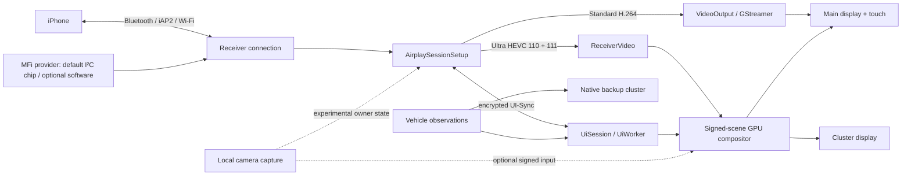
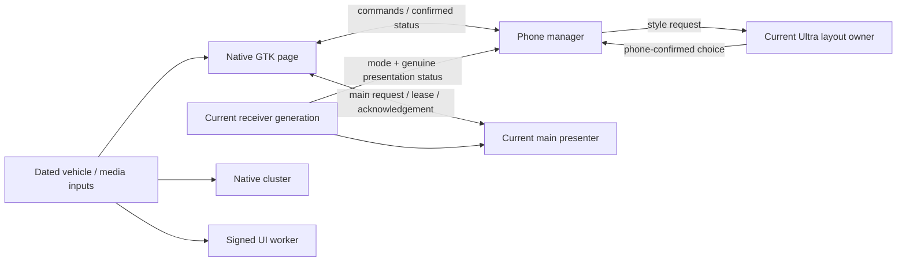

<!--
Author: gautch29
Notice date: 2026-11-23
Provided as is, without warranty. See NOTICE.md.
-->

# Architecture

Linux Head Unit is an original C++20 Linux receiver for a main touchscreen and a separate instrument display. It uses no LIVI source code. The installed Apple-signed theme, pairing identity, keys and phone captures are external inputs, not repository contents. This page maps the current code and its ownership boundaries; [feature status](../README.md) records what has been tested with a phone.

## Current system and release boundary

The CM5 bench has displayed Standard CarPlay with touch and a native cluster,
and CarPlay Ultra with signed main and cluster scenes on two physical outputs.
Retained release generations include the integrated native interface, startup-first
startup branding vectors, parallel phone radio preparation, corrected clock publication
and phone-applied remote cluster selections. The exact live binding belongs in
[HANDOFF](HANDOFF.md). Cold-power boot, sustained reliability and physical
rollback remain open.

The comprehensive source integrates native Home, bounded receiver recovery,
configuration-driven vehicle capabilities and gauges, strict incremental protocol
framing, event completions and fault-safe stream retirement. The integration also
preserves fresh video generation ownership and correct premultiplied artwork.
These are component-qualified software paths; installing a generation does not
establish its complete phone or hardware acceptance. See [application releases](APPLICATION_RELEASES.md),
[manager startup](PHONE_MANAGER_BOOT.md), [native Home](NATIVE_HOME.md) and
[startup animation](STARTUP_SPLASH.md).

V63 includes the managed signed camera graph. Actual USB pixels appear in the
main Punch-through slot and managed Off restores the dashboard; labelled lanes
run in the cluster ADAS slot. Phone camera controls/focus and sustained audio
remain open. New centre-content source extends the immutable vehicle capability
file with optional Remote UI declarations and a private, expiring manager intent.
A copied connection snapshot drives matching explicit signed-scene bindings;
no VM/GPU object crosses into the receiver control thread. Phone dismissal
retires the command. See [vehicle views](VEHICLE_VIEWS.md) and the
[OEM alignment audit](OEM_ALIGNMENT.md).

Arrows show ownership and data flow, not process boundaries. The lab launcher also starts the access point and discovery; the selected application release uses supervised services and a phone manager. A Wayland compositor owns physical outputs in either case.

## Local signed gauges without a phone

Opt-in `pre_phone_gauges` runs `src/theme/local_cluster.cpp` inside the existing
cluster service/background role. Verified resources and a filtered remembered
layout/colour supply an independent VM. Vehicle acquisition/freshness is shared
through the existing semantic source; animation uses real local monotonic time.
The signed controller's declared remote slot is empty with no producer, decoder
or offered frames. No AirPlay clock, UI-Sync session or phone readiness is created.
Main/control ownership remains separate.

Local failure destroys its GPU/VM before ordinary native instruments resume.
The background cannot take touch or cover a foreground phone scene. Missing
presentation feedback while covered also retires the local GPU path; return to
local signed gauges after phone loss and connected handover remain to qualify.
An explicit diagnostic `--local-ultra-output-retry` offers one additional attempt
only after an unresolved presentation timeout and a fresh native frame callback
for a post-backoff commit. The native Client fully retires before signed
re-admission. Default behavior remains once-only; callback output-work eligibility
is not foreground withdrawal or a presentation receipt. Pack/VM/GPU/output faults
and retry exhaustion retain native fallback. Optional unmap-ack timeout aborts
without exiting that native owner: the same connection/buffers retain ownership,
old role/surface proxies retire in order and one replacement native surface waits
for a fresh configure. Late old callbacks cannot authorize a signed successor.
Native initialization uses stop-aware private-connection dispatch so shutdown
also retires registry/configure waits. [Local return contract](LOCAL_ULTRA_CLUSTER.md#bounded-output-work-retry--14-october-source-only)
owns its limits and qualification plan.
The host preference disk worker preloads/copies bounded records, coalesces writes
and syncs atomic replacements independently of VM/control ticks.

## Where the code lives

| Boundary | Main implementation | Rule |
| --- | --- | --- |
| Lab configuration and launch | `tools/receiver_configuration.py`, `tools/run_lab_receiver.py` | Validate identity, display geometry and capability files before radio changes. |
| Retained application releases | `tools/appliance_release.py`, `tools/install_appliance_release.py` | Seal a fixed program/configuration graph; keep secrets and live state external. |
| Wireless and authentication | `src/bluetooth_iap_profile.cpp`, `src/iap2_session_engine.cpp`, `src/airplay_session_setup.cpp`, `src/hap_*.cpp` | Bluetooth/iAP2, MFi-backed authentication, Wi-Fi handoff and encrypted AirPlay control share one accessory identity. |
| Control composition | `src/control_probe.cpp` | One `Connection` owns session setup, optional video, vehicle-data and Ultra objects. Parsing and cryptography stay in dedicated components. |
| Standard picture | `src/video_output.cpp`, `src/gst_video_preview.cpp`, `src/gst_preview_output.cpp` | H.264 decode/presentation and touch; an optional owned GPU handoff is component-tested, not phone-qualified. |
| Ultra worker and video | `src/theme/ui_session.cpp`, `src/theme/ui_worker.cpp`, `src/theme/receiver_video.cpp`, `src/theme/video_decoder.cpp` | Fresh worker generation per connection; bounded UI/video queues; signed scripts and native HEVC decode. |
| Ultra composition | `src/theme/gpu_compositor.cpp`, `src/theme/gpu_display.cpp`, `src/theme/live_ui.cpp` | Combine phone video, local theme and optional local inputs; schedule by qualified phone clock and real presentation receipts. |
| Vehicle observations | `src/vehicle_observation*.cpp`, `src/theme/gauge_input.cpp`, `src/theme/vehicle_service.cpp` | Preserve acquisition time, age, availability and provenance; never turn missing into zero. |
| Phone-facing vehicle state | `src/theme/vehicle_configuration.cpp`, `src/theme/vehicle_session.cpp` | Compile semantic Climate/settings files into fixed per-session resources; validate dated provider readings and confirmed writes. |
| Camera experiment | `src/theme/camera_input.cpp`, `src/theme/camera_visibility.cpp`, `src/theme/camera_state.cpp` | Register a local signed-scene input and mirror its accepted, dated visibility to two read-only phone states. No phone control/focus acceptance yet. |
| Phone-free cluster and Home | `src/native_cluster.cpp`, `src/backup_cluster.cpp`, `tools/phone_page*.py` | Native instruments survive phone loss; Home is a separately owned main surface. |
| Boot decoration | `tools/phone_page_presentation.py`, `tools/phone_icons.py` | The existing page draws bounded GTK/GSK vectors at native resolution once per boot below phone foregrounds, with an empty input region; animation time never grants readiness. |
| Optional local HUD | `src/native_hud.cpp`, `src/native_hud_wayland.cpp`, `src/navigation_socket.cpp` | One explicitly named third output reads dated vehicle observations and the existing iAP navigation model; no extra phone subscription, signed panel or connection owner. |
| Audio/media | `src/carplay_media_stream.cpp`, `src/audio_output.cpp`, `src/audio_control*.cpp`, `src/audio_focus_command.cpp` | Authenticated AAC and bounded PCM output; one stream-owned phone duck request, separate from user mixer gain/mute and phone Bluetooth volume. Audible phone playback remains unqualified. |

Public C++ contracts are under `include/headunit/`. Topic guides carry details that this map intentionally omits: [wireless handoff](WIRELESS_HANDOFF.md), [AirPlay control](AIRPLAY_CONTROL.md), [UI session](UI_SESSION.md), [native video](NATIVE_VIDEO.md), [GPU display](GPU_DISPLAY.md), [audio](AUDIO_OUTPUT.md) and [provenance](PROVENANCE.md).

## Session and display ownership

New source offers both configured modes; the iPhone controls the session.
Legacy saved hints and headunit mode controls have no authority. An incomplete
UI-Sync/HEVC feature pair selects Standard; an accepted pair stays unknown
until the exact registered UI service SETUP succeeds. Presenters are deferred
until this decision, and fresh receiver publications report actual mode.
The initial capability offer retains both configured modes. Once initial SETUP
chooses Standard, subsequent `/info` uses the precomputed Standard display and
HID description and omits Ultra-only vehicle service additions. Unknown/Ultra
uses the original signed-panel description. Selection belongs to that connection;
a prior Standard session cannot change the next phone's capability offer.
Historical V3 had a different mode policy; the current integrated receiver
retains phone-authoritative mode negotiation. [HANDOFF](HANDOFF.md) owns selection.

The receiver registers consumers before accepting the phone's stream SETUP. Standard uses its H.264 main preview and native cluster. Ultra requires a verified installed pack, named main/cluster panels, UI-Sync and two HEVC streams. The reference pack uses `Center_Display` and `Cluster_Display`; those names and its artwork dimensions do not define a universal Ultra format. [Ultra integration](CARPLAY_ULTRA_GUIDE.md) follows the connection in order.

`UiSession` routes encrypted UI messages to a worker that owns its Lua VM, decoder inputs and GPU displays. Socket callbacks enqueue bounded work; they do not execute scripts or draw. A qualified phone clock and real compositor receipts determine presentation. Disconnect closes video and touch, stops the worker, and retains its resources until retirement completes. A new connection receives a new state generation.

The native cluster and backup are separate from signed Ultra rendering. An actual phone disconnect has produced an automatic backup handoff on the CM5. Optional cluster output isolation and transparent waiting are default-off recovery policies; their physical backup visibility and failback remain to be qualified. See [output fault recovery](OUTPUT_FAULT_RECOVERY.md).

The optional [HUD](HUD.md) is always a native local consumer, independent of
Standard/Ultra and Home. A bounded nonblocking publication from the sole live
iAP engine carries original guidance dates and a distinct two-second owner
lease. The existing vehicle broker may forward unchanged observations to a
fourth `hud` endpoint. Reflection and one measured projective correction belong
to its presenter; signed phone display geometry stays unchanged. Absent or
withdrawn HUD outputs never acquire the main/cluster output. Source support does
not select a physical module or install an additional service in the current retained appliance.

## Native and phone UI ownership

The native interface, Standard picture and signed Ultra scene share semantic
inputs and action contracts, not a rendering engine. GTK owns the native main
page; the native C++ cluster owns fallback instruments; the connection's
Standard presenter or Ultra worker owns CarPlay pixels. labwc owns the physical
outputs. There is one current manager/receiver graph, not a second connection
manager inside the page.

| Responsibility | Authority | Consumer boundary |
| --- | --- | --- |
| Phone selection and connect/disconnect | Supervised phone manager | Private bounded request/reply socket; page renders confirmed status. |
| Actual Standard/Ultra mode | Current receiver connection's negotiated services | Fresh launch-bound mode publication; page displays it and cannot choose it. |
| Home/Back eligibility | Current renderer's qualified presentation receipts | Manager validates generation/freshness; page also bounds reply age. |
| Main-surface handoff | Current Standard presenter or Ultra main worker | Existing request/lease/acknowledgement; page rises only after withdrawal. |
| Ultra styles | Current ready UI-Sync scene and verified catalogue | Manager admits style requests only during its fresh return-ready Ultra mode; worker confirms selection before persistence. |
| Vehicle readings and controls | Dated semantic providers / command coordinator | Independent native and signed consumers; missing values remain unavailable and requests remain separate from applied state. |
| Audio gain/media actions | Current media/audio owner | Page uses the same confirmed control route; it does not own decoding or device state. |

A process being alive, Bluetooth being connected, a window repaint or a late
socket completion never creates readiness. The page dates a manager request at
actual dispatch and carries that conservative observation bound through the
executor and GTK callback. Both navigation and presentation use one freshness
predicate; a delayed completion cannot grant another five seconds. The page has
one outstanding operation and no queued action or duplicate pending flag.

Native Home changes main-screen ownership without changing connection mode or
stopping cluster, streams or UI-Sync. Disconnect retires the phone generation;
its old status cannot enable Back or authorize Ultra styles. The layout catalogue
and button request carry the existing receiver launch nonce and actual control
connection generation. Manager admission requires both to match fresh
return-ready Ultra; a stale same-pack publisher or rendered button cannot act in
its successor. Catalogue age comes from its original host monotonic publication,
so changing filesystem dates grants no freshness. Retirement leaves dated bytes
untouched rather than risking a retiring worker erasing a successor. Only the
separate phone-confirmed pack/version preference can restore through the current
ready scene. [UI session](UI_SESSION.md) owns this contract and its component
evidence; physical switching remains a separate qualification.

Keep page composition and presentation separate: page code renders confirmed
models and actions; `phone_page_presentation.py` owns Wayland surfaces and
handoff; `phone_manager.py` owns child lifecycle and admission. Keep protocol,
VM/GPU and hardware provider code outside widget callbacks. A shared widget
framework or new UI supervisor is unnecessary for these ownership boundaries.

## Vehicle and camera boundaries

`VehicleSource` and `VehicleObservationCache` carry optional values with original acquisition dates and expiry. HVO1–HVO4 provide versioned metadata-bearing snapshots to separate processes; HUV2 remains a legacy complete snapshot. Speed, RPM, transmission, drive mode, trip and heading are separate observations. A physical sensor/CAN reader and actuator executor do not exist yet. The native cluster and Ultra script bindings consume the same semantic source but have independent freshness checks. See [vehicle observations](VEHICLE_OBSERVATIONS.md), [wire protocol](VEHICLE_OBSERVATION_PROTOCOL.md) and [vehicle controls](VEHICLE_COMMANDS.md).

Phone-facing Climate/settings use a different vehicle-state protocol. A compiled configuration remains fixed for one session while provider values change. The installed simulation has opened Apple's Climate and settings pages, but cannot operate physical HVAC. The control coordinator distinguishes requests, pending operations and confirmed state; the present synchronous phone writer rejects operations it cannot confirm. See [vehicle-state integration](VEHICLE_STATE_GUIDE.md) and [capability configuration](VEHICLE_CONFIGURATION_GUIDE.md).

The intended connected Ultra camera is **Punch-through within the existing signed main scene**. The main and cluster scripts, both phone video streams, UI-Sync, audio and control connection stay alive. Local pixels enter the signed `camera` slot; a separate phone-facing `AutomakerExteriorCamera` resource is intended to provide Remote UI controls. The new read-only camera-state bridge ties both phone On fields to one per-connection camera owner, with manual simulated-camera entry/exit confirmed using a real phone; exact phone state consumption and control/focus remain unqualified. A separate native camera surface may replace only the main window for phone-free or fallback experiments; that route does not prove integrated Ultra camera behavior. See [Punch-through camera](CAMERA_ULTRA_GUIDE.md) and [native camera appliance](NATIVE_CAMERA_APPLIANCE.md).

## Source-only ambient lighting

`ambient::Controller` derives one bounded target from a current screen accent or
observed drive mode and the shared night-mode function. Car dates/provenance stay
attached; source loss leaves colour unavailable. A dedicated instance of the
existing vehicle command coordinator separates target, dispatched operation and
actual MCU confirmation. The MCU owns transitions; no GPU/VM object or PWM work
moves onto the control thread. `ambient_light_model.py` supplies pure UI data;
no GTK styling, appliance service or physical executor is added.
[Ambient lighting](AMBIENT_LIGHT.md) owns the interface and the paired hardware
proposal. The signed pack, receiver and live ownership graph remain unchanged.
Opt-in sport telemetry is a non-visual manager worker consuming a dedicated
vehicle fan-out endpoint or labelled synthetic acquisitions. Its pure Python
engine calculates timers/laps/g from original observation dates; private session
history I/O and bounded parsing stay off manager/phone control callbacks.
Typed IMU/GPS extend the same C++ cache and explicit HVO6 codec. The GTK page
receives the existing manager JSON; it adds no radio, display, script or actuator
owner. [Sport telemetry](SPORT_TELEMETRY.md) owns the interface and evidence.

## Reliability review scope

The 7 October source pass reviewed the principal resource and freshness owners:
Bluetooth/iAP/control, native manager/page/modal handoff, Standard presentation,
Ultra worker/transport, camera request/lease IPC, vehicle observation admission
and audio/media scheduling. It repairs demonstrated owner failures; it does not
replace those domains with a generic coordinator or imply every protocol and
hardware path is qualified.

| Boundary | Decision and remaining constraint |
| --- | --- |
| Bluetooth/control | Wake the existing poll on transport readiness, use bounded nonblocking ordered writes and retire terminal iAP failures even through retained engine references. Preserve only a live authenticated handoff. Trace stages are observations, separate from connection authority. |
| Native page/manager | Use one pending action and one conservative reply-age predicate; retire modal resources with their parent and reject queued responses after withdrawal. Admit styles only during fresh return-ready Ultra. |
| Standard and signed UI | Retain their existing single-thread GPU/VM owners, bounded mailboxes, receipt/source floors and delayed retirement. No script/GPU work moves onto the control thread. |
| Camera IPC | Retain bounded reads, inode/owner/generation checks, freshness and lease retirement. Whole-session phone controls/focus and physical capture remain separate qualification. |
| Vehicle distribution | Retain atomic observation admission, independent acquisition/expiry and immutable source policies. Physical calibration and MCU clock mapping require the hardware adapter. |
| Media/audio | Retain stream-owned bounded decode/output and fault retirement, with focus separate from user gain. Silent output does not prove audible navigation/calls. |

IP control responses retain their existing synchronous sender and encryption
transition order. Each send call has one absolute two-second deadline, including
partial progress and interruptions; a timed-out partial response retires that
connection. Plaintext header/body writes are separate calls. This bounds the
existing failure path but does not make the control owner asynchronous. Measure
backpressure before moving responses into the connection's ordered transmit
queue; preserve actual completion and encrypted-transition ordering.

The shared `MfiAuthenticator` boundary serves iAP2, authenticated pair-setup
and AirPlay `/auth-setup`. Hardware remains the default; the explicit optional
software provider loads external matching P-256 credentials before startup,
without opening I²C or falling back to the chip. Both providers preserve
protocol-owned challenge derivation and bounded failure/retirement paths.
[MFi authentication](MFI_COPROCESSOR.md) owns configuration and evidence.

The hardware MFi bus/signature operation remains synchronous on the existing owner. One
logical signature deadline covers all completed register operations and rejects
late success, without preempting a blocked kernel call. The Linux device/kernel
behavior must be measured before claiming a hard whole-owner timeout. Selective
data-service teardown preserves unrelated RECORD/presentation authority; only
full session teardown retires it. Physical radio congestion,
Standard startup, driver hangs and long-run
phone recovery remain open; component passes do not remove those limits.
Scoped failure evidence belongs in [wireless handoff](WIRELESS_HANDOFF.md),
[native Home](NATIVE_HOME.md) and the existing domain guides.

## Hardware integration boundary

The companion hardware project owns boards, power, vehicle harnesses,
mechanical layouts and MCU firmware. This repository owns Linux-side
acquisition/control adapters and their semantic contracts.

The hardware MCU owns vehicle I/O, interlocks and sequencing. Linux sends bounded
requests and consumes dated observations and confirmed applied state; it has no
direct vehicle-output authority. Installation profiles admit only fitted,
qualified equipment. Physical providers remain unqualified by simulation.

Linux owns media/focus mixing, capture and runtime PCM volume by default. Purchased
DSP/amplification owns commissioned output filtering/routing/limits; MCU remote
enable follows current readiness. Any transfer of volume authority or exposed
DSP controls requires an explicit qualified interface. Requested enable is not
observed readiness. Phone-key authentication is separate from CarPlay pairing.
Cross-repository interface changes require an explicit compatible contract revision;
hardware design never implies a software release was selected or qualified.

## Trust and change rules

Prefer a single clear owner and one state model for each resource. Extend the
existing owner's transition/recovery rules before adding another supervisor or
coordination layer. Share small semantic contracts across native and Ultra
consumers; keep diagnostic and hardware-fixture paths explicit. An abstraction
should remove duplicated behavior or isolate a real boundary, not conceal a
workaround. Native interfaces should use consistent geometry, typography and
confirmed state so phone loss preserves a coherent useful experience.

The saved receiver JSON, display file and installed-UI profile are distinct inputs. Display pixels, physical millimetres, panel names and touch transform must agree. The signed asset is verified before use; a recorded historical acceptance reopens only the exact same package, not arbitrary packs. Keys, Wi-Fi credentials, pair stores, assets and captures stay outside Git. [Configuration](CONFIGURATION.md) and [asset trust](ULTRA_ASSETS.md) explain the checks.

When extending the receiver, put parsing or encoding in a bounded component, register a phone service only with an attached consumer, keep VM/GPU work off the control thread, and carry source acquisition time into vehicle data. A new camera or vehicle control is incomplete until its phone behavior and failure path are verified. Measure fresh phone frames and physical presentation separately from local animation throughput; see [performance](ULTRA_PERFORMANCE.md).
