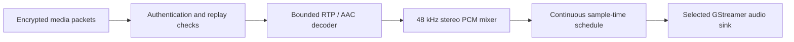

<!--
Author: gautch29
Notice date: 2026-11-23
Provided as is, without warranty. See NOTICE.md.
-->

# Audio output

## V84 measured camera PCM — 14 October

Frozen `3bd3db9` controlled Music Off 30s/On 60s/Off 30s records 112/222/112
fresh-PCM samples, both panels Ready and unchanged owner invocations. Accepted
blocks increase 2990/5796/2980; underruns and discontinuities increase 0/6/0.
**Continuous camera-On PCM fails.** Maximum output-owner gap 7.913ms and last
underrun gap 2.056ms do not establish an owner-stall cause. Two earlier media
fixtures were rejected before measurement for missing phone/generation; excluded.

Final post-cold-start manager Play intent left media paused/audio unavailable;
its attempted PCM fixture is retained as failed setup, without zero defaults or
continuity claims. Tapping the observed main Play control then resumes actual
playing/fresh PCM: +831 blocks and 0 new underruns over 8s with both panels Ready.
This short camera-Off check does not negate the controlled On failure.

No additional audio repair is justified by these samples. The V83 diagnosis below
owns missing original input/decoder/PCM-supply boundaries; collect those before
fixing a proven cause. Buffer/reserve/deadlines remain unchanged. Silent-sink
software evidence does not qualify audible sound. Original samples and bounded
USB log: private `20261013/phone-session/v84-camera-complete-audio-summary.json`.

## Offline original PCM trace audit — 14 October source only

`tools/pcm_trace_audit.py` reads **only** the private numeric schema 2 JSONL
produced by qualified `d544236` (collector implementation `f62a307`). It adds
no runtime logger, capture, protocol, GTK or appliance owner. Frozen V85 remains
unchanged; this tool is future source tooling subject to manager review. The phone owner later supplied one numeric-only partial V85 artifact for
read-only analysis after qualified selection. Original V84 On +6 and longer Off +2 failures
remain separate observations, with no On-only causal proof or new audio repair.

```sh
python3 -B tools/pcm_trace_audit.py /private/finished-numeric-trace.jsonl \
  --output /private/new-pcm-audit.json
# Optional owner-established original phase boundaries:
python3 -B tools/pcm_trace_audit.py /private/finished-numeric-trace.jsonl \
  --phases /private/original-phases.json --output /private/new-phase-audit.json
python3 -B tests/pcm_trace_audit_test.py
```

The CLI creates an exclusive 0600 JSON report, never overwrites input/evidence,
and prints only event count/coverage or a fixed sanitized rejection. Exit 0
means the numeric artifact was analyzed, including a partial artifact; it is
**not** a continuity pass. Exit 2 rejects malformed/changed/unsupported input
or failed output. Inputs/reports stay outside Git. Do not supply raw phone logs,
audio payloads, captures or Apple exports. `audit(path, phases_path=None)` is the
same production parser used by the CLI and returns the private report model.

Admission uses `O_NOFOLLOW | O_NONBLOCK | O_CLOEXEC`, rejects nonregular files,
and checks leaf identity plus device/inode/size/mtime/ctime/link count before and
after a second original-byte SHA256 pass. It rejects replacement/mutation rather
than publishing a mixed report. This checks a stable artifact, not authenticity,
durable capture, ancestor-directory trust or a hard filesystem syscall deadline.
Bounds: 53,000,000 input bytes, 262,272 events, 4,096 bytes per line/phase file,
128 source/route/epoch groups, 16 phases, 128 exhaustion contexts and 64 earlier
boundary representatives per context. Omitted context counts remain explicit.
The compact event store uses eleven uint64s per event (23,079,936 bytes at the
limit), plus a bounded sort index and small group summaries; no per-event JSON
tree is retained. The exclusive output has a 32,000,000-byte limit. Exceeding
any admission/report bound fails explicitly, without resizing a runtime queue.

The strict ASCII parser rejects excessive nesting/string/integer sizes, duplicate
keys, unsupported fields/schema/clock/kinds, floats, booleans in numeric slots,
negative/out-of-range integers and interior malformed lines. It requires the
exact producer header and nine numeric event columns. Input unavailable is
UINT64_MAX; report `original`/`values` use null for that sentinel, preserving zero.
Each representative retains original line and byte offset, date/source/route/
epoch, a/b/c/d and exact field semantics. Header/footer/capture loss, IPC loss,
encoding/write costs, original hash and file identity survive in the report.
Footer written-event/byte totals must match the artifact. `recorded` below
written events plus IPC drops is rejected. A larger total is preserved as
`unaccountedRecordedEvents`; it is incomplete coverage with an unattributed cause. A final unterminated
line, even valid JSON without the producer newline, remains an uncommitted
partial tail with its own hash/line/offset and no content echo.

Coverage is `unknown_partial` without a complete footer, `incomplete_reported_loss`
with any capture/lifecycle/IPC loss, `incomplete_unaccounted_records` with a recorded/written/IPC deficit and no
reported drops, or `finished_no_reported_loss`. The last
state certifies only consistent finished framing, record conservation and zero
**reported** drops.
Unrecorded clock-read failures, missing boundaries, lifecycle omissions and
collector reaping remain unproven; `continuousProducerCoverage` stays unknown
and `collectorReaped` stays null. Footer write metrics cover preceding writes;
the parent's final IPC/exit/reap receipt is separate evidence. No missing row,
zero count or between-observation gap proves network/supply absence.

Dates are actual userspace host `CLOCK_MONOTONIC` observations. Gaps are computed
only within one kind/source/route/epoch and retain original endpoint rows.
Lifecycle-first export can reverse dates/epochs in file order; counts expose
both. Equal-date rows have no inferred order; first/last/gap representatives are
only reproducible choices. Exhaustion contexts use **strictly earlier** original
same-route boundaries, independently tagged with each source and epoch, with
equal-date candidate/omission counts. They are adjacent observations, never an
RTP-to-PCM provenance join or a causal classification. Different routes stay
separate. Rows dated after stream/decoder/channel/route terminal observations
are counted explicitly; equal terminal dates are ambiguous. Already queued
old-epoch channel pops after decoder FLUSH/retirement are legitimate observations,
not fresh decoder revival. The tool creates no active/playback state machine.

`pcm_pull` emitted zero, `channel_pop` remaining zero and `output_exhausted`
appsrc bytes zero are separate observed quantities. Supply a/b retain the
shared-queue/direct-output alternatives because schema 2 does not encode that
mode. Resource/focus configuration remains distinct from requested state.
RTP sample times, decoder Gst PTS/duration and output running time/scheduled PTS
stay in their original domains. Output observation/running-time pairs establish
only that particular decision; there is no NTP/wall-clock conversion, reconstructed
clock, packet/block mapping, played/audible receipt or network-loss inference.

The optional phase file is one bounded JSON object with exactly `traceSha256`,
`clock` (`CLOCK_MONOTONIC`), `parentPid` matching the header,
`sameHostClockConfirmed` (owner assertion true) and `phases`. Each phase has
exactly `label`, `startNs`, `endNs`; labels are off/on/pause/resume/teardown/reopen/
other, intervals are disjoint, in supplied order and `[startNs,endNs)` with
original nonzero uint64 host dates. The trace hash binds the phases to the
artifact. Phone-session must independently establish the invocation/boot/host
clock scope and actual phase transition receipts before setting the assertion;
PID equality alone is not that qualification. No guessed duration, camera event,
phone wall-clock text or regenerated date is accepted as a boundary. Per-phase
counts retain exact bounds/group identities; phase coverage always stays unknown.

### Offline evidence and sole-owner next check

Focused qualification exercises the production parser with explicitly numeric
synthetic traces: lifecycle/hot reordering, FLUSH and queued old epochs, equal
observations, retirement/successors, separate routes/clocks, each loss category,
partial/missing footers, original references/hash, maximum record budget, input
mutation/replacement/symlink/FIFO/depth/number bounds and exclusive failed-output
retirement. A tiny private interoperability fixture uses the **unchanged real
Capture/File collector** with numeric synthetic events; it introduces no tracked
C++ or production change. Final macOS Debug CTest passes **1/1** in **5.93 s**, exercising 20 actual
Python cases without skips/retries, including 262,272 records. Pinned format
19.1.7 passes. Real unchanged File interop passes finished/loss/cancelled framing
and actual waitpid/reap/collector-absence checks. In the synthetic 8,193-hot-row
shutdown fixture, a finished footer twice reports recorded 8,194, written 448,
IPC drops 64 and overflow 1: **7,682 recorded events remain unaccounted for**.
This is retained macOS fixture evidence of incomplete diagnostic coverage, not
a qualified Linux/phone producer fault or audio cause. The audit preserves the
deficit and cannot call that artifact complete coverage. Initial missing
libarchive pkg-config configure failure and the first interop parser rejection
are retained separately; the latter motivated explicit deficit handling.
All three owned build trees are absent after independent retained-hash checks;
no container was created. Actual retained results/source/Testing/retirement
receipts live in `20261014/codex-pcm-trace-audit/`; no full matrix, Linux/GPU execution,
new phone run, audible, sustained-camera or fresh60 acceptance follows.

The sole phone owner subsequently supplied the original partial V85 numeric
copy after selected `d544236` qualification. Its exact notified hash/17,293,354
bytes pass the stable bounded parser: 262,161 events, six source/route/epoch
groups, 17 file-date reversals and no footer. Coverage/loss/reaping remain
unknown. Ten exhaustion observations occur across a 382.803-second original
span. The owner's original **remote CM5 monotonic phase sampling** bounds place
0/4/0 in Off/On/Off; six are outside those windows and are left unassigned.
Transition gaps are not filled. This agrees with the owner's four On underruns,
without treating zero diagnostic rows as a continuity pass. All four On rows
observe zero appsrc bytes. Their preceding same-route boundary observations
have datagram gaps 197.716–282.144 ms, decoder-submit gaps 197.688–282.129 ms,
decoded-pull gaps 225.660–230.345 ms, supply gaps 166.442–169.409 ms and
output-accept gaps 89.300–91.024 ms. These are **observed gaps**, not proven
network/decoder/supply absence or shortage duration. Missing-footer/loss and
packet-to-block provenance prevent causal attribution. Original hash, full
line/date/value/context references, owner driver-line/hash/source-clock
provenance and exact phase intervals are private under `v85-partial/` and
`v85-phases/` in this worker's evidence directory. No new capture, runtime change,
reaping receipt, audio fix or end-to-end acceptance is claimed.

Phone-session alone, after qualified source selection, exports only closed
numeric traces and original owner receipts. Preserve hash/header/footer,
source/release/receiver invocation/boot clock scope and actual collector exit/
reap/cancellation/loss/cost receipts. Keep actual camera Off/On/Off transition
host dates (no pause/skip/focus/FLUSH during that comparison), output samples,
both Ready panels/streams/UI-Sync/audio/control and camera acquisition ages.
Use the owner-only recipe above for a **new** private report, then inspect each
exhaustion's same-route source/epoch groups and original input/decoder/supply
rows. Retain an interrupted phase as partial. Separately label intentional
pause/resume/teardown/reopen and verify old source/route/epoch retirement; those
are not continuity passes. Missing ingress, sender clock, phase coverage or
packet-to-block provenance stays unknown. A causal fix remains parked until an
actual dated production defect and deterministic same-policy owner regression
exist; never expand buffers/reserve/deadlines/queues to hide failure. The live
high-priority owner does not wait for this offline tool. No UI keys/actions/IDs,
widgets or native pieces are added for native UI integration.

## Original-dated PCM supply capture — 14 October source only

The source candidate adds opt-in numeric observations at the unresolved V84
supply boundaries. It changes no RTP interpretation, decoder/jitter policy,
queue capacity, output reserve, admission horizon, deadline or mixer envelope.
The camera-On cause remains **parked pending a new qualified phone-owner run**;
there is no runtime supply repair or camera/audio acceptance claim.
The phone owner subsequently reports a separate camera-Off partial run
(123.689 s, 36 samples, +12,098 accepted blocks / +2 underruns, both panels
Ready and unchanged owners). It stops on continuity failure. This demonstrates
that observed shortages are not exclusively On; it supplies no missing input
dates or causal attribution. Its original receipts remain privately owned under
`20261014/codex-phone-session/sustained-camera-off-pcm/`.

`audio_observation::Capture` belongs to the receiver invocation. Production
`AirplaySessionSetup` binds that same capture to the shared playback route and
its authenticated streams. Locally allocated numeric source and route IDs
identify lifetimes, without exporting crypto connection IDs or phone identities.
Each stream's decoder starts at epoch 1; an applied FLUSH destroys its old
pipeline before creating the next epoch. Accepted FLUSH requests use epoch 0
(unknown applied epoch), and skipped requests retain the current decoder.
Shared output uses epoch 0 because its local schedule outlives decoder resets.
Every queued shared-playback entry retains the supplying decoder epoch until
consumption, including PCM that had already crossed that boundary before FLUSH.
FLUSH still does not flush previously admitted shared-output PCM.

All event `dateNs` values are acquired at their actual boundary in host
`CLOCK_MONOTONIC`. Datagram dates follow the actual `recvmsg` read and peer
check; they are **userspace receipt observations, not kernel arrival dates**.
`receive_turn` dates expose receive-owner scheduling gaps. Jitter sink/src pad
probes observe entry/release; entry is not an acceptance/loss classification.
Decoded sink admission and appsink pull retain original Gst PTS, duration,
size and flags. Pulling/emitting a PCM block is separate from successful channel
handoff and sink acceptance. Existing jitter classifications are dated where
queried, not assigned retroactive packet-loss dates. No old telemetry is redated.

RTP time and decoded/output Gst running times remain separate clock domains.
The output admission/exhaustion rows carry both the actual owner observation
date and the running-time values read for that decision; this is an observed
correlation pair, not a general clock mapping. Opus jitter timestamps retain
the existing negotiated-rate normalization; authenticated/submit rows retain
original negotiated sample time. RTP sequence is outside timestamp/SSRC AAD:
sequence is a routing observation even on an authenticated packet, not an
independently authenticated loss receipt. Rejected/truncated/pre-resume packets,
empty pulls, resets and requests never count as accepted fresh PCM.

### Opt-in, bounds and export

Set `HEADUNIT_AUDIO_OBSERVATION_FILE` only on the receiver's existing launch
for a newly qualified generation. Omission creates no capture, collector, IPC,
pad probes, diagnostic clock reads or export. `File(path, executable)` spawns
**one storage process**, using the same qualified receiver executable's private
`--audio-observation-collector` entry before ordinary receiver initialization.
It creates no audio, radio, GPU or display owner and needs no additional binary
or sealed asset role. This is opt-in diagnostic scope, not a GTK/manager action
or a permanent logging service. The bench owner supplies the new private path
and validated launch environment; never set it globally or reuse a filename.

All target directory/file operations, JSON encoding and regular-file writes
belong to that collector. It creates a **new** 0600 file in a receiver-UID-owned
0700 directory using exclusive `openat`/no-follow admission. Invalid private
paths, open failures and partial/failed writes return an explicit collector
error; normal receiver/audio servicing continues with capture stopped. The
collector emits only a bounded numeric failure summary to its inherited receiver
log, never keys, payloads or arbitrary path text. The control loop performs no
trace disk I/O, formatting or error-log writes, and does not destroy/wait for the
collector while servicing connections. This replaces `ee0b51f`'s rejected
synchronous control-loop disk export. Its original commit/FINAL/checks remain
retained and do not authorize integration or deployment.

Hot observations retain the nonblocking `try_lock`, fixed 8,192-event ring,
262,144 hot-record budget and separate lifetime reservoir of 128 events.
Contention, ring overflow, budget exhaustion and lifetime overflow remain
explicit. The lifetime reservoir is finite across the receiver invocation,
including reconnects, and can lose a contended record. Missing rows do not prove
missing packets/events. No samples, payloads, keys, addresses, phone identities
or Apple assets are retained; maximum export remains 262,272 numeric records,
under 53 MB including framing.

The sole control owner sends at most eight **64-event fixed binary datagrams**
per poll on a private anonymous Unix socket pair. Socket sends/receives use
`MSG_DONTWAIT`; there is no disk descriptor on that path and no unbounded retry
or heap-encoded backlog. Both ends request 32 KiB send/receive buffers; the
collector verifies actual capacities between one packet and 64 KiB each and
reports them in its header (Linux reports 65,536 bytes). The existing ring
remains about 0.6 MB; the parent has one fixed packet (~4.7 KiB) and the collector
one fixed packet plus at most 64 encoded rows (under 13 KiB). Kernel socket
accounting and process/library overhead are additional, explicitly bounded or
bench-measured separately. No per-packet thread is introduced. When the socket
is full or broken, removed diagnostic batches are counted in
`transportDroppedEvents`/`transportDroppedBatches`; they never backpressure or
retire PCM. Collector acknowledgements are bounded copied numeric progress;
missing/old exporter progress is not a fresh PCM receipt.

The receiver owns the collector PID and descriptor. `File::poll()` uses only
bounded capture copies, nonblocking IPC and `waitpid(WNOHANG)`; `status()` reads
the cached `starting/running/finished/failed/cancelled`, actual reaped flag,
transport loss/error and optional last observed exporter counts/cost/error.
`finish()` is shutdown-only, after normal connections/audio retire: seal against
producers, attempt at most 17 ring-drain polls, send a final counter frame, allow
100 ms for graceful completion, then SIGKILL and observe reaping for at most
another 100 ms. Reaping fixes the remaining reply set; a bounded status drain
preserves its terminal receipt behind older progress. The collector's Linux
parent-death SIGKILL plus original-parent check prevents a crashed receiver
from leaving userspace export alive. There is no detached logger or restart.

Those retirement waits are diagnostic observation budgets, **not hard syscall
or kernel I/O bounds**, and do not change PCM deadlines. An uninterruptible
kernel task can delay reaping despite pending SIGKILL; `reaped:false` remains
explicit and cannot count as completed retirement. Normal graceful return
requires actual successful final-frame send, exit zero and `waitpid` evidence.
Cancellation or write failure can leave a partial private file without a final
footer. Only a successful `finished:true` footer/zero-exit retirement establishes
completed export; losses still make coverage incomplete. Never treat the byte
bound as a time bound or add `O_NONBLOCK` to a regular file as a stall remedy.

### Receiver-group shutdown repair — 14 October source-only

Selected V85's complete camera Off30/On60/Off30 observations add0/4/0
underruns with both panels Ready and unchanged owners. That continuity failure
is separate from diagnostic retirement. After an intentional manager disconnect,
the numeric capture has262161 events and no completion footer. Its17.293MB
copy is hash/metadata verified, and the incomplete original remains on the CM5.
Loss counters and complete coverage are unavailable; missing rows prove no
network or supply absence.

The existing launcher stops the receiver's process group with SIGTERM. The
collector inherited that group, and exec reset its caught signal dispositions,
so the same signal killed storage before the parent could send the final frame.
An actual File/process-group regression fails against qualified d544236, then
passes the repair under Linux GCC and Clang19 ASan+UBSan. The fixture uses real
owned processes, SIGTERM/SIGINT, a held collector, completed footer, actual
waitpid/reaping and final process absence. The existing parent-death test also
passes. This is component evidence; the new source is not selected yet.

The repair atomically blocks INT/TERM/HUP in the child's spawn attributes,
preserving other inherited mask bits. Only the collector installs ignore
handlers and unblocks those signals. Parent handlers/mask and the shared
process group/session/cgroup remain unchanged. The parent still owns EOF,
100ms graceful completion, SIGKILL/reap and Linux parent-death protection.
No queue, record budget, audio reserve, timeout, warning or leak policy changes.
Abrupt parent death or incomplete export remains partial, never a completed
capture. New combined manager review, full matrix and immutable fix-forward
release are required before a live repeated retirement check.

### Local diagnostic retirement accounting — 14 October source-only

The retained original real File synthetic-loss fixture reports a finished footer
with 8,194 recorded, 448 written and 64 IPC-rejected records. Exact qualified
`a140236` production source reproduces that 7,682-record deficit. A separate
post-retirement probe retrieves **7,682 actual original records still in Capture**,
with their unchanged dates/source/route/epoch, and observes transport error
`ENOBUFS`. Successful final send, zero exit, actual reaping and process absence
do not make those unexported records disappear. Original evidence is preserved;
this attributes the reproduced local defect, not an unobserved historical phone
or audio cause.

On macOS, a full Unix datagram buffer returns `ENOBUFS`. The parent classified
that as terminal, stopped capture and broke its finite drain. Older queued
collector `running` replies then replaced the failed state during retirement,
allowing the final frame before the remaining local queue was drained. The
deterministic stopped-child/socket-fill/resume regression fails on the same
production source: 8,194 original records, 384 written, 64 IPC-rejected and
**7,746 actual residual records** after successful retirement.

The narrow repair treats `ENOBUFS` as nonblocking diagnostic rejection alongside
`EAGAIN`/`EINTR`, counting the exact removed packet and continuing the existing
finite drain. Queued progress can no longer revive a terminal parent failure.
There is no new retry backlog, queue/budget/reserve/deadline, acquisition,
thread, logger, service or audio/GStreamer/PCM/PTS/jitter/decoder policy. The
17 drain polls, eight 64-record packets per poll, 100ms grace/SIGKILL/reap,
Linux parent-death protection and inherited soft-signal guards are unchanged.
Schema 2 and its exact original header/footer fields are unchanged.

Private baseline source, original fixture, numeric rows, residual records,
failure logs and verified retirement receipts are under
`20261014/codex-pcm-retirement-coverage/`. The portable production File regression
checks exact exported row identity, uniqueness and residual queue accounting;
held/resumed, cancelled/killed and late-producer paths remain explicit. Component
qualification and a later coherent required matrix do not establish deployed
collector behavior or complete phone diagnostic coverage. The genuine V86 short
trace's reported contention still precludes a coverage pass. No UI keys/actions/
IDs or native pieces are added. Phone-session alone owns the later immutable
generation and ordinary Disconnect/footer/reaping check described below.

Final focused evidence: Mac File CTest **1/1** (0.76s), unchanged accepted
offline-analyzer tests **20/20**, and ARM64 Linux Clang19 ASan+UBSan **3/3**
(6.73s: File, production audio observation and authenticated control). The final
fixture still fails against retained `a140236` with 7,746 residual records.
Corrected original File interoperability records 8,194 admitted / 576 written /
7,618 IPC-rejected / zero unaccounted; its loss classification remains incomplete.
Linux verifies SIGTERM/SIGINT group stop, actual parent-death SIGKILL/reaping,
failed writes and unchanged decoded/output PCM. Strict warnings, leak detection,
existing external suppressions and retirement budgets are retained; video is
enabled and GPU disabled. Actual runner/container INT/TERM/HUP cleanup passes
with exits130/143/129. All five own containers and four own host build trees are
retired after verified retention. The initial Mac dependency-path failure and
Linux fixture's mistaken one-poll buffer-fill assumption remain separate failed
evidence; four ordinary fixture polls now force the actual stopped socket full,
without changing any production bound. No full required matrix or live acceptance
is claimed by these focused checks.

### Actual collector storage exhaustion — 14 October source only

The `pcm-storage-faults` branch starts at fully qualified V87 `3670763` and
imports only reviewed retirement accounting `15315db` (equivalent `8d0bcec`,
no conflicts). Its new delta adds failure regression coverage; it changes no
production collector, PCM/control owner, budget, deadline, decode timing,
mailbox, volume, retirement policy or default-off configuration.

The Linux tests require an explicitly supplied, private owned Docker tmpfs,
checked for the actual tmpfs filesystem and at most **1 MiB** total capacity.
Only owned synthetic files fill that mount. Host/CM5 disks, real phone data,
Apple resources and pairing identities are excluded. Set
`HEADUNIT_PCM_STORAGE_FIXTURE` to that mount and
`HEADUNIT_PCM_STORAGE_RECEIPTS` to an evidence directory outside it. Without
that fixture, the two `owned-linux-tmpfs` CTests return 77 with an explicit skip;
that is not storage-failure evidence. They are not registered on macOS.

`audio-observation-storage` first completes a normal export, then observes real
OS ENOSPC on the header, a batch and the footer. Genuine acquired synthetic rows
align the collector's own writes to a page boundary; no external writer alters
its trace. A separate exhausted batch makes a real short write: the collector
reports EIO and positive `partialBytes`, while a one-byte filesystem probe still
returns ENOSPC. This distinction preserves the existing write policy. Each
failure proves failed status, actual owner waitpid/reaping, collector absence,
no successful footer, no late producer replay and terminal repeated `finish()`.
Exact original 64-bit dates, source/route IDs above 2^53, epoch and unavailable
sentinels survive in the retained trace prefix. The empty failed header provides
no event coverage; even a complete row prefix before a failed footer is an
unfinished export. Failure receipts leave complete coverage **null/unknown**.

`audio-observation-storage-control` extends the existing actual receiver fixture.
Generated synthetic pairing establishes authenticated encrypted control and PCM;
a normal accepted-PCM baseline precedes exhaustion of only its diagnostic mount.
The same receiver continues accepting PCM and answering authenticated feedback
while its collector fails and is reaped **before** TEARDOWN. Original output
observation dates advance. Normal receiver exit is separately waited and checked.
This uses a silent fakesink and software owners, not a real phone or audible sound.
The existing stopped-child/IPC-loss fixture remains required and unchanged in
its normal invocation.

Unchanged V87 checks first pass Mac 8/8 and strict Linux GCC 13/13, including
normal/EFBIG, stopped/killed collector, group shutdown, parent death, encrypted
PCM and control. Final source qualification and exact timings are retained
outside Git under `20261014/codex-pcm-storage-faults/`. The same final source
passes Mac 9/9 portable checks in 8.96 s. Final strict GCC passes 16/16 in 31.00 s and Clang 19 ASan+UBSan passes 16/16 in 48.37 s, with Linux
leak checks and only the existing external suppressions. Both build the actual
receiver and native Wayland caller with video enabled/GPU disabled. GCC/ASan
accept 23→128 / 24→129 PCM blocks, with 15 authenticated feedback replies and
maximum replies 0.771/1.214 ms; these isolated observations are not worst-case
bounds or continuity/audible claims. The existing offline audit preserves
`unknown_partial`, null losses and unknown reap from failed trace bytes; direct
owner waitpid evidence remains separate. Two initial GCC runs pass
16/16 tests but outer retention fails on a write-only empty synthetic trace copy;
the runner keeps each stopped container/build. Both original failures remain,
then verified salvage precedes own retirement. A permission-only attempt does
not resolve the host-backed copy; direct byte copying corrects only the owned
evidence artifact. No runtime repair or assertion waiver is justified.
Current backend INT/TERM/HUP plus repeated-signal checks stop the actual owned container and reap its client; serialized source/logs/Testing/CMake/
JSON/hash manifests are re-read before every own build/container removal.

The manager's review holds the first `68958a8` source: its evidence streams
could fail silently before fixture originals were deleted. The fix-forward
changes only test retention. Mandatory trace, original-row, JSON and control
receipts now use bounded regular-file reads, exclusive writes, successful sync
and close, and exact closed-byte verification. Explicit fixture retirement
serializes and re-reads a manifest before deleting original files. Failed copy
or assertion unwind keeps originals; a checked copy in the owned container
layer survives the ephemeral tmpfs. The host retrieves that fallback twice,
compares exact bytes and verifies its retained hash manifest before container
removal. Failed fallback is an explicit failure, never a complete-retention claim.
Portable checks cover empty copies, missing inputs, overwrite refusal, mismatched
bytes, missing destinations, actual partial write failure, failed close,
descriptor retirement and verified recovery. An actual full-tmpfs copy failure
proves originals survive unwind; verified external recovery then frees the mount
for the following encrypted-owner fixture. The first checked GCC run keeps the
mount full and fails the following collector startup (15/16); its fallback trace,
receiver log/state, source and failed Testing remain retained. No runtime,
assertion, budget or deadline is changed by that fixture retirement correction.
The first sanitizer run also rejects a concurrently growing live trace peek
through the strict closed-retention reader (15/16). A separate bounded 1024-byte
header reader checks the live, append-only header; full copies still require
closed-source verification. Earlier console-only fallback retrieval missed a
passing test's duplicate container copy, while verified external recovery had
already preserved the exact trace and same manifest content. The corrected
backend reads both console and closed detailed CTest output and proves retrieval
of that actual fallback twice. These limitations and original attempts remain.
Final updated Mac/GCC/ASan checks above use the same corrected source. The
portable File-test wrapper still cleans its own synthetic root after an
unexpected assertion; it does not independently guarantee retention of every
failing test artifact. The scoped storage/control originals have the explicit
checked preservation path described here. Old source/archive/reports remain
retained; root acceptance still requires the final corrected identity.

UI keys, actions, control IDs and new UI pieces: **none**. Root whole-diff review,
a future complete coherent six-lane matrix, actual GTK checks, matched helper,
configuration/input/unit/asset identities and fresh capacity/full reserve remain
required before a new immutable CM5 generation. The sole phone-session owner
owns that work. Do not exhaust the CM5 disk: use the owned host fixture above,
then a normal finite capture with sufficient headroom and verified closed-trace
archival. A successful export does not prove full coverage or power-loss
storage durability. Camera/audio continuity, phone Close/focus, GPU execution,
optical/physical/audible acceptance and fresh 60 fps remain open.

### Numeric schema

The JSONL header declares schema 2, actual collector/parent PIDs and observed
socket buffer capacities, `CLOCK_MONOTONIC`, the unchanged columns
`[dateNs, kind, source, route, epoch, a, b, c, d]` and the unavailable sentinel
`18446744073709551615`. An unused value or invalid Gst PTS/duration remains
unavailable, not zero. The footer adds capture loss, IPC dropped event/batch counts, actual written
events and collector row-encoding/write costs and byte/call counts. Footer write
metrics describe preceding writes; the final IPC snapshot includes the footer
write too. Partial write/error details remain available in the collector error
reply/log when a footer cannot be written. Lifetime records are exported before queued hot records;
file order is not acquisition order. Join by date and source/route/epoch,
retaining original rows and loss counters. A PCM pull can split/aggregate decoded
buffers, so nearest PTS is not an exact block-to-RTP provenance mapping.

The counters describe distinct local diagnostic stages:

| Counter / receipt | Exact boundary |
| --- | --- |
| `recorded` | Accepted into the hot ring or lifetime reservoir. It excludes rejected recording attempts and does not mean exported. |
| `contention` | Recording could not acquire the capture lock; no record was admitted. |
| `overflow` / `budget` | Hot recording rejected at the full ring or exhausted budget. A full-ring attempt already spends one hot budget entry. |
| `lifecycleOverflow` | Rejected at the finite invocation-wide lifetime reservoir; taking earlier rows does not renew its 128-entry allowance. |
| `transportDroppedEvents` / `transportDroppedBatches` | Original rows removed by `Capture::take` whose fixed datagram send failed. Retried final counter frames have zero rows but can add a dropped batch. |
| `writtenEvents` | Complete event-batch writes accepted by the collector's write syscall. A partial batch does not advance this counter and leaves an explicit failed/partial export. |
| `finished:true` | The collector wrote its final footer. Actual parent final-send, zero exit and waitpid/reaping remain separate receipts; complete diagnostic coverage also requires accounted records and zero reported loss. |

`recorded - writtenEvents - transportDroppedEvents` is an accounting deficit,
not a cause. Only actual original queue/process evidence can identify accepted
records left locally undrained. Neither a deficit nor a missing row establishes
phone, network, decoder, PCM-supply or audible loss. Late producers after sealing
are outside capture admission; they cannot amend an already finished footer.

| Kind ID / name | `a`, `b`, `c`, `d` |
| --- | --- |
| 1 stream_start | negotiated format, latency ms, media, alternate |
| 2 stream_stop | authenticated count, decoded-block count, applied FLUSH count, fault present |
| 3 decoder_start | format, latency ms, existing appsrc byte cap, existing appsink buffer cap |
| 4 decoder_stop | submitted count, input backpressure count, discarded PCM frames, fault present |
| 5 route_start | startup reserve ns, admission horizon ns, appsrc byte cap, unavailable |
| 6 route_stop | accepted blocks, exhaustion count, discontinuities, fault present |
| 7 flush_requested | optional resume sequence, request count, unavailable, unavailable |
| 8 flush_begin | optional resume sequence, pending PCM present, last sequence, unavailable |
| 9 flush_applied | optional resume sequence, unavailable, unavailable, unavailable |
| 10 flush_skipped | optional resume sequence, last sequence, unavailable, unavailable |
| 11 resource / 34 resource_requested | enabled, configured/request count, unavailable, unavailable |
| 12 focus / 35 focus_requested | configured/request count, gain millionths, duration ns, unavailable |
| 13 receive_turn | pending PCM present, unavailable, unavailable, unavailable |
| 14 datagram | received bytes, recvmsg flags, untrusted sequence, untrusted sample time |
| 15 authenticated | sequence, original sample time, RTP bytes, unavailable |
| 16 rejected / 17 truncated | received bytes, unavailable, unavailable, unavailable |
| 18 pre_resume | sequence, required resume sequence, unavailable, unavailable |
| 19 decoder_submit | sequence, original sample time, RTP bytes, submitted count |
| 20 decoder_reject | reason (1 invalid / 2 bounded full / 3 Gst flow failure), RTP bytes, optional queued bytes, unavailable |
| 21 jitter_enter / 22 jitter_release | sequence, decoder RTP time, SSRC, original Gst PTS |
| 23 decoded_buffer / 24 decoded_pull | original Gst PTS, duration, bytes, flags |
| 25 pcm_pull | emitted blocks, remaining local PCM frames, unavailable, unavailable |
| 26 jitter_counts | pushed, considered-lost, late, duplicate classifications |
| 27 decoder_counts | submitted, discarded PCM frames, invalid PCM buffers, optional appsink drop count |
| 28 supply (shared) | channel queued blocks, enabled, unavailable, unavailable |
| 28 supply / 29 supply_blocked (direct) | output accepted blocks, pending PCM present, unavailable, unavailable |
| 29 supply_blocked (shared) | channel queued blocks, unavailable, unavailable, unavailable |
| 30 channel_pop | remaining queued blocks, output accepted blocks, unavailable, unavailable |
| 31 channel_detach | withdrawn queued blocks, output accepted blocks, unavailable, unavailable |
| 32 output_accept | actual scheduled PTS, running time at admission, accepted count, fresh origin |
| 33 output_exhausted | actual running time, exhausted schedule end, appsrc bytes, exhaustion count |

`resource` and `focus` mean worker configuration, not physical applied state or
audible playback. `output_accept` is appsrc acceptance, not a speaker receipt.
No new UI keys, actions, IDs, native pieces or widget framework are introduced;
native UI has no visual changes to review. The only new public source interfaces
are the optional `Point`/`Capture` constructor and playback-submission parameters,
`AirplaySessionSetup::set_audio_observation`, and the private exporter.

### Focused component evidence and limits

The original `ee0b51f` checks (GCC/ASan 17 each plus final 3) are retained,
**held evidence** because they did not isolate synchronous control-loop export.
The original early-withdrawal fixture failure and private runner HUP failure
also remain untouched. Source correction evidence is separate under
`20261014/codex-pcm-observation/export-fix/`; no previous result is reused as a
corrected exporter pass.

Revised focused ARM64 Linux GCC and Clang 19 ASan+UBSan compile the actual
receiver with video enabled/GPU disabled, retaining default warnings, leak
checks and the existing external suppressions. Both pass 18/18 (40.24/42.84 s) before a final
bounded terminal-reply drain refinement. Same final-source GCC/ASan affected
rechecks pass 4/4 each (10.30/10.61 s) and match all 766 non-Markdown inputs. The new actual receiver fixture uses generated private synthetic pairing,
authenticated SETUP and encrypted PCM while SIGSTOP holds its real collector.
It receives 15 authenticated feedback replies, observes over 100 original-dated
accepted PCM blocks and proves actual IPC loss, completed footer and no surviving
collector after receiver shutdown. Separate production fixtures compare exact
PCM/amplitude/ten-ms PTS/reserve with absent, enabled, stopped and killed
collectors; prove finite ring/reservoir/IPC, private paths, actual EFBIG failure,
cancellation/SIGKILL/waitpid retirement and actual parent-crash/PDEATHSIG reaping.
No deadline, reserve, payload or audio queue policy is relaxed.

Measurements separate original-dated **hot recording only**, copied binary parent
handoff, collector JSON row encoding and actual collector write syscalls.
The retained revised GCC Debug samples report 131 ns/hot event, 4,249 ns/64-record
handoff poll, 3,952 ns/written-event encoding and 8,155 ns/write call; ASan+UBSan
reports 189/5,330/6,331/3,973 ns respectively. The burst export benchmark drops
7,360/7,424 of 8,192 submitted diagnostic events, explicitly accounted; it is
not complete-coverage throughput. The actual stopped-collector receiver fixture
measures maximum replies 0.799/1.215 ms with 131/127 accepted blocks and 2,706/2,696
IPC event drops. These are isolated host-component observations, not worst-case
scheduling, durable-storage time, camera/GPU cost, live PCM continuity or a
qualified bench budget. Final same-source measurements/retirement/source hashes
belong to the revised private receipts and coordination FINAL.

Each lane retains logs, failures, Testing, source/CMake/JSON identities outside
its build before verified own container/tree removal. Actual INT/TERM/HUP runner
cleanup proofs are retained separately. The manager still reviews the complete
revised branch and owns the coherent combined required matrix before sealing.
No CM5, real phone, GPU, speaker or microphone check is performed by this worker.

### Exact next check — phone-session owner only

After manager review, integrate only this finished source and pass the complete
coherent required matrix before publishing a new immutable generation. Retain
the selected V84 and all validated private roles; keep the silent sink, 10%
unmuted, microphone disabled and existing single radio/display owner. Build the
receiver target and preserve its exact source/manifest, receiver invocation,
boot identity, clock domain, trace header/footer and private file hashes.
Enable the trace on that launch with a new private filename and sufficient
retention capacity, admitting exactly one supervised diagnostic collector in
the existing receiver cgroup. Retain its actual PID/parent association, bounded
IPC capacities, loss/error/partial footer, zero-exit/reap or explicit cancellation
receipt and normal owner identities. Archive directly off-device rather than accumulating
repeated finite captures on the CM5. This branch neither launches nor changes
that graph.

On one continuous playing track/route, collect the same **Off 30 s / On 60 s /
Off 30 s** with no pause, skip or intentional focus/FLUSH. Preserve original
output-date samples at 100–250 ms, both Ready panels and advancing streams,
UI-Sync/control, camera acquisition ages, owner invocations/restarts and bounded
private phone logs. The trace budget does not promise any duration at a given
workload: validate its loss counters and actual phase coverage. Stop on a
terminal fault, retain withdrawal receipts and report completed intervals only.
For each exhaustion, inspect preceding original receive turns/datagrams,
authentication/submission, jitter entry/release, decoded admission/pull and
channel supply/pop on the matching route/epoch. Use source/route changes and
request/configured/FLUSH boundaries to exclude withdrawal/reset. Do not map
phone wall-clock text or unrelated Gst clocks without an observed correlation.

Separately pause/resume and teardown/reopen once to verify intentional exhaustion,
fresh origin, decoder retirement and new local source/route IDs; these intentional
gaps are not continuity passes. A missing diagnostic row, appsink statistic,
RTP-to-block mapping or sender/network observation stays unavailable. If the
new dates isolate a reproducible production defect, prove the same-policy owner
regression before a fix-forward change. Otherwise park the causal repair with
the exact remaining boundary; no buffer/reserve/queue increase is authorized by
this source work. Camera/audio continuity, phone Close/focus and fresh 60 fps
remain open independently of component diagnostics.

## V83 real-phone follow-up — 14 October

Selected frozen0fe2ef9 has a controlled camera-On PCM continuity failure.
[Original evidence and diagnosis](#v83-camera-on-continuity-failure--14-october-source-review)
own the counters, event brackets, retained track-ended attempt, and missing
input/decoder observations. Output-owner telemetry does not establish a long
owner stall; no runtime repair or expanded buffer/deadline is claimed. The
bench silent sink proves software PCM, not audible sound.

## Current audio work — 11 October 2026

Historical V66 retains V61 audio source `a790261`; exact current release and
rollback belong in [HANDOFF](HANDOFF.md). For the later V83 camera/audio failure,
see the [14 October source review](#v83-camera-on-continuity-failure--14-october-source-review).
V60 is V61’s historical direct rollback. V59's Siri
failure established a type-100 speechRecognition SETUP with format
`0x40000000` and 80 ms latency. The installed reference SDK establishes that
**request `dataPort` is the microphone destination**; the earlier absence of
`inputDataPort` was not evidence that input was absent. The original capability
profile is retained; V57/V58 capability withdrawal experiments failed music.

### Voice, guidance and microphone software

The session admits type 100 main audio and type 101 alternate audio in the
advertised 8/16/24/32/48 kHz mono/stereo network-order S16 PCM formats and
16/24/48 kHz mono Opus formats. Buffered type 102 retains its tested 48 kHz stereo
AAC-LC path. Categories and latency are bounded and validated before allocation;
batch requests remain atomic. Unknown codecs, invalid microphone destinations,
reused connection IDs and duplicate active streams are rejected. A response
never echoes unsupported RTP redundancy or high-accuracy timestamp extensions.

Each stream authenticates the existing bounded 12-byte RTP / ChaCha20-Poly1305
framing before decoding. Main audio carries payload type 100. Opus uses 20 ms
codec frames; the SDK timestamps in negotiated PCM sample units. The decoder
normalizes 16/24 kHz Opus timestamps for GStreamer's fixed 48 kHz RTP clock.
All decoded outputs become 48 kHz stereo ten-ms blocks. One session playback
worker owns the output, bounded per-stream queues, shared gain/mute and local
mixing. The native bridge sees one master route, not three competing devices.
Selective voice retirement preserves music and master controls; final retirement
closes the device and route. Sink counters on stream diagnostics describe the
shared output and must not be summed across streams. This local receive schedule
is not proof of synchronization between independent phone RTP clocks.

Capture opens only for a main-stream SETUP with a nonzero phone `dataPort` and
an explicit configured source. Production configuration accepts `alsasrc` and
`pulsesrc`; it cannot select a synthetic microphone. Capture produces mono
Opus (20 ms) or network-order PCM (10 ms) matching the negotiated format, with
bounded buffering. Uplink uses the independent `DataStream-Input-Encryption-Key`,
a fresh connection ID and monotonic 64-bit nonces. RTP timestamps come from
actual capture pipeline PTS; gaps are preserved. No capture timestamp, missing
device, EOS or device/send fault retires input availability without closing the
voice downlink, music, video or control session. An unconfigured microphone
sends no invented silence and reports `microphone not configured`.

Receiver JSON / launcher options:

```json
{"audio_sink":"alsasink","audio_device":"hw:USB,0",
 "microphone_source":"alsasrc","microphone_device":"hw:USB,0"}
```

The launcher clears inherited capture variables before applying configuration.
The selected historical boot helper was qualified with capture omitted; enabling
these keys also requires a new retained helper with the capture-capable schema.
A microphone requires a configured audio output. Publish a new sealed generation
to change the device route; do not edit the selected generation. This example
is not the current bench configuration. The CM5 has HDMI playback only, no
capture device and no speakers; the selected silent output remains `fakesink`
at initial 10% gain, microphone disabled. The user requested software/bench
completion without a microphone. Spoken Siri, audible music/prompts/calls,
acoustic echo/noise processing and physical latency remain hardware acceptance,
not consequences of these component tests.

The voice fixture injects original PCM through an explicit in-process appsrc
endpoint, then exercises the production conversion/encoding, capture timestamp
gaps, input-key encryption, authenticated metadata, RTP decoder and actual
loopback UDP voice workers (including wrong-direction key rejection). It covers
all eight mono input variants and all ten PCM downlink variants, nonzero stereo
PCM, simultaneous music/voice mixing, bounded backpressure, mute confirmation,
selective retirement and terminal microphone/output faults. Admission fixtures
cover missing microphone, main/alternate response fields, shared master control,
selective teardown and fresh-key requirements. This bench does not open a phone,
radio, display owner or real microphone. V60 passes 11/11 exact-input local GCC
and 11/11 Clang 19 ASan+UBSan checks,
32 configuration checks and 31/31 strict full-Skia CM5 checks. Selection and
a fresh ten-second actual phone/cluster Ready tail pass; live Siri/Maps continuity
is pending. Qualification receipts are private under
`~/.cache/headunit-qualification/20261011/audio-voice-v60/`.

### Shared focus and voice retirement regression — 14 October source only

The existing `audio-focus-session` fixture now combines the production
`AudioPlayback` owner, all three channel slots, media ducking and shared user
volume/mute with saturated appsrc and channel queues. It selectively detaches
one voice channel, attaches its successor, then models a late producer's
configuration and PCM completion through the retained retired channel. The
retired PCM must be rejected while the same master mailbox, original media
focus and alternate channel survive. Already accepted mixed PCM may drain;
retirement does not revoke sink-owned buffers.

After that drain, isolated sink-pad peaks distinguish preserved media ducking,
independent alternate/voice gain and mute/unmute. An actual injected Gst bus
error closes the master route, clears live output telemetry and retains command
history. A fresh playback owner starts with independent controls, focus and
counters; a modeled old mailbox acknowledgment cannot consume its command.

This closes a combined regression gap, with no demonstrated production defect
or runtime repair. PCM and producer completions are synthetic; the GStreamer
pipeline, pad blockage, bus fault, worker and mailbox are production software.
No clock is injected. This direct channel seam is not authenticated phone
TEARDOWN, Maps/Siri/call focus, speaker audibility, automatic route recovery or
camera/audio continuity evidence. Portable control/mixer/focus checks and Linux
GCC/Clang 19 ASan+UBSan exercise the relevant existing fixtures; GStreamer and
session execution remain Linux-only. No queue, reserve, gain, scheduling,
deadline, protocol or observation policy changes accompany the test.

### Repeated-stream hardening — deployed V61

V61 separates twelve active stream slots from a bounded
4,096-ID crypto history. Selective retirement frees the active slot, while the
old key remains reserved; history exhaustion rejects the complete offer and
requires a fresh control session. IDs are reserved before a microphone worker
can emit packets, including construction/publication failure paths.
Shared playback keeps the latest focus target after handing it to the worker,
so repeated duck requests do not restart its ramp. Media duck commands skip
voice-only streams, even when voice was negotiated before music. V60 remains
sealed and retained as rollback.

Regression fixtures cover 64 voice replacements with music/master controls
retained, actual released UDP ports, key reuse rejection, active-capacity and
history exhaustion, allocation rollback, repeated configured focus and voice-first
focus routing. Actual capture-worker UDP uplink fixtures cover Opus and PCM,
input/output key separation, capture timestamp gaps and capture EOS isolation.
A named nonexistent ALSA capture device fails input while substantial authenticated
voice downlink continues. Synthetic input is available only to explicit
in-process fixtures, never saved production configuration.

V61 passes 11/11 local GCC (30.18 s), 11/11 Clang 19 ASan+UBSan (32.44 s),
32 configuration checks and 32/32 strict full-Skia CM5 checks (69.04 s). Sealed
selection, retained helper and all five running services verify with no restarts.
The phone is absent; no V61 live Siri/Maps/phone or audible acceptance is claimed.
Private qualification is under the sibling `audio-offline-v61/` workspace.

### Check an output without a phone

Build the Linux `headunit-audio-output-check` target. It uses the production
`AudioMixer` and `AudioOutput`, opens no radio/display/microphone and changes no
appliance configuration. Sink selection is mandatory; ALSA/PulseAudio also
require an explicit device. Do not run it against a device already owned by
the live receiver or another playback process.

```sh
# Explicit silent software check; no audio device is opened.
build/headunit-audio-output-check --sink fakesink --seconds 1

# Linux ALSA null PCM exercises the ALSA plugin without speakers.
build/headunit-audio-output-check --sink alsasink --device null --seconds 1
```

Once the actual output is connected and commissioned, choose its named device:

```sh
build/headunit-audio-output-check --sink alsasink \
  --device plughw:CARD=vc4hdmi0,DEV=0 --seconds 2 --volume 5
```

The example is not the selected bench route. Default gain is 5%, with a local
1–10% limit; duration is 1–10 seconds of channel identification. The generated
440 Hz tone plays left, right, mute, half gain, a 250 ms pause, then both channels
at the original gain. Playback uses bounded retry and total run deadlines plus
the production drain timeout. A blocked kernel/driver operation is not thereby
preemptible. Device/plugin/open/drain errors return nonzero.

JSON reports accepted blocks, backpressure retries, local schedule exhaustion,
discontinuities and sink-pad buffer/peak measurements. Peak is available only
for exact 480-frame S16LE stereo buffers; conversion can leave it unavailable.
`audible_verified` is always false: hearing correct left/right output requires
a person and speakers. ALSA null/fakesink evidence is software-only and never
enables a phone capability or completes Gate 4. This checker prepares device
commissioning; the encrypted AAC and stream lifecycle tests remain separate.

### Bench qualification — 10 October 2026

Source `460a78a527b1a7a2fab58adce91fb3d2334f66a0` on
`development branch` adds only the checker, its Linux CMake target and
CLI regression; it does not change the receiver's audio contracts or V55 inputs.

| Check | Result and scope |
| --- | --- |
| Local ARM64 Linux GCC | 174/174, 49.69 s; default strict warnings, no bench exception |
| Local ARM64 Linux Clang 19 ASan+UBSan | 174/174, 64.94 s; Linux leak checks and existing external suppressions, system libraries uninstrumented |
| Actual CM5 | 9/9, 17.254 s; checker CLI, ALSA null, absent ALSA card, output, RTP decoder, encrypted media, gain/mute, session admission and lifecycle |
| Formatting and documentation | Pinned clang-format 19.1.7, whitespace, current planning links/anchors and archive file links pass |

Both local jobs use the unchanged `tools/ci/run-local-job.sh` with two jobs,
`HEADUNIT_BUILD_THEME_VIDEO=ON` and GPU off; these are not full Skia/GPU jobs or
hosted CI. Initial compiler failures from the checker's JSON-helper name
collision are retained separately from corrected final runs.

The CM5 runs the exact retained GCC-built ARM binaries with its installed
GStreamer/ALSA, not a new on-device build. Binary digests match independently;
its low disk space was not used for compilation. ALSA null observes 200 exact
PCM buffers: 175 nonzero and 25 muted, peak 1638 at 5% gain, two discontinuities
and one local pause-exhaustion episode. Its retry count reflects bounded pacing,
not lost samples or a hardware xrun. The absent-card run fails without accepting
an output. The other fixtures exercise authenticated synthetic AAC, actual
production bus faults and stream/control/port retirement. No physical device
was opened and no real phone audio was used.

All five appliance MainPID/active/restart snapshots match before and after;
V55's sealed payload and installed units verify. No radio/display owner was
added or restarted. Six temporary CM5 test binaries were removed after digest
checks and off-device archival; only the bounded checker and small receipts
remain in `/home/headunit/headunit-audio-bench-20261010`. Restore the archived exact
test binaries before rerunning its full recipe. Private source snapshots,
failed/final logs, binaries and hash receipts are under
`~/.cache/headunit-qualification/20261010/audio-bench/`.

Audible speakers, navigation/Siri/call contracts, microphone and physical-device
recovery remain open. Retained V56 enables the existing receiver with those settings;
it reuses the exact
V55 compiled source/binaries. Candidate preflight, complete unit selection and
a ten-second fresh phone/cluster Ready tail pass. Actual phone media delivery,
worker gain/mute and retirement have the scoped evidence below; interruption
and sustained continuity remain open.
The silent sink never proves audible output. [HANDOFF](HANDOFF.md) owns bindings.

### Actual phone music on V56 — 10 October 2026

The user confirmed CarPlay connected and a song playing. The phone opened the
existing type-102 media worker, with an available native audio route at 10%
unmuted. Manager gain/mute requests were worker-confirmed at 20% unmuted,
20% muted, 5% unmuted and the restored 10% unmuted. Accepted/applied sequences
match for each, within 175–280 ms, while CarPlay remains Ready. These are mixer
configuration confirmations, not measurements of speaker loudness.

One deliberate same-phone disconnect collects the real connection-retirement
counters; reconnect returns to a fresh ten-second Ready tail and music resumes.
A subsequent 25-sample, 48.321-second watch keeps fresh phone/cluster Ready
and the same available music route, without a reported audio fault. This checks
availability, not uninterrupted decoding or sound. The old audio state/control
sidecars disappear and old-generation controls reject. Pairing is preserved; no new radio owner or sealed edit is introduced.

| Actual retired media observation | Value |
| --- | --- |
| Authenticated / decoder-submitted packets | 3,282 / 3,282 |
| Crypto rejects / truncated packets | 0 / 0 |
| Decoded 10 ms PCM blocks / appsrc-accepted blocks | 6,944 / 6,943 |
| Decoder invalid packets / input failures / discarded PCM frames | 0 / 0 / 0 |
| Terminal worker fault | None |
| Local output discontinuities / exhausted-schedule underruns | 6 / 5 |
| Jitter-buffer considered-lost / late / duplicate packets | 48 / 0 / 0 |
| Optional appsink dropped-buffer measurement | Unavailable |

The block counts are a retirement snapshot; an unaccepted block cannot be
classified as physical loss. The 13,816 output retries represent bounded
backpressure turns, not 13,816 lost blocks. Jitter-buffer considered-lost is not
proven wire loss; local underruns can include sender pauses. This run establishes
phone authentication, decode, output admission and control/retirement, with
observed gaps still to investigate. It does not establish uninterrupted audible
playback, actual sink-pad PCM amplitude or a shared phone audio/video clock.

No speaker/device was commissioned. This V56 run predates V60 voice adapters;
a requested prompt is not a completed interruption test.
Sanitized receipts and private captures stay outside Git under the V56 evidence
workspace listed in [HANDOFF](HANDOFF.md).

## Gate-4 receiver audit — updated 11 October 2026

| Route / gap inventory | Receiver behavior | Evidence boundary |
| --- | --- | --- |
| Media / G06, G22 | SETUP admits one type-102 `media`, format `0x800000` (48 kHz stereo AAC-LC), latency 20–2000 ms; an initialized output is required before ports are returned | Synthetic fixtures plus real-phone AAC authentication/decode and silent-output admission on V56; speakers remain unqualified |
| Navigation/alerts / G13 | V60 admits type 101 PCM/Opus into the shared playback owner, independent of mainAudio permission | Component format/mix/retirement checks; actual phone prompt and audible interruption/resume pending |
| Voice/Siri / G14–G16 | V60 admits type 100 PCM/Opus; explicit real capture produces input-key encrypted uplink | Synthetic capture-to-crypto/decode/UDP checks; live Siri continuity, actual microphone and echo/noise pending |
| Calls / G17 | Main audio admits telephony with validated format and mono input; a PhoneCall mode observation alone is not delivery | Incoming/outgoing call negotiation, actual speech, focus and restoration remain open |
| Duck/release / G18 | Exact authenticated commands reach the stream worker; sample-count envelopes commit only with accepted PCM, independently of user gain/mute | Synthetic encrypted event and PCM tests; applied `modesChanged` media permission is integrated into the retained worker |
| Timing/loss / G19–G21 | Bounded queues, local sample scheduling, one underrun observation per exhausted schedule and terminal worker retirement | No shared phone audio/video clock, `flushAudio` epoch or retransmission contract |

Admission rejects unsupported categories/formats/latencies, duplicate active
media and crypto-ID reuse. Whole multi-stream offers validate before allocation;
an invalid audio entry cannot publish an earlier valid video entry. Selective
teardown preserves RECORD/event ownership and shared master controls while another
audio stream remains, and requires a fresh crypto ID on reopening. A terminal audio fault requires explicit peer
teardown/reopening or a new session; there is no automatic replacement output.

V56 retained compatibility type-100/101 offers although SETUP rejects their
unimplemented consumers. The user observed Siri stopping CarPlay; the log
records unsupported SETUP and subsequent control failure/retirement, followed
by recovery to Ready. V57 removes these offers and retains only type-102 media.
The historical basic profile was needed to bootstrap music on an earlier phone,
so V57 failed the actual music test and was retired. V60 keeps the original
profile and supplies bounded voice consumers; physical/live qualification remains open.

## Choose an output

Add these fields to the receiver's JSON configuration:

```json
{
  "audio_sink": "alsasink",
  "audio_device": "plughw:CARD=vc4hdmi0,DEV=0"
}
```

This is an example HDMI route. Choose the card/device actually connected to the
speaker or amplifier. `audio_sink` accepts `none`, `fakesink`, `alsasink` and
`pulsesink`. `none` remains the default and advertises no implemented audio
downlink. `fakesink` deliberately produces no sound and has no device setting.
For ALSA, `audio_device` is a PCM device name; for PulseAudio it is a sink name.
Omitting it preserves the chosen plugin's system default. A stable named device
is preferable to a numeric card index when USB audio hardware may be added.

Device strings contain 1–255 printable ASCII characters. They are passed as a
literal GObject property, never interpreted as shell text or a pipeline. The
saved configuration and command-line launcher both validate the selection.
An unavailable plugin or a device that fails to open prevents audio SETUP from
advertising its ports. A later output error is reported as an audio-stream fault.

On 1 October 2026, read-only CM5 inspection found two ALSA playback cards,
`vc4hdmi0` and `vc4hdmi1`; no PulseAudio sink was listed. This inventory does not
prove either monitor has speakers or that sound can be heard. No physical route
was opened or changed during the offline implementation.

## Follow the media path



`CarplayMediaStream` owns one 48 kHz stereo AAC-LC stream, type 102. The worker
authenticates packets, feeds the RTP jitter buffer and decoder, and obtains
480-frame PCM blocks: exactly ten milliseconds at 48 kHz. Network processing,
decoding and playback stay off the display and receiver control threads.

The UDP owner reads the actual datagram with `recvmsg` and rejects truncation
before authentication or nonce history changes. An oversized packet containing
an otherwise authenticated 4096-byte prefix is not a valid bounded packet.

The mixer supports master gain, mute, independent guidance ducking and a
phone-requested music-duck envelope. Only the media bus currently has a live
stream adapter. Bluetooth volume commands
still control the matching Bluetooth transport; they are **not** connected to
this head-unit mixer or an amplifier. The native Music page now has separate
head-unit volume/mute controls with worker-confirmed gain, private route-scoped
requests and persisted desired settings. See [audio controls](AUDIO_CONTROLS.md).

### Phone-requested music ducking

The current source handles exact authenticated `/command` binary-plist
`duckAudio` and `unduckAudio` requests on both the control and encrypted event
connections through the same session method and media worker. `params.durationMs` accepts integer or real milliseconds, defaulting to
500. Duck `params.volume` is decibels: gain is `10^(dB/20)`, clamped to zero
at −144 dB and unity at or above zero; absent volume defaults to 0.2 linear.
Release targets unity and ignores a bounded `volume` field, matching the
inspected release handler. The local duration policy is 0–60000 ms, not an Apple
advertised limit. Focus commands are bounded to 8 KiB, 32 nodes and depth four;
Well-formed unknown command types retain the diagnostic route within the
broader 64 KiB/512-node parser. The former diagnostic path acknowledged
arbitrary bodies; current source requires a binary-plist dictionary with a
string `type`. Historical real-phone command shapes were not requalified offline. Malformed focus requests produce 400; an unavailable audio
worker produces 501. A successful reply means accepted, not applied or audible.

One latest request belongs to the existing stream generation. Worker
configuration is distinct from the last envelope committed by successfully
accepted PCM. Ramps use actual 48 kHz sample counts, including fractional
milliseconds; repeated targets do not restart a ramp, and a new target
supersedes it. The worker copies the mixer before submission and commits it only
on output acceptance, so backpressure retries and source starvation create no
ramp progress. User volume/mute remain separate. Fault or teardown retires
request availability and the latest request; a replacement stream starts clear.

On 6 October, strict portable parser/mixer checks and local GStreamer tests
with synthetic encrypted AAC pass. Actual sink-pad blockage verifies ramp
freeze under backpressure; source starvation and idle decoder/output failure
checks verify no invented progress and retired availability. Parser/mixer
ASan/UBSan checks also pass with leak detection disabled. These are local
software checks, not phone delivery or audible output. A strict focused session
fixture also passes actual SETUP and encrypted event 501/400/200 responses,
invalid-to-valid channel survival, no-source configuration, teardown and fresh
stream defaults. On macOS it uses an explicit socket-flag compatibility shim;
it supplies no phone timing clock. The event codec regression passes, and the
control owner passes strict syntax checking with that shim.

The full session fixture fails the same pre-existing timing-reply assertion
on unchanged source under this shim; that run is not counted as qualification.
Actual isolated Debian 13 ARM64 Linux execution subsequently passes eight
session/audio/control suites with default strict GCC 14.2 flags and no warning
exceptions. The authenticating production handler smoke passes synthetic
pairing, fragmented encrypted main/event 400/501/200 focus requests, subsequent
channel survival, SETUP/RECORD and teardown. The bounded smoke readiness check
accepts preceding display diagnostics and counts all four event requests.
Evidence is private under `/private/tmp/headunit-linux-audio-20261006/`;
later automatic-mode integration evidence is separately pinned at
`/private/tmp/headunit-camera-auto-20261006/evidence.json`. Neither opens speakers
or proves real-phone focus command shapes/audibility.

These interface facts were established from local SDK inspection; the parser,
mailbox and DSP are newly authored project code. [Provenance](PROVENANCE.md).
This is music duck/release support, not a guidance PCM adapter, microphone/call
routing, shared phone clock or a complete focus coordinator. That offline work enabled no new audio
capability or running CM5 profile.

### Preserve sample time

The decoder can return several consecutive blocks together. Giving each block
its arrival timestamp would place those blocks at nearly the same instant.
`AudioOutput` instead anchors the first block to the selected pipeline's running
clock, with 60 ms of starting lead, then advances the presentation timestamp by
exactly 10 ms for each accepted block. Buffer duration and frame offsets match
the actual sample count. The silent test sink also obeys that schedule.

If starvation makes the next scheduled timestamp older than the current output
clock, the next accepted block gets a new origin and a discontinuity flag. It
does not send the resumed PCM with an obsolete timestamp. This local schedule
does not yet carry the phone's RTP timestamps through to a shared audio/video
clock; lip sync and navigation/call alignment remain separate unfinished work.
The existing phone-requested media jitter latency is also unchanged.

The owner now observes schedule exhaustion on idle `poll()` turns as well as
submissions. `underruns()` counts one episode when the local clock passes the end
of the last accepted PCM block; `starved()` remains true until another block is
accepted. Initial absence of PCM, the 60 ms starting lead, repeated idle polls
and a finished drain create no episodes. Recovery keeps the existing fresh
origin/discontinuity behavior. An invalid pipeline clock is terminal and cannot
be restored into a healthy timeline by a later poll.

This is a **local PCM schedule underrun**, including intentional phone pauses
or an expired schedule under output blockage. It does not identify the cause,
measure an ALSA/device xrun, count missing RTP packets or prove audible silence.
The worker caches `output_accepted`, `output_discontinuities`, `output_underruns`
and `output_starved`; the connection summary prints the corresponding
`audio_output_*` fields. Counters survive terminal failure and are read without
GStreamer work on the control thread. No silence is synthesized to advance a
duck ramp during starvation.

### Bound pending audio

The appsrc queue holds at most eight ten-millisecond blocks. The scheduler also
limits queued presentation time to less than 80 ms ahead of its running clock,
so a consuming downstream element cannot hide an unbounded backlog beyond
appsrc. The initial 60 ms lead is included in that horizon. This bound does not
include an audio device's own ring buffer or the upstream RTP jitter buffer.

When output has no room, the media worker keeps one unmixed source block and
retries on its next nonblocking turn. A new gain/mute setting affects the next
attempt; rejected submissions do not advance the mixer envelope. It leaves
further PCM in the bounded decoder rather
than consuming a batch and dropping the middle of a song. UDP ports continue to
be serviced. `output_backpressure` counts those retry turns; it is not a packet
loss or physical playback count. Sustained overload can still overflow upstream
queues. Loss observations now have distinct counters below; retransmission and
qualified live continuity remain unfinished.

### Loss and overload accounting

Source `0d60915` separates peer UDP datagrams/truncation and cryptographic or wire
rejections from successful authentication. Authentication is counted before
decoder admission: a full appsrc no longer becomes a rejected/authentication
failure. Decoder diagnostics separately count successful submissions, invalid
input, bounded input-queue backpressure, failed GStreamer flow, invalid PCM
buffers and exact local discarded PCM **frames**. The previous always-zero
`dropped_blocks` field is removed; it did not measure upstream losses.

The worker reads the real named jitter buffer's optional pushed, considered-lost,
late, duplicate and average-jitter measurements. These are receiver
classifications, not verified physical network loss: the wire RTP sequence bytes
are outside this format's authenticated timestamp/SSRC AAD. No new AAD or
retransmission format is invented. See the
[GStreamer jitter-buffer statistics](https://gstreamer.freedesktop.org/documentation/rtpmanager/rtpjitterbuffer.html#rtpjitterbuffer:stats).

Appsink dropped-buffer measurements are optional and queried only if the runtime
exposes a readable 64-bit property. The current CM5 uses GStreamer 1.26.2;
its drop measurement is **unavailable**, not zero. Upstream buffer counts cannot
be converted to lost PCM blocks or audible playback receipts. The property is
documented since 1.28 in [appsink](https://gstreamer.freedesktop.org/documentation/app/appsink.html#appsink:dropped).

The worker also counts opaque datagrams drained from the configured peer on the
control UDP port, including empty packets and a separate truncation subset.
Their bodies are not retained or treated as audio, acknowledgements or completed
feedback/retransmission. Read failure retires the worker; each turn still drains
at most 16 control datagrams. Output backpressure remains a count of retry turns.

Counters saturate. GStreamer queries stay on the audio worker, outside the
control/status lock; control reads only a cached numeric snapshot. Final decoder
diagnostics are cached before terminal failure destroys its owner. These values
are observations of queues/decoding, not physical output confirmations.

Six affected CM5 suites pass, including real production GStreamer with a
synthetic AAC gap/duplicate, an actually blocked jitter-input pad that fills the
bounded appsrc, encrypted UDP/oversized-prefix nonce preservation, empty and
truncated control datagrams, gain/mute/ducking and terminal error/EOS retirement.
Three focused Clang 19 ASan+UBSan suites pass with leak detection disabled;
system GStreamer/OpenSSL are uninstrumented. The full isolated receiver rebuild
and encrypted smoke pass. All 637 first-party inputs match `0d60915`; private
logs/source/hash receipts are in
`~/.cache/headunit-qualification/20261009/iphone-gap-audio-accounting/`.
GNU receiver checks retain the documented bench warning exception and compact
RelWithDebInfo flags. No phone, audible-device, microphone, retransmission or
full Linux-suite result follows; component evidence does not change release selection.

### Detect failure while playback is paused

The audio worker polls the actual output bus even when no PCM block is ready.
Each poll inspects at most 32 queued messages without waiting. Device errors,
lost playback clocks and unexpected end-of-stream are terminal for that output
generation; later polls and submissions retain the same fault. Clock loss never
creates a replacement timeline silently. An intentional offline `finish()` still
drains normally.

If output fails during that explicit drain, `poll()`, `submit()` and a later
`finish()` all report the retained fault. It cannot masquerade as a full queue.
After a successful drain, `submit()` instead returns false because that output
has finished; a new output owns a fresh timeline.

The worker retires its mixer mailbox when output fails, so a paused or starved
route cannot remain available indefinitely or accept new gain controls after
retirement. This is a software fault observation, not proof that a speaker
stopped or a new audio device works. Terminal worker exit now releases both UDP
ports before withdrawing control availability, even if the session retains its
fault diagnostics. Teardown joins the already-retired worker without closing a
reused descriptor. A graphics frame, metadata update or UI interaction is not needed to
discover the failure.

The decoder uses the same bounded owner discipline: each bus poll consumes at
most 32 messages, including ordinary notices. Decoder errors and unexpected
EOS remain terminal for that decoder generation on subsequent `take()` and
`submit()` calls. The media worker retires its control route after an idle
decoder fault as well as after an output fault. This strengthens the existing
decoder/worker path without adding another retry or playback owner.

## Use the C++ interface

```cpp
AudioOutput output("alsasink", "plughw:CARD=Headunit,DEV=0");
output.poll(); // Also call on idle audio-owner turns; never on the display thread.
if (!output.submit(block)) {
  // Keep one pending block and retry outside the receiver/display threads.
}
```

All ordinary methods have one owner, the audio worker. `submit` never waits for
queue space. `accepted` means that GStreamer accepted a block, not that a speaker
played it. `rejected` includes full-queue retries. `discontinuities` includes the
initial origin and subsequent restarts after starvation. `finish` is a bounded
offline/test drain; normal session teardown can destroy the output directly.

An optional `AudioOutput::Observer` receives each PCM buffer's timestamp,
duration, byte count and discontinuity flag when it reaches the sink pad. For
an exact 48 kHz stereo S16LE block, it also exposes an optional bounded peak
sample measurement without retaining PCM bytes. It
runs on the streaming thread and must remain brief, avoid reentry and not throw.
This diagnostic point precedes hardware playback and is not an audible-output
receipt. Destruction stops the pipeline before releasing the observer.

## Verification and remaining work

The selected CM5 generation belongs in [the handoff](HANDOFF.md); current source
work and historical audio candidates must be distinguished. Component tests run in isolated
processes with `fakesink` and do not enable a speaker route or select a release.

Historical candidate evidence, **9 October 2026**, on `development branch` from
`c8622e8`:

| Check | Result / scope |
| --- | --- |
| macOS portable CTest | 141/141, 74.67 s; fresh Homebrew libplist 2.8.0 cache and a short account-owned temporary directory |
| CM5 audio/control CTest | 15/15, 12.56 s; real Linux/GStreamer encrypted AAC, admission, focus, timing and retirement fixtures; Linux control-probe target also compiles |
| CM5 Clang 19 ASan+UBSan | 4/4, 10.93 s: output, RTP decoder, encrypted stream and audio controls; leak detection disabled, system GStreamer/OpenSSL uninstrumented |
| Inputs / formatting | All 650 non-document inputs match the isolated CM5 workspace; pinned clang-format 19.1.7 and whitespace checks pass |

GNU checks use GCC 14.2, GStreamer 1.26.2, `-O2 -g0 -DNDEBUG` and the existing
`-Wno-misleading-indentation` bench exception; this is not a default
warning-clean GCC build. Clang checks use `-O1 -g1` with ASan/UBSan and retain
strict warnings. All CM5 work used `umask 022`, `TMPDIR=/tmp`, `nice` and at most
two compilation jobs in `/home/headunit/headunit-audio-20261009`; its peak observed
size was 70 MB, and the workspace was removed after evidence retrieval.

The added fixtures verify rejection without disturbing an existing owner,
atomic invalid-batch admission, initial absence versus exhausted PCM schedules,
one count per gap, resumed discontinuity, sticky invalid-clock failure and fresh
output defaults. Actual encrypted AAC verifies frozen envelopes/counters during
source loss. Real bus ERROR/EOS checks retain the faulted object, rebind both
UDP ports and prove its later destructor cannot close reused descriptors.

Logs and source hashes are private under this worktree's
`build/qualification-20261009/`, including failed/corrective runs: stale Mac
libplist/temporary-directory metadata, a copied range-loop test value corrected
to a reference, and a rejected GStreamer fault-fixture sentinel replaced with
an API-valid but invalid running timeline. No phone, speakers, microphone,
physical device recovery, GPU or complete Linux-suite qualification follows.

At that 9 October qualification, the protocol branch's `72a3e5c` mainAudio
permission gate was separate from the tested candidate, so the results did not
qualify combined resource-gate/underrun/retirement behavior. Those implementations
are now integrated in V55; later combined checks retain their own scope.

Historical evidence recorded on **4 October 2026**:

| Check | What it establishes |
| --- | --- |
| Actual sink-pad PCM | Contiguous ten-millisecond sample timing, real-time silent-sink pacing, bounded bursts, starvation recovery and decoded gain/mute. Accepted PCM is not an audible receipt. |
| Idle output faults | Actual production-bus ERROR, CLOCK_LOST and unexpected source EOS remain terminal; the worker retires its control mailbox even without new packets. Polling inspects at most 32 messages per turn. |
| Encrypted UDP boundary | A real oversized datagram with an authenticated 4096-byte prefix is rejected before replay history changes; normal AAC using the same nonce still decodes. |
| Explicit drain fault | A real sink EOS event triggers a controlled bus error during `finish()`. The regression fails on the old submission ordering and passes after the sticky-fault fix; successful drains still reject new PCM normally. |
| Missing ALSA device | The installed Linux `alsasink` rejects a deliberately nonexistent named card during output/media construction. Repeated failures release descriptors after plugin warmup. This temporary harness opens no physical route. |

The CM5 passed `audio-output`, `audio-rtp-decoder`, `carplay-media-stream` and
`carplay-audio-control` (**4/4**, 6.77 s). After the drain fix, the rebuilt
`audio-output` suite passed separately (**1/1**, 2.86 s). The target used AArch64
Linux 6.18.50, GStreamer 1.26.2 and GCC 14.2 `RelWithDebInfo`, with `-Werror`
and the shared build's explicit `-Wno-misleading-indentation` exception. These
were ordinary Linux runs, not Linux sanitizer checks.

The output, encrypted stream and gain/mute fixtures also passed strict Clang,
source ASan/UBSan and ThreadSanitizer on the Mac. External GStreamer/OpenSSL
were uninstrumented and Mac leak detection was disabled. Injected bus errors
qualify software fault handling; they do not qualify physical unplug, recovery
or audible playback. New source fixes are not thereby deployed to the retained
CM5 release.

```sh
ctest --test-dir build --output-on-failure \
  -R '^(audio-output|audio-rtp-decoder|carplay-media-stream|carplay-audio-control)$'
```

An earlier live iPhone-to-silent-sink check established authenticated media
delivery, not sound. Next, qualify sustained phone playback on an actual speaker
route, including pause/resume, track changes, head-unit volume/mute and device
failure. Artwork is a separate implemented, offline-tested metadata path whose
automatic iPhone delivery remains unqualified; see
[media transports](PHONE_PAGE_MEDIA.md#media-model-and-transports).

### Next phone and hardware checks

On 4 October, the updated decoder and idle-worker fault fixtures passed on the
CM5 with the actual production GStreamer buses and a silent sink. Controlled
notice bursts verify the work bound; injected ERROR/EOS verify retained faults
and control retirement. The affected `audio-output`, `audio-rtp-decoder`,
`carplay-media-stream` and `carplay-audio-control` suites all pass. Private logs
are in `/home/headunit/headunit-camera-state-gpu-20261004/next-linux-tests.log`.
These are Linux software fault checks, not speaker/device recovery or audible
music qualification. The user confirms no speakers are currently connected;
these checks do not enable audio advertisement in the selected release.

| Path | Implemented evidence | Remaining qualification |
| --- | --- | --- |
| Music | Authenticated stream 102 AAC-LC, bounded decoded PCM, gain/mute, selected sink | Real speaker output, sustained playback, pause/resume/skip, live volume and device failure |
| Artwork | Bounded iAP session-12 assembly and matching now-playing transfer ID; private normalized image path | Automatic delivery for actual changing tracks from the phone |
| Guidance/focus | V60 type 101 PCM/Opus shared playback; music duck/release and sample-count ramp | Actual phone guidance, source-clock alignment, audible interruption/resume |
| Microphone/Siri | V60 optional ALSA/Pulse capture, PCM/Opus encoding, independent input-key uplink and shared output | Actual microphone, phone acceptance, Siri continuity, echo/noise and focus |
| Calls | V60 validated main-stream telephony downlink and mono capture software | Actual call negotiation, speech/routing and interruption/resume |

Historical V56 included compatibility categories on stream types 100/101 because
an earlier phone needed that basic declaration before opening music. It did not
provide their consumers and rejected their SETUP. After the actual Siri-triggered
interruption, V57 withdraws those offers and adds numeric rejected-type logging.
Its actual phone test kept CarPlay visible during Siri but failed to create a
music worker, despite the app showing Playing. V60 restores that original profile
and implements voice consumers. Capture actual phone delivery and clock/focus
behavior before declaring each route accepted.

### Bounded live and audible qualification plan

Only the agreed live owner runs these steps in a new retained generation with
validated external inputs and rollback. Isolated fixtures never start a competing
radio/display owner. Record the source/manifest, effective sink/profile,
stream and session IDs, original request dates and numeric counter deltas. Keep
payloads, phone identifiers and captures in the private qualification directory.

1. **Contract capture, at most five minutes, silent output allowed:** with both
   Ultra panels, touch and UI-Sync healthy, play music for 30 s; pause 5 s/resume,
   skip, trigger one Maps prompt, one Siri request/cancel and one call/end. Capture
   only bounded SETUP/TEARDOWN/command shapes, negotiated formats/categories,
   input/output direction, packet framing, resource/app-state transitions,
   audio timing and channel outcome. Retain field types, latency, sample/frame
   sizes and encrypted packet/AAD layout privately; never commit keys or raw
   phone payloads. Unsupported
   routes must report unsupported rather than acquire a fake consumer. Stop on
   video/control loss, a terminal worker fault or missing bounded retirement.
   This step establishes contracts and delivery, not audible qualification.
2. **Audible media, at most three minutes, only once speakers are connected:**
   explicitly choose the commissioned output and begin at a low user gain. Hear
   60 s of actual phone music; verify title/artist/artwork/progress, play/pause,
   previous/next, 50%/25% gain, mute/unmute and restoration of the user level.
   Pause 5 s: expect one local schedule-exhaustion episode, no invented PCM/ramp
   progress and a fresh discontinuity on resume. Compare audible results with
   sink-pad diagnostics without treating accepted buffers as speaker receipts.
3. **Interruption, at most two minutes per implemented route:** only after the
   captured contracts have receiver adapters, run music plus a Maps prompt,
   Siri cancel/completion and an incoming/outgoing call. Verify audible prompt/
   speech/call, microphone uplink, independent user mute/gain, phone duck/release,
   ownership/restoration and continuing main/cluster/control. With no speakers
   or microphone, record this as blocked hardware qualification, not a pass.
4. **Retirement/recovery, at most two minutes:** let the live owner induce one
   bounded audio-only selected-device failure, leaving display connections
   intact, then explicitly teardown/reopen with a fresh
   stream ID, and finally disconnect/reconnect. Verify unavailable old controls,
   closed UDP ports, sticky fault diagnostics, fresh default focus and the
   configured user level on the new route. Preserve both displays, native
   fallback and Climate/settings. A PCM bus injection alone does not qualify a
   physical device failure or audible recovery.

Gate 4 remains open until the physical audible and microphone/call/prompt
checks pass. No speakers are currently connected; only the contract-capture
step can be attempted in the present bench configuration by the live owner.

The timing model follows GStreamer's documented
[clock and running-time rules](https://gstreamer.freedesktop.org/documentation/application-development/advanced/clocks.html)
and [timestamped appsrc buffers](https://gstreamer.freedesktop.org/documentation/app/appsrc.html).
The device setting uses the selected
[ALSA sink's device property](https://gstreamer.freedesktop.org/documentation/alsa/alsasink.html).
Failure polling follows [GStreamer's bus message API](https://gstreamer.freedesktop.org/documentation/gstreamer/gstbus.html).

### Camera/music route coexistence — 11 October

Selected V68 is checked with user-started CarPlay music, USB camera On/Off and a
90-second camera hold. All 203 status samples retain both Ultra panels Ready,
the same available audio route and fresh mixer status (maximum age 108.2 ms).
Volume stays 10%, unmuted, with no pending/error state or outer owner restart.
Private evidence is `camera-music-v68/` on CM5/Mac. [Vehicle views](VEHICLE_VIEWS.md#v68-camera-with-user-started-music--11-october)
owns the eight reviewed output captures and exact scope.

This checks route coexistence, not uninterrupted decoded/output PCM or sound.
V68 mixer status did not expose stream-progress counters; retirement
totals did not establish progress across each camera phase. The dated output
telemetry below now addresses that observation gap; retain the existing silent
sink during remaining qualification. Speakers, microphone and active voice/call focus are
still separate acceptance requirements.

### Dated live output progress — 11 October source

The existing output counters now have an allocation-free copied mailbox seam.
The shared playback owner and direct media-output owner publish actual accepted
PCM blocks, discontinuities, exhausted-schedule underruns and starvation with an
original CLOCK_MONOTONIC observation date. The existing control-thread private
state bridge carries that copy; it does not poll GStreamer or run file I/O on
the audio worker. Python distinguishes the original worker date from receiver
file publication and reports a separate one-second freshness decision. Owner,
monotonic/counter regression, same-date mutation, retirement and legacy state
checks are explicit. [Audio controls](AUDIO_CONTROLS.md#state-format) owns the
optional wire fields and their limits. This telemetry is deployed in V72.
Pinned format and the complete matrix pass: macOS 153/153, Linux GCC and Clang
ASan+UBSan 181/181, full-Skia receiver GCC/ASan 182/182 each. Immutable source
binding, logs and production binaries are retained in private `cluster-modes-v72/`
receipts. Earlier `audio-progress/` results are source-only historical evidence.

A V71 short camera On/Off run retains both Ready panels, a stable available
route and fresh output in 46 samples, accepting 2,389 blocks without new
underruns/discontinuities or starvation. V72's corresponding 46-sample run
accepts 2,247 blocks, retains both Ready panels and fresh available output, but
adds three underruns/discontinuities with one sampled starvation. A separate
camera-Off 46-sample baseline accepts 2,303 blocks with no new errors or
starvation. This comparison does not establish the cause: uninterrupted
camera/audio continuity remains open. Music was paused during the separate V72
native page-button captures; that scope is not continuous-audio evidence.
No speakers, microphone, sustained run or real voice/call focus is qualified.


### V82 measured camera/music intervals — 14 October

On the real phone, Off30s/On60s/Off30s supplies 114/227/114 original fresh PCM
observations, all with both panels Ready and one route. Accepted block deltas
are 2894/6000/2982; underrun and discontinuity deltas are 4/0/0 each. The 60-second
camera-On interval is clean, while the complete run is not uninterrupted. Five
service owner records are unchanged. Manager Off returns to Music; no phone
Close/focus or audible-output acceptance follows. Camera pixels are dark/noisy
and need a lit target. Private original rows and phone logs are in
`20261013/phone-session/`, with `v82-camera-audio-summary.json`. V83 must repeat
this measurement with its refill/reserve change and owner timing fields; V82 has
no timing evidence sufficient to attribute the four baseline gaps.

### Camera/audio scheduling repair — 13 October source only

The retained V72 camera samples place all three new exhaustion episodes in the
first 3.57 seconds of camera activation, with both signed panels Ready. The
separate camera-Off baseline has none. Those samples carry output counters but
no owner-turn timing, decoded-buffer occupancy or concurrent CPU/GPU trace;
they cannot distinguish late scheduling from upstream packet/decoder starvation.
There is no demonstrated VM/GPU invocation on an audio/control thread: packed
camera conversion and adaptation belong to `CaptureProvider`'s capture worker;
camera texture preparation/composition belongs to the existing signed UI worker.
Source introduces no thread scheduling overrides. No realtime priority, CPU
pinning or new GPU owner is introduced without a contention measurement.
Linux diagnostic names `hu-audio-play` (shared output) and `hu-audio-rx`
(receive/decode, including direct output) identify the owners for per-thread
CPU/wait/policy observation; naming success never grants playback availability.

Source inspection finds avoidable delay in the shared playback owner: it consumes
one mixed ten-ms block and then waits up to two ms even when more PCM is already
queued. Producer notifications can precede that wait. It now refills at most eight
mixed blocks per turn, stops at output backpressure, and uses fixed arrays for
its three admitted channels. Source PCM and duck envelopes still commit only
after output acceptance. The redundant self-notification on every turn is removed.
Startup and resumed output use a 60 ms reserve instead of 20 ms, adding **40 ms**
to their local starting latency. The existing eight-block appsrc limit and
less-than-80-ms admission horizon stay in force; the final admitted block can end
less than 90 ms ahead. This is bounded tolerance of short scheduling delays,
not suppression of exhaustion or an increase in phone RTP jitter latency.

Optional owner-dated `output.timing` publishes remaining scheduled PCM,
maximum interval between output-owner schedule observations, and the owner gap
and lateness at the most recent exhaustion, plus actual appsrc bytes now and
at that episode. A large gap relative to exhaustion lateness identifies a late
output turn. Frequent turns with queued PCM at exhaustion identify a late
streaming path; an empty appsrc requires source/in-flight/phone-log correlation.
These values cannot distinguish CPU preemption, lock blocking and pipeline work
by themselves. They describe accepted
PCM timing, not physical device xruns or actual speaker playback. The mailbox
copies numeric state only. GStreamer queries stay on the audio owners; the
control/file bridge reads cached state, and audio workers perform no file I/O.
[Audio controls](AUDIO_CONTROLS.md#state-format) owns the fields.

A controlled GStreamer running-time fixture models a 50 ms output-owner suspension
with one accepted PCM block. The old 20 ms origin exhausts; the 60 ms reserve
preserves contiguous sample scheduling. A subsequent 100 ms interruption still
records one exhaustion with its original timing, retains that observation across
idle polls and marks resumed PCM discontinuous. A blocked streaming-path fixture
also preserves nonempty queued PCM at exhaustion and keeps that episode through
drain; fixture withdrawal remains safe if an assertion fails. Existing blocked-sink
shared music/voice, frozen-envelope, idle fault, drain and retirement fixtures remain
required. The backpressure fixture now measures eight queued appsrc blocks and
the worker's matching acceptance snapshot before asserting a frozen envelope;
horizon retries alone do not prove a physically full queue. This is simulated
timing/Linux component evidence, not camera/phone continuity or physical speaker
qualification.

Final source checks: pinned clang-format **19.1.7**, macOS portable **156/156**,
ARM64 Linux GCC and Clang 19 ASan+UBSan **19/19** focused checks each, including
controls/wire interop, output/checker, AAC/PCM/Opus, shared voice, encrypted media,
focus, admission and retirement. Both Linux jobs also build the receiver target
with video enabled and GPU disabled. Linux leak detection remains enabled with
only the existing external suppressions. Final checks use host-backed build files,
a private 128 MiB tmpfs and unprivileged UID 501; these are explicit software
fixtures, not the default CI filesystem or CM5/GPU/phone evidence. All 718
non-Markdown inputs match the frozen final source. Private receipts, build inputs
and source hashes are under `20261013/camera-audio/`.

Failed attempts remain separate: the enlarged copied DTO exposed a strict
range-loop warning, repaired with a reference; default broad GCC hit the release
test's unchanged timeout; ASan exposed the horizon-versus-full-queue fixture
assumption, an unrelated camera endpoint inode rejection and the release timeout.
A cached serial recheck then encountered shared Docker VM ENOSPC. The final
focused fixtures pass without relaxing deadlines or envelope assertions. The
full required matrix, including Skia, is **not qualified by this branch** and must
pass on combined inputs before the bench owner seals a generation.

#### Bench owner follow-up

Integrate `development branch` into the bench owner's current source,
qualify those combined inputs (including the retained full-Skia GCC/ASan
release checks), and build `headunit-control-probe` (shared playback,
media worker, output and mailbox/file encoding) plus the updated native page tools
(`tools/audio_control.py`). Publish a new immutable application generation with
those program/tool inputs and the bench owner's unchanged validated private roles.
No configuration or signed-pack change is required; keep silent `fakesink`, 10%,
unmuted, capture disabled and the existing camera graph. Do not deploy a binary
alone or copy files into the sealed selected release. This source-only branch
has no newly selected release and requests no live ownership slot.

On one route/generation, use user-started continuous music with no pause, skip,
FLUSH or focus change during the comparison: camera Off 60 s, On 120 s, Off 60 s,
then three On 30 s / Off 30 s cycles. Stream private evidence directly off-device.
Sample at 100–250 ms: both Ready panels, original camera acquisition/publication
ages, output original date/freshness, accepted/discontinuity/underrun deltas,
starvation and all six timing/queue fields. Record actual completed intervals and
service PIDs/restarts. Retain receiver decoder/jitter/backpressure/flush totals,
and a bounded USB phone syslog alongside the run; do not put identities/payloads
in Git. On macOS, redirect `perl -e 'alarm 480; exec @ARGV' idevicesyslog`
directly into a private evidence file for the seven-minute comparison.

Pass requires progressing fresh PCM and zero new exhaustion/discontinuity after
the initial origin during every continuous-music phase, both panels/streams,
UI-Sync/control alive, and fresh camera captures without owner restart. The
silent bench does not judge by ear. If an episode remains, correlate its
`lastUnderrunOwnerGapNs`, `lastUnderrunLateNs` and `lastUnderrunQueuedBytes`
with camera age, decoder/jitter
counters, phone logs and per-thread CPU/scheduling observations before changing
priorities or buffering again. Stop on a terminal session/output fault and retain
its retirement evidence; fix forward in the next generation. Separately verify
pause/resume (one exhaustion, fresh origin) and disconnect/reconnect (old controls
and timing disappear, new route starts fresh). These intentional gaps are not
continuous-music passes. Phone Close/focus, actual speakers/microphone, shared
phone audio/video clocks and sustained camera/audio acceptance remain open.

### V83 camera-On continuity failure — 14 October source review

Qualified V83 source `0fe2ef9` contains `7716827`, including bounded playback
refilling, the 60 ms startup/resume reserve and output-owner telemetry. The
phone-session owner's deployed repeat **fails continuous camera-On PCM**.
This source-only follow-up preserves those qualified inputs and changes no
runtime behavior. No CM5, radio, display or manager service was accessed.

#### Original evidence and boundaries

The retained `20261013/phone-session/v83-camera-repeat-audio-summary.json` and
its three original sampled files establish the following on one route with
unchanged owners. Durations below are between first/last original remote sample
dates; the nominal collection intervals are 30/60/30 seconds.

| Phase | Sample span | Fresh PCM / both Ready | Accepted blocks | New underruns / discontinuities |
| --- | --- | --- | --- | --- |
| Off baseline | 29.813 s | 114/114 | 2,977 | 0/0 |
| On | 59.884 s | 226/226 | 5,932 | 3/3 |
| Off return | 29.812 s | 114/114 | 2,979 | 0/0 |

Fresh observations of an available output do not imply continuous supply.
All three first observed counter increments occur late in the On phase:

| Episode | Bracket since first On remote sample | Owner gap at exhaustion | Lateness when detected | Appsrc bytes at exhaustion |
| --- | --- | --- | --- | --- |
| 1 | (37.528, 37.793] s | 2.072 ms | 1.330 ms | 0 |
| 2 | (38.592, 38.859] s | 2.065 ms | 1.339 ms | 0 |
| 3 | (38.859, 39.124] s | 2.085 ms | 0.341 ms | 0 |

These are observation brackets, not reconstructed packet/event dates. The
original output dates continue advancing, independently of the collector and
file publication. Before episode 1 a sample has only 17.313 ms scheduled ahead
and zero queued bytes. The samples first showing episodes 2/3 are genuinely
starved with no scheduled lead; accepted counts advance only six blocks in the
preceding 309.632 ms and five in the next 207.715 ms of **output observation**
time. Resume is visible separately: discontinuities reach four after the third
exhaustion, including the initial origin. The phase maximum output-owner gap is
7.828 ms. Detection lateness measures the first poll after schedule exhaustion;
it does **not** measure the duration of the ensuing PCM shortage.

The first V83 camera run is excluded from continuity attribution: its track
ends before On, On has no fresh PCM, and the next track is initially paused.
The repeat starts fresh music with a newly available route. Its initial origin
and counters cannot be joined to the prior track's absent route. Track position
is separately dated metadata, not a PCM sample clock or delivery receipt.

`v83-first-connection-audio-log.txt` contains two RTSP FLUSH requests before the
repeat: both sit in line order between UI windows at original host monotonic
43,523.236 and 43,528.241 s; the repeat baseline starts at 43,662.679 s. These
UI dates bound nearby **log observations**, not the exact audio application
instant. No additional FLUSH request is recorded later in this retained log.
Request acceptance is not an applied flush receipt. Applied FLUSH rebuilds the
decoder and resets its diagnostics; stream authentication/decoded totals and
the shared output schedule have different lifetimes.

The later retirement record reports 6,846 authenticated/submitted/pushed
packets, 30 jitter-buffer considered-lost packets, zero peer rejection,
truncation, decoder input backpressure/failure, invalid PCM or locally discarded
PCM frames, and unavailable appsink drop counts. It also reports the same
three output underruns/four discontinuities and no terminal audio fault.
Those totals span the retained stream/decoder lifetime; they have no original
per-counter acquisition dates, no applied-FLUSH epoch and no On-phase baseline.
They cannot place the 30 missing-sequence classifications inside the three
episodes or prove physical network loss. Average jitter is 31.451 ms at
retirement, not a peak delay during a shortage. Output backpressure (29,096
retry turns) is ordinary bounded pacing, not a count of lost packets.

The paired FPS summary retains original five-second windows: main fresh means
15.466/15.610/15.069 fps and cluster 31.880/29.422/31.099 fps for Off/On/Off.
The On windows contain 138 cluster supersessions and one video admission
backpressure event per panel, with zero clock drops. This establishes concurrent
video pressure, not a dated audio cause. The bounded phone capture's 40 frame-POC
timeout messages also lack qualified phase attribution. Phone wall-clock text,
receiver monotonic dates and Gst running time remain distinct domains.

#### What the source establishes

`CarplayMediaStream::run` is the separate UDP/authentication/decoder owner. Each
turn polls at most 5 ms, drains at most 64 data and 16 opaque control datagrams,
then supplies at most eight decoded blocks while retaining a backpressured block.
The shared playback worker mixes only queued PCM and observes its own output
schedule. Camera capture/conversion and UI VM/GPU composition stay on their
existing workers; neither executes on these audio owners.

`AudioRtpDecoder` enables appsrc `do-timestamp` on its Gst clock, passes RTP
sample time through the named jitter buffer, then takes decoded samples from an
asynchronous appsink. This is not a retained kernel datagram-arrival date. It emits ten-ms PCM blocks without preserving those
samples' RTP/decoded PTS in the playback block contract. The output creates a
separate bounded contiguous local schedule. Consequently an output observation
cannot say whether no new accepted PCM came from missing arrivals, producer
preemption, jitter release, codec/streaming delay or a discarded upstream buffer.
The input worker has no equivalent maximum-gap/date telemetry in this generation.

The [GStreamer jitter-buffer contract](https://gstreamer.freedesktop.org/documentation/rtpmanager/rtpjitterbuffer.html)
uses input arrival dates and RTP time to produce output PTS, waits for missing
packets up to its latency, and can drop oldest buffers under `drop-on-latency`.
Its classifications do not establish where a missing packet disappeared. Our
control UDP path deliberately drains bytes without interpreting retransmission
or feeding them to decoding. No verified peer retransmission contract has been
established here; no new opcode, control acceptance or concealment is justified.
RTP sequence observations also retain the existing timestamp/SSRC AAD boundary.

**Bounded diagnosis:** the accepted-PCM schedule runs out while the output owner
continues frequent turns. This evidence does not support a long output-owner
stall as the cause. The unresolved boundary is PCM supply upstream of shared
output admission, including receive-owner scheduling and jitter/decoder release.
It does not prove a specific input bug, network loss, a sender pause, GPU
preemption of the producer or audible silence. There is therefore no production
repair/regression claimed by this follow-up, and no reserve, latency, queue,
timeout, warning, leak or acceptance policy is relaxed.

#### Remaining evidence — phone-session owner only

No application deployment is needed for this documentation-only branch. Keep
V84's accepted feature train independent of this unproven cause. On the owner's
next suitable route/generation, preserve original output-date samples and the
same continuous-track Off/On/Off comparison. To distinguish the remaining
boundaries, collect **bounded numeric observations with original dates**:

1. Per-stream receive-owner turn and actual datagram-receipt dates; count admitted,
   rejected and truncated packets, decoder submissions and input backpressure.
   Retain RTP sequence/sample-time observations privately with their authentication
   status; do not treat an observation date as the packet's kernel arrival time.
   If kernel arrival/drop evidence is collected, retain its clock domain and
   socket/stream lifetime rather than inventing a monotonic conversion.
2. Per-decoder generation, actual creation/applied-FLUSH dates and resume boundary;
   date jitter pushed/lost/late/duplicate counters and decoded PCM availability.
   Include negotiated format/latency and sample counts, input/appsink occupancy
   where supported, and original decoded PTS. Unavailable counters stay unavailable.
3. Date pending-block and shared-channel occupancy plus successful handoff to the
   existing playback owner, then match those bounds to the existing six output
   timing/queue fields. Keep sink acceptance distinct from speaker playback.
4. Retain user pause/skip/track-end, resource/focus and selective TEARDOWN boundaries,
   original host journal dates and privately bounded phone logs. Identify which
   quantities reset across flush, stream replacement or final route retirement.
   Record sender/network evidence only when actually present; generic phone TCP
   retransmission or video timeout text is not an audio retransmission receipt.

The current output side is instrumented; most input-side observations above are
not exported in V83's dated audio file. A phase-level retirement total or another
250 ms route poll cannot supply the missing dates. Any diagnostic source change
must first be reviewed as bounded numeric capture on the existing owners, with
no protocol/queue policy change, and qualified before a new immutable generation.
A repair follows only after a reproducible narrow bug and a deterministic
production-owner regression; phone-session alone integrates/qualifies and runs
live acceptance. Separate pause/resume and disconnect tests still cover genuine
gaps and retirement; they are not continuous-music passes.

This review performs only private evidence consistency checks, source inspection,
pinned formatting and whitespace checks; it creates no build tree/container and
reruns no compiler matrix. Qualified V83's earlier full matrix is retained by the
phone-session owner, not counted as a new runtime test here. Sanitized extracts,
original-file hashes and the analysis receipt live outside Git under
`20261014/camera-audio-v83/`. Raw phone logs, identifiers, keys and payloads remain
private. Sustained camera/audio continuity and exact cause remain open.
