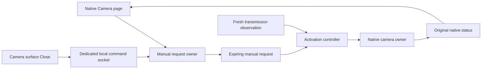

<!--
Author: gautch29
Notice date: 2026-11-23
Provided as is, without warranty. See NOTICE.md.
-->

# Control a local camera

Open and close a manual camera view from the native **Camera** page or close it
from the camera surface itself. These controls do not require a phone. They use
the existing [activation controller](CAMERA_ACTIVATION.md), which coordinates
the native owner and main renderer; they do not send an Apple exterior-camera
command or select a signed cluster layout.

The implementation is opt-in and its example profile is disabled. Portable
process, private-file, C++/Python and native GTK checks pass. Seven control/IPC
suites also pass on actual CM5 Linux as of **4 October 2026**. Managed camera
deployment and physical touchscreen open/close/focus remain to qualify. These
are native controls, not the iPhone's Ultra exterior-camera interface.

## Configure manual controls

Start with [camera-manual.example.json](../config/camera-manual.example.json).

| Field | Purpose |
| --- | --- |
| `schemaVersion` | `1`; duplicate, unknown and missing fields are rejected. |
| `enabled` | Permit manual requests. Defaults to false; a disabled owner creates no runtime endpoints or worker. |
| `requestFile` | The activation controller's **manual** input, exactly matching `manual.requestFile`. This is separate from its managed output request. |
| `ownerFile` | Empty private writer lock. One manual owner may renew this request. |
| `statusFile` | The native owner's original HCS1 heartbeat, matching its `--status-file`. This is observed, never overwritten by the manual owner. |
| `controlSocket` | Dedicated private Unix stream endpoint for camera commands. Its separate ownership lock is this path plus `.lock`. |
| `timing.leaseMs` | Lifetime of a renewed manual request, 50–1000 ms. |
| `timing.pollMs` | Renewal interval, 10–100 ms, no greater than one third of the lease. |
| `timing.statusMaximumAgeMs` | Maximum age of the original native heartbeat, 50–5000 ms, with at least two polling intervals. |

Paths name distinct bounded absolute files in real user-owned `0700` runtime
directories. The command endpoint also requires canonical real ancestors and
at most 103 printable ASCII bytes. Regular endpoints use `0600`, one hard link,
and bounded canonical data; the command socket uses `0600`. Never replace an
ownership lock. Existing unsafe endpoints are rejected instead of repaired.

On Linux, an abandoned owned `0600`, single-link socket can be retired while
both writer locks are held. Recovery requires a bounded kernel socket inventory
with no matching bound owner, `ECONNREFUSED` from the pinned endpoint and unchanged
socket/parent identities. A bound socket that has not reached `listen()` is
preserved, as are unsafe mode/hard-link endpoints or endpoints whose kernel
inventory cannot be read. The manual owner restarts off after recovery; it never
replays the dead owner's On intent. This is covered by actual Linux socket/process
fixtures, including killed-owner restart; phone/display recovery remains separate.

Add this manager-only field to the saved receiver JSON:

```json
{
  "camera_manual_profile": "/absolute/private/path/camera-manual.json"
}
```

The phone manager loads the profile once, after validating its other setup.
It strips this field from generated phone receiver configurations. Neither a
phone disconnect nor a mode change owns or restarts these camera controls.
Restart the manager to load a changed profile.

Add this option to the native camera owner's existing command:

```text
--manual-control-socket /absolute/private/runtime/manual.sock
```

Use the same `controlSocket` from the manual profile. This optional argument
adds the local Close button; omitting it preserves the camera-only view. Native
`--validate-only` checks the path without connecting to the socket or creating
its endpoint. The existing appliance installer does not add this option or
enable the manual owner/controller automatically. Installed Standard-camera
admission remains unchanged.

The Close control requires an authored canvas of at least 320 × 240; preflight
rejects smaller canvases when this option is supplied. Camera-only canvases
keep their existing bounds.

Retained Version 3 application releases include a camera-free phone manager,
but still reject `camera_manual_profile`: the complete camera activation,
status and cross-mode ownership graph is not yet admitted as a sealed release.
The resident Home boot route also rejects camera combinations. Run the
explicitly configured native manager for this opt-in component check;
publication does not start manual controls.

## Follow a request



The manual owner starts **off**, renews timed on records only after an explicit
request, and withdraws manual intent on orderly shutdown. It does not persist
an on preference. If its process dies, the existing request expires at its
original deadline; polling cannot renew it. The controller then stops renewing
its own separate lease unless fresh reverse input independently requests a view.

A dedicated small-lock worker renews manual leases and serves camera commands.
It does not wait for the phone manager's potentially slow pairing, receiver or
Bluetooth operations. One partial command is bounded to 256 bytes and 200 ms;
an incomplete client cannot stop renewal. There is no network listener.

The enabled production owner requires Linux `CLOCK_MONOTONIC`, matching the
Linux C++ activation/native clock. Do not transfer these dates between hosts
or substitute a phone timestamp. Portable tests inject a clock explicitly;
the Darwin interoperability fixture brackets `CLOCK_MONOTONIC_RAW` against the
actual C++ helper before using it. This is fixture qualification, not a claim
that the enabled Linux production owner runs on macOS.

## Read the interface

The Camera page separates **manual request** from **native display phase**.
Preparing, visible, closed, stopped and unavailable follow a validated fresh
HCS1 observation. A request accepted by the manager does not invent visibility.
An active native scene may contain a missing/stale camera label rather than
fresh camera imagery.

**Close camera** clears only the manual request. It cannot override fresh
reverse input. If the native view remains active afterward, the page retains
that actual phase rather than claiming the camera closed. HCS1 does not reveal
the activation reason; the page does not guess that a remaining view is reversing.

The camera surface renders a cached rounded Close control in canvas coordinates.
It shares the existing aspect-preserving touch fit, independently of capture
rotation or mirroring. A new press inside the button sends one request; held
presses, motion into the button and releases do not send extra commands. All
camera touch stays local and never reaches a hidden CarPlay view.

Close communication runs on one optional C++ worker with a maximum 500 ms total
connect/write/read deadline and asynchronous cancellation. Rendering only
enqueues a request and reads a small result snapshot. Pending requests coalesce.
The labels distinguish pending, accepted manual cancellation and retryable
failure; acceptance alone never destroys a GPU surface or releases its lease.
The normal controller/native-owner ordering still performs withdrawal.

## Camera owner-status provenance — 15 October source only

Manager `status.camera_status_observation` is a bounded, read-only diagnostic
copied from the **same** `_StatusReader` that supplies `status.camera.phase`.
The manager calls `ManualCamera.snapshot_with_status_observation()` once; it
returns `(camera, observation)` after one existing HCS1 validation. No second
file read, polling loop, thread, endpoint or service is added. Public
`ManualCamera.snapshot()` and `request()` retain exactly `configured`,
`requested`, `phase`, `error`; local manual IPC remains its existing 256-byte
request/reply contract. Request/lease/file/clock/focus policies are unchanged.

HCS1 is the native camera **owner status receipt**. It is not controller
acquisition, camera frame
freshness, fresh pixels, phone readiness, applied manual intent or qualified
physical presentation. In particular, `active` can describe an unavailable
status scene. The retained receipt never authorizes a camera action.

For native UI, the additive manager field has these fixed primitive keys:

| Key | Meaning |
| --- | --- |
| `schemaVersion` | Integer `1`, for this data model only; no transport version changes. |
| `meaning` | Always `native_camera_owner_status_only`. |
| `eligible` | Boolean: this manual owner/reader is currently eligible to validate status. This may be true while no status is available. |
| `availability` | `available` only for a currently accepted, fresh HCS1 receipt from the existing validator; otherwise `unavailable`. |
| `state` | `current`, `unavailable`, `reader_retired`, `manual_owner_unavailable`, `disabled`, `not_configured`, or `suppressed`. It is diagnostic, not readiness. |
| `clockDomain` | `linux_clock_monotonic` for the enabled production adapter; `injected_fixture` for any explicitly supplied clock; null when no clock is established. No boot/host identity or cross-host mapping is invented. |
| `maximumAgeMs` | The existing profile's positive integer age limit, or null without an admitted profile/suppressed owner. Exact expiry is unavailable. |
| `lastObservation` | Null before an accepted receipt or under manager suppression; otherwise a copied object with `instanceStartNs`, `sequence`, `observedNs`, `phase`. The three uint64 fields are exact decimal strings, preserving values beyond JavaScript number precision; phase is one of the five existing HCS1 phases. |

`lastObservation` retains the **last accepted original** receipt through missing,
unsafe, malformed, future, replayed or expired input and terminal reader clock
rollback. It may remain present after close/failure; then availability is
unavailable and eligibility false. A retained phase is stale diagnostic history,
never current authority. Repeated identical valid reads preserve the original
sequence/date. Observed loss cannot be healed by replaying the same receipt;
recovery uses the existing strictly newer validator rules. There is no smoothing,
observed-on-read date, derived acquisition, timeline or arbitrary error string.
HCS1's three numeric fields are positive by its existing grammar; unknown fields
remain null rather than fabricated zero. Known booleans remain false when false.

Reader validation and receipt copying share its existing lock, held through the
paired copy while taking the manual-state lock inside it. Concurrent
close/failure takes precedence over eligibility even if validation just finished.
A later reader cannot retire the clock between validation and that paired copy.
The paired camera phase and original receipt stay together across concurrent reads. A disabled profile creates no worker/endpoints. Signed camera Standard
mode, a fully retired launcher and whole-service retirement quarantine suppress
the new field; old cached diagnostics cannot appear live in a new generation.
Native-only camera status retains its existing phone-independent policy.

**New UI widgets, pages, actions and control IDs: none.** GTK, glass/style and
Home composition stay native UI. The offline support-summary whitelist is
unchanged. Existing manager-reply age rules still apply to consumers; forwarding
this object cannot refresh its original `observedNs`.

Focused qualification uses real private-file/IPC manager endpoints, dated
synthetic HCS1 writers and the existing C++ `StatusWriter` interoperability
fixture. Linux C++ boundary checks are compiler/sanitizer component evidence;
Python execution is not ASan instrumentation. No GPU, real camera, physical
screen, phone, audio continuity or car acceptance follows from these fixtures.
The model remains unpublished until root whole-source review, a coherent full
release matrix and the sole bench owner's new immutable generation/input checks.

## Local command contract

Each connection contains exactly one bounded newline-terminated JSON command:

```json
{"action":"camera","enabled":false}
```

`true` requests the manual view; `false` cancels it. The native Close client
always sends false. No phone address, session generation or media field belongs
in this command. The server verifies the desktop owner or root peer. The C++
client pins the user-owned socket and real parent, verifies the peer, rejects
replaced identities, and requires a complete strict positive reply followed by
connection EOF. A server acknowledgement confirms accepted **intent**, not
presentation, fresh camera pixels or main-screen restoration.

## Verify and qualify

- `camera-manual-python`: strict profile, private ownership, renewal, original
  status age/replay, command bounds and lifecycle fixtures.
- `camera-manual-client`: actual local servers, partial I/O, coalescing,
  deadlines/cancellation, unsafe/replaced endpoints and strict acknowledgement.
- `camera-manual-interop`: actual C++ reader/publisher/client against the Python
  owner, SIGKILL expiry and independence of manual intent from native status.
- `camera-local-controls`: fitted touch routing and cached rendered button states.
- `camera-native-configuration-model`: real CLI preflight linked to explicit
  fake output/provider boundaries; no GPU is opened during validation.
- `phone-management`, `receiver-configuration` and the actual GTK workflow:
  separate camera actions/status and preservation of phone/media behaviour.

### CM5 control qualification — 4 October 2026

Seven freshly built/source-matched suites pass on the CM5:
`camera-activation`, `camera-activation-session`, `camera-controller-io`,
`camera-manual-client`, `camera-controller-integration`, `camera-manual-python`
and `camera-manual-interop` (7/7, 5.79 seconds). Actual Linux Unix sockets,
private files, fork/exec controller processes and the enabled production
`CLOCK_MONOTONIC` adapter are exercised. The interoperability helper brackets
its C++ clock against Python before testing renewal, cancellation and killed
owner expiry. Its HCS1 publisher is explicitly synthetic; an active status in
that check is not a real camera presentation. No GPU, device, radio, live
manager or service is opened by these control fixtures.

These ordinary GCC target runs retain the shared build's legacy warning
exceptions and are not Linux sanitizer execution. Evidence stays private under
`/home/headunit/.cache/headunit-qualification/20261004/camera-control-linux/`.
They qualify the local native command boundary, not iPhone exterior-camera
controls or signed Ultra Punch-through.

Next qualify both physical displays and the touchscreen with a real camera:
open/close repeatedly with and without a phone, verify no hidden phone input,
retain cluster visibility, test missing/stale capture and manual-owner failure,
and measure actual trigger/presentation age. UI/IPC fixtures do not complete
that physical acceptance gate.

## Abandoned manual socket recovery — 13 October

V79 carries the V77 Linux startup repair. With both cooperating owner locks held,
the manager only retires an owned single-link 0600 socket after bounded kernel
binding inventory, connection refusal and stable inode/metadata checks. A live,
bound, unsafe or ambiguous endpoint is preserved. Other platforms retain explicit
cleanup. Restart begins with manual requests Off, not a replayed camera lease.
Linux subprocess SIGKILL fixtures and a pinned-inode CM5 V77 manager crash recover;
the other four owners remain unchanged. This does not qualify phone camera Close,
USB recovery or uninterrupted audio. Current source/deployment: [handoff](HANDOFF.md).
