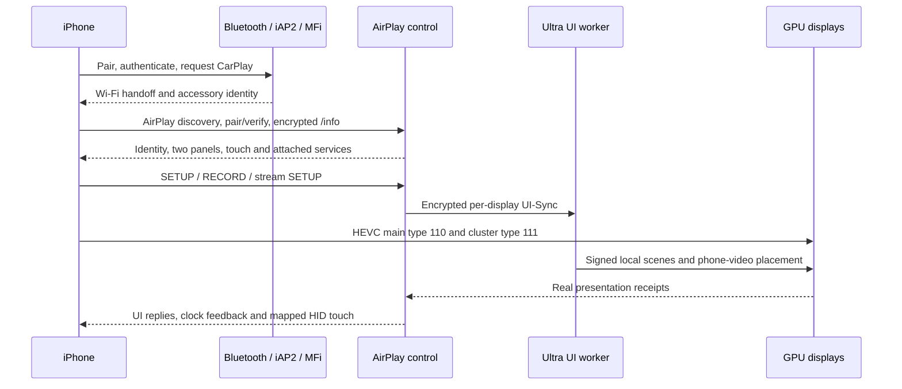

<!--
Author: gautch29
Notice date: 2026-11-23
Provided as is, without warranty. See NOTICE.md.
-->

# CarPlay Ultra integration guide

This guide describes this project's experimental, independent receiver and the CM5 evidence through **4 October 2026**. It is not Apple documentation, an MFi specification or certification. Start with [current status](../README.md), [goal and acceptance gates](GOAL.md), then [architecture](ARCHITECTURE.md). The private signed pack, acceptance reference, identity, keys and captures are not in Git.

## Tested path and current boundary

The supported live setup uses one signed asset package, `44C9FA31EC` with
accessory version `985`. Supply the exact package and its trust inputs
externally. Other packages and versions remain unqualified.
[Asset verification](ULTRA_ASSETS.md) · [Discovery experiments](ASSET_DISCOVERY.md)

The CM5 has shown the full Ultra main view with working physical touch and a signed cluster scene with live Apple Maps video between local gauges on **two physical outputs**. The reference pack identifies as `44C9FA31EC` version `985`, with `Center_Display` and `Cluster_Display` panels. Those are pack-specific identifiers. The source checkout has also shown Home/Back and Standard/Ultra switching; the selected **Version 3 Home-readiness release** has passed sealed CM5 preflight and service-path checks, while packaged physical touch, cold boot and rollback need qualification. [CM5 bring-up](CM5_BRINGUP.md), [application releases](APPLICATION_RELEASES.md).

Sustained fresh phone-video 60 fps, disconnect/fault recovery under every condition, audible playback, microphone/Siri/calls and car hardware input remain open. The local 60 fps scene result and phone-video throughput are different measures; use [rendering measurements](ULTRA_PERFORMANCE.md) for the actual comparisons. The simulated Climate and car-settings pages have opened on an iPhone, but no physical HVAC is attached. [Vehicle-state guide](VEHICLE_STATE_GUIDE.md).

The new camera-state bridge is **candidate code, not part of the selected V3 release or a phone-accepted feature**. It has offline and isolated CM5 checks only. Connected Ultra camera means Punch-through pixels inside the existing signed main scene, with both panels, UI-Sync, video, audio and control still running. No phone camera controls or focus behavior have been qualified. [Punch-through camera](CAMERA_ULTRA_GUIDE.md).

## Inputs required for the standalone bench

| Input | Purpose |
| --- | --- |
| CM5 radio and MFi coprocessor on I²C | Bluetooth/iAP2 pairing, accessory authentication and Wi-Fi handoff. |
| Private AirPlay identity, Ed25519 pairing key, setup secret, Wi-Fi AP file and pair store | One stable accessory identity; keep outside Git and do not invent replacements during a test. |
| Already accepted signed asset and installed-UI profile | Verify the exact package and bind its panel names/scripts. A historical acceptance record is exact-package only. [Asset trust](ULTRA_ASSETS.md). |
| Receiver JSON and display file | Select modes, logical video/panel geometry, physical millimetres, touch, Wayland sockets and outputs. [Configuration](CONFIGURATION.md). |
| Wayland compositor and Linux GPU/HEVC build | Own two output surfaces and import decoded phone frames. |

`config/receiver-cm5.example.json` and `config/displays-cm5.conf` are starting examples, not the selected release's sealed files. The standalone launcher and the V3 phone manager are different owners; do not start both against the same radios or displays. [Lab receiver](LAB_RECEIVER.md), [manager startup](PHONE_MANAGER_BOOT.md).

For the inspected pack, both **logical Ultra streams are 1920 × 720**. The physical main screen is 1280 × 720: the renderer fits the complete 1920 × 720 scene into 1280 × 480 and leaves inactive bars above and below. Touch uses the inverse fit. Ultra display descriptions require physical dimensions; the current bench millimetres are estimates, not measured panel specifications. A 1280-wide stream produced a phone image already cropped at the right, so local GPU scaling could not restore it. [Display configuration](CONFIGURATION.md).

## Connection sequence



1. Bluetooth/iAP2 authenticates the accessory through the MFi chip before Wi-Fi credentials are handed over. The phone joins the AP and finds the AirPlay endpoint. [Wireless handoff](WIRELESS_HANDOFF.md).
2. The receiver presents a consistent identity and two display descriptions. `AirplaySessionSetup` registers UI/video consumers **before** accepting SETUP, validates the offered `uiSync` and `hevc` features, and can accept RECORD before individual stream SETUP. [AirPlay control](AIRPLAY_CONTROL.md), [UI session](UI_SESSION.md).
3. The encrypted DataStream carries ordered per-display UI messages. `UiTransport` retains a reply until its queue accepts it; a transport write is not a display receipt. A new connection gets fresh script VMs and generation-bound inputs. [UI transport](UI_TRANSPORT.md), [message format](ULTRA_MESSAGES.md).
4. `ReceiverVideo` routes authenticated stream types **110** and **111** to native HEVC decoders. The signed scene combines those pictures with local graphics. A qualified phone clock and real compositor receipts control presentation. The main touch transform maps output pixels back through the fitted scene before sending HID. [Native video](NATIVE_VIDEO.md), [GPU display](GPU_DISPLAY.md), [phone clock](PHONE_CLOCK.md).
5. On disconnect, video and touch retire and the worker is kept owned until its GPU/VM resources finish. The independent native cluster is the phone-free fallback. Actual disconnect takeover has been seen; deliberate output-fault failover still needs a physical acceptance test. [Output fault recovery](OUTPUT_FAULT_RECOVERY.md).

The local gauge/vehicle script profile and the phone-facing Climate/settings configuration are separate protocols. The former supplies signed-theme local inputs; the latter creates Apple Remote UI resources. Adding a local signal alone will not make a phone app appear. [Vehicle input](VEHICLE_INPUT.md), [vehicle-state guide](VEHICLE_STATE_GUIDE.md).

## Validate a standalone bench connection

Use the already prepared private profile; a dry run validates without taking the radio. Stop competing receiver/manager services before a live standalone run. The commands do not create the private identity or install an asset:

```sh
sudo python3 tools/run_lab_receiver.py --config /home/headunit/.config/ultra-headunit/lab/receiver.json --dry-run
sudo python3 tools/run_lab_receiver.py --config /home/headunit/.config/ultra-headunit/lab/receiver.json
```

After connection, verify Bluetooth/MFi and Wi-Fi handoff; encrypted /info and SETUP/RECORD; the UI worker and both video stream configurations; actual decoded frames and presentation receipts; then physical main touch and the cluster gauges. Select Maps and start a route to check that the phone map appears **between** the gauges. A successful reconnect is a smoke test, not sustained reliability evidence. The launcher writes private session logs and bounded captures that may contain phone data. [Lab receiver](LAB_RECEIVER.md).

## Diagnose by layer

| Symptom | First boundary to inspect |
| --- | --- |
| Bluetooth pairs but CarPlay does not start | MFi/I²C response, iAP2 authentication, AP handoff, AirPlay discovery and selected-phone reconnect policy. |
| Phone accepts Ultra but a panel stays blank | SETUP/RECORD, UI service registration, per-panel worker startup and type 110/111 video configuration/frame counters. |
| Gauges appear but the center is black/white | Type 111 source frames and the signed UI's map-component selection; the map is a separate phone stream. |
| Main image is cut off | Restore the inspected pack's 1920 × 720 logical stream and check aspect-fit to the physical output. |
| Touch misses | Match advertised scene dimensions, fitted rectangle and inverse HID mapping; bars must remain inactive. |
| Climate is absent or loading | Check the opt-in numeric vehicle-state configuration, initialized resources and fresh phone session; local gauge bindings do not enable it. |
| Camera slot appears locally but no phone controls | The candidate bridge has no verified CameraButton, phone acceptance or Remote UI focus path. Do not replace the signed main window as a shortcut. |

For a new pack, preserve its own signed identifiers, geometry and layout rules. Renaming an existing pack or its panels cannot create a new supported vehicle configuration. [Asset handling](ULTRA_ASSETS.md) and [layout review](CLUSTER_STYLE_REVIEW.md) describe the current limits.
