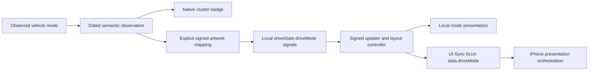

<!--
Author: gautch29
Notice date: 2026-11-23
Provided as is, without warranty. See NOTICE.md.
-->

# Display an observed drive mode

## V84 connected qualification — 14 October

Frozen `3bd3db9` deploys a separate private diagnostic profile file and the reviewed
manager contract. Full-colour GT/Sport/Sport+/Track requests save but fail complete
layout/palette confirmation at the unchanged 5s deadline. The existing direct
palette path also fails its normal deadline and directs the user to phone
Customize; requested colour is not applied. Signed wallpaper remains unsupported.

Using the existing revision-bound API, diagnostic profiles were changed to
palette empty/wallpaper phone. All four layout-only profiles then report actual
confirmed phases with both panels Ready and unchanged owners; phone colour is
preserved. Patch/reset/clear actions are intent evidence separately. Manual choice
is cleared after testing; vehicle mode is not actuated. Phone Customize is parked
while the user sleeps. Physical observed-mode handover/expiry remains unqualified.
Exact predecessor, partial module-group, Home2 and hash-bound sport opt-in checks
pass in the coherent full V84 matrix; no compatibility guard is relaxed. Original
receipts: private `20261013/phone-session/v84-supported-profile-summary.json`.

Configure the modes a vehicle supports, then supply its observed active mode
through the shared read-only vehicle interface. The native cluster and local
Ultra script bridge use that reading without selecting a default mode.

This is our independent integration API. The signed artwork identifiers below
are inspected display values, not official Apple vehicle-protocol IDs. No
hardware mode reader or command to change the vehicle's mode is implemented.

## How a car mode interacts with CarPlay

Reviewed **9 October 2026** against repair source `49eeee4` and the private installed
reference pack `44C9FA31EC / 985`. Keep these four concepts separate:

| Concept | Authority | Effect |
| --- | --- | --- |
| Vehicle drive mode, such as GT/Sport/Eco | Observed car state; eventually a qualified hardware provider | Local mode label and a request for matching phone presentation |
| Transmission Sport selector | Independent transmission observation | Gear/selector presentation; does not imply a drive mode |
| Standard versus Ultra | Current phone-negotiated connection | Chooses the available CarPlay experience |
| AirPlay `modesChanged` | Phone screen/audio/app resource state | Bounded session-local resource/app observations; applied focus/restoration remains open |

Apple describes local driving information, a separate remote vehicle-state
interface and drive-mode notifications/configuration entry points in
[its architecture presentation](https://developer.apple.com/videos/play/wwdc2024/10111/).
The vehicle remains responsible for actual driving behavior. This project has
no qualified authority to change throttle, gearbox, suspension or steering.

The inspected signed reference controller does more than draw a mode label:



Read-only inspection establishes that `VehicleDataUpdater` reads fixed
`identifiers` and timed zero-based `currentIndex`, producing the corresponding
index/identifier value. `LayoutController` subscribes to that value and, when
valid, sends `REQUEST_DRIVE_MODE` (`0x14`) with `data.driveMode` through the
existing signed session. The outgoing field is the authored **identifier string**,
not the updater's internal index/identifier dictionary; the isolated signed-entry
probe below verifies the serialized request. The identifier comes from the
authored array at
`currentIndex + 1` in Lua, not the semantic source catalogue's order.

Despite the name **request**, this inspected path is **headunit → iPhone**
after an observed mode update. It is not an incoming car-actuator command.
The worker/transport already bridges signed outbound UI packets; no extra HTTP
`/sport` endpoint or control-thread mode dispatcher is needed. Unknown mode
withdrawal must remain honest: the controller does not send a valid mode request
for its invalid sentinel. Whether the phone restores a prior presentation after
withdrawal still requires qualification.

The phone response can depend on the signed pack and selected layout.
No current evidence proves that Sport changes an entire style, palette,
background, map placement or app policy. The simulated DigiRing pixel comparisons
below show only the local mode widget changing. Changing a palette or gauge
style does not establish the car's observed drive mode.

The currently selected V27 `vehicle-profile.plist` has **no drive-mode signals**
(checked again on 9 October).
It therefore does not exercise this observed-mode binding or outgoing request.
A review of 245 retained session logs found no `0x14` in the bounded UI
diagnostics; that is not proof the phone rejects it. A new retained explicit
simulation profile and real-phone transition test are needed before claiming
acceptance.

### Remote vehicle-state identifiers are a separate surface

The pinned iOS 26.1 framework analysis corroborates these research facts:

| Item | Numeric type | Observed value kind |
| --- | --- | --- |
| DriveState accessory | `0x09000003` | Separate transmission, recommendation and drive-mode services |
| DriveMode service | `0x1A000008` | Inherits the mode-item reading interface |
| Identifiers | `0x30000037` | Array |
| CurrentIndex | `0x30000038` | UInt32 with invalid-state accessor |
| DefaultIndex | `0x30000039` | Optional UInt32 |
| Hidden | `0x36000023` | Boolean |

Sources: [accessory map](https://github.com/EthanArbuckle/iPhone18-3_26.1_23B85_Restore/blob/90aa0cfe59d9682b4265e1354c8b19ec3c7823ab/System/Library/PrivateFrameworks/CarAccessoryFramework.framework/CarAccessoryFramework/CAFAccessoryTypes.mm),
[service map](https://github.com/EthanArbuckle/iPhone18-3_26.1_23B85_Restore/blob/90aa0cfe59d9682b4265e1354c8b19ec3c7823ab/System/Library/PrivateFrameworks/CarAccessoryFramework.framework/CarAccessoryFramework/CAFServiceTypes.mm),
[mode-item getters](https://github.com/EthanArbuckle/iPhone18-3_26.1_23B85_Restore/blob/90aa0cfe59d9682b4265e1354c8b19ec3c7823ab/System/Library/PrivateFrameworks/CarAccessoryFramework.framework/CarAccessoryFramework/CAFModeItems.mm),
[hidden getter](https://github.com/EthanArbuckle/iPhone18-3_26.1_23B85_Restore/blob/90aa0cfe59d9682b4265e1354c8b19ec3c7823ab/System/Library/PrivateFrameworks/CarAccessoryFramework.framework/CarAccessoryFramework/CAFDriveMode.mm).

These getters establish a reading surface, not writable actuator permission.
The phone-facing configuration builder exposes no DriveState/DriveMode resource.
The [single vehicle definition](VEHICLE_CONFIGURATION_GUIDE.md#one-vehicle-definition)
can omit modes completely or compile explicitly configured semantic/artwork
mappings into the local signed profile. A 1998 Defender example declares no
modes; changing make/model never invents them.
Local script `driveState` bindings do not advertise that remote model. An
automaker settings selector or notification/configure action is an additional
integration needing a qualified request/applied-state contract. See the
[complete interface audit](IPHONE_PROTOCOL_AUDIT.md).

Inspection provenance: signed resources were read in place, never extracted
into Git. `LayoutController.lua` SHA-256 is
`19fcf5d735a8f48ec278da40cdf00e1caeb0f53a94d0a0cd51f46e32afc8f3c5`;
`VehicleDataUpdater.lua` is
`3df615e7711e710ed6f2eb5c2d5700f7abf5d11bb857a9418a9fa6d02ab71d6e`.
These are static facts, not a new phone or physical-car test.

## Separate capabilities from current state

`VehicleSample` appends two fields declared in `headunit/drive_mode.hpp`:

| Field | Lifetime | Contract |
| --- | --- | --- |
| `drive_mode_catalog` | Immutable capability configuration | Optional ordered list of 1–32 distinct semantic identifiers. |
| `drive_mode` | Acquired observation | Optional active identifier that belongs to the configured catalogue. |

Identifiers are case-sensitive ASCII, 1–64 characters, beginning with a
letter. Remaining characters may be letters, digits, `_` or `-`. Use names
that describe the car's actual modes, such as `comfort` and `sport`, without
depending on an asset's order or numeric enums. Fixed-size value objects and
canonical unused storage keep snapshot commits allocation-free.

An absent catalogue means this capability is unconfigured. A configured
catalogue with no active reading means the selection is unknown. Source loss,
expiry and generation restart preserve the catalogue while withdrawing the
active reading. Consumers reject catalogue replacement, reordering or removal
within their lifetime, including across source generations. Changing capability
configuration requires new source/consumer instances.

Do not derive a drive mode from a gearbox type, effective transmission selector,
speed, RPM, palette or selected cluster style. In particular, a transmission's
`sport` selector and a vehicle's `sport` drive mode are separate observations.
Requested mode changes belong in a future command/applied-state interface.

## Acquire the selection

Configure the catalogue before constructing `VehicleObservationCache`:

```cpp
const auto catalog = parse_drive_mode_catalog_key("comfort,sport");
const auto sport = parse_drive_mode_identifier("sport");
if (!catalog || !sport) throw std::invalid_argument("invalid configuration");

VehicleAgePolicy ages;
ages.drive_mode = std::chrono::milliseconds(250); // Example policy only.
VehicleObservationCache source(ages, catalog);
source.begin_generation(generation, started_at, now);

const std::array batch{
    VehicleObservation{"drive_mode", *sport, acquired_at}
};
source.accept(generation, batch_sequence, batch, now);
```

This example does not measure the project car. Explicit fixtures use
`VehicleObservationOrigin::simulation`. A real adapter supplies its qualified
original acquisition date and configured age policy. Unsupported identifiers,
invalid provenance, reversed/future dates and conflicting equal-date updates
reject the entire batch without advancing its sequence or changing other
signals. An acquired unavailable reading uses `std::monostate` and
`VehicleAvailability::unavailable`.

The active mode expires at **age ≥ maximum age**. Heartbeats, cache reads and
fresh speed updates cannot renew it. Recovery requires a genuinely newer
acquisition; identical old observations cannot revive a withdrawn mode.
See [the observation contract](VEHICLE_OBSERVATIONS.md).

## Transport capabilities and acquisition with HVO3

Select `VehicleObservationWireVersion::hvo3` explicitly. HVO1/HVO2 remain
unchanged and reject mode data or nondefault mode timing they cannot retain.
HUV2 also rejects the new catalogue/active fields.

HVO3 has a fixed catalogue header and all 36 acquired records:

```text
HVO3 <generation> <sequence> <started_ns> <published_ns> drive_modes=comfort,sport <36 records>
```

The active record has the ordinary per-signal timing shape:

```text
drive_mode=sport,1000000000,250000000,m,a
```

These are shape illustrations, not complete sendable packets. Dates must
match the actual host steady clock and generation/publication. Use a single
`-` for an absent catalogue or active value. No whitespace, escaping, implicit
catalogue or numeric index is accepted in the semantic state.

Each consumer independently validates the full snapshot and pins its first
wire version and catalogue. Fan-out forwards original bytes without renewing
dates or caching state for a restarted consumer. The maximum datagram remains
8192 bytes. [Protocol](VEHICLE_OBSERVATION_PROTOCOL.md).

Select HVO4 when the same source also supplies current-trip statistics or
heading. It retains this catalogue and mode record unchanged; HVO1/HVO2/HVO3
reject new values or nondefault timing they cannot preserve. A version change
requires a new consumer instance. [Trip and heading](TRIP_AND_HEADING.md).

## Map semantic modes to signed artwork

The inspected cluster reads an immutable `driveState.driveMode.identifiers`
array and a timed zero-based `driveState.driveMode.currentIndex`. The semantic
source catalogue remains independent of that authored array's order.

The [example configuration](../config/drive-modes.reference.example.json) maps
`comfort` to the inspected `GT` artwork and `sport` to `sport`:

```json
{
  "schemaVersion": 1,
  "modes": [
    {"id": "comfort", "assetIdentifier": "GT"},
    {"id": "sport", "assetIdentifier": "sport"}
  ]
}
```

This is an illustrative capability mapping, not a claim that the 1998 car has
these modes. Copy it to a private path and select supported modes explicitly:

```sh
python3 tools/create_cluster_bench_profile.py \
  --extended-readings --observed-transmission \
  --drive-mode-config /private/drive-modes.json \
  --output /private/observed.plist
```

The generator creates the fixed authored identifier array and a timed
`vehicleField: "drive_mode"` dictionary mapping semantic keys to indices.
It supplies no active reading. Input is bounded to 16 KiB and 1–32 entries;
duplicate/unknown JSON keys, repeated semantic or artwork identifiers, invalid
names and an authored array exceeding the existing 1 KiB limit are rejected.
An artwork identifier must be nonempty, at most 128 UTF-8 bytes and free of
control characters. Bounded explicit names still need qualification against
the chosen signed pack.

Local plist signal dictionaries can also map `drive_mode` to bounded integer
or string values through `vehicleStates`. The inspected `currentIndex` path
specifically requires an integer mapping and a matching immutable authored
array. Indices must be in bounds and unambiguous. The parser and direct
`GaugeInput` construction enforce this same contract. A source order of
`comfort,sport` may map into authored order `sport,GT` as `comfort: 1, sport: 0`;
the source's position does not become a display enum.

An unknown or valid-but-unmapped active mode withdraws its script scalar.
It does not select index zero. `GaugeInput` retains original acquisition dates,
expiry and replay guards, and pins the source catalogue only after an accepted
source sample. An early empty socket poll cannot select an absent catalogue.

## Review native and signed presentation

When a vehicle catalogue is configured, the native cluster shows a small mode
badge beneath the speed gauge. It displays the observed semantic identifier
in readable uppercase, or `--` when unknown/stale. Long labels fit inside the
badge. Unconfigured vehicles have no mode badge.

For a labelled native fixture:

```sh
build/headunit-native-cluster-snapshot /private/sport.ppm \
  --center vehicle --drive-mode-catalog comfort,sport --drive-mode-fixture sport
```

For an isolated signed CPU layout probe, combine the generated local profile
with `HEADUNIT_THEME_PROBE_GAUGES=1`,
`HEADUNIT_THEME_PROBE_DRIVE_MODES=comfort,sport` and
`HEADUNIT_THEME_PROBE_DRIVE_MODE=sport`. The literal `unavailable` tests an
unknown active state. A requested mode requires its explicit source catalogue
and membership; these environment controls supply only simulated observations.

The older `--drive-mode-fixture` option still selects a fixed artwork fixture.
It cannot be combined with `--drive-mode-config`. Fixed artwork selection is
useful for review, but is never an observed vehicle mode.

## Qualification boundaries

Model, cache, versioned transport, profile and native-presentation tests cover
capability validation, active membership, atomic rejection, independent expiry,
catalogue pinning, reordered artwork mappings, missing/unmapped state and
original service dates. Thirteen affected portable suites pass, including
actual HVO3 Unix socket → gauge → service publication. Focused model/cache and
codec/receiver address/undefined-behavior sanitizer checks pass. Nine generator
cases pass. That original broker run skipped Linux-only kernel checks on the Mac. Later
4 October CM5 qualification passed sixteen broker cases, including actual
kernel ingress/queue/ownership/restart behavior; see
[distribution](VEHICLE_DISTRIBUTION.md).

Five private regular DigiRing CPU fixtures render the signed entry points at
1920 × 720. `comfort` maps to GT, `sport` to Sport, and unknown selection to
authored redaction. Exact RGBA changes between known/unknown labels stay in
the mode widget. Reordered source catalogue pixels are identical to the
original comfort case; valid unmapped `eco` matches unknown redaction exactly.
These explicit simulated fixtures establish no phone video, physical reading,
GPU performance or compatibility with every signed style.

The repair source adds an explicit signed-entry/session probe:

```sh
build/headunit-theme-probe /private/verified-asset 44C9FA31EC 985 \
  /private/accepted-reference.conf --drive-modes /private/observed-mode-profile.plist
```

Use an observed profile generated with `--drive-mode-config`, containing at
least two explicitly mapped modes. The bundle still passes the ordinary archive,
certificate and accepted-reference checks. This is an offline CPU/VM fixture,
with a synthetic UI peer and frame context; it acquires no radio or display.

On the isolated CM5, both `Center_Display` and `Cluster_Display` run the verified
pack's actual `main` entrypoint. Source catalogue `comfort,sport` maps into authored
order `sport,GT`; each VM emits three correctly mapped `0x14` identifier-string
requests across selection and recovery. Initial unknown, real 250 ms expiry and
source-generation restart emit no valid mode request (and no unknown identifier
requests in this pack). Fresh recovery emits exactly one new request. Acquisition
dates come from the host monotonic clock and survive the existing gauge/service
path. The peer only acknowledges transport: it supplies no phone layout/remote
scene or presentation confirmation. This does not qualify signed-scene disconnect
rendering, phone consumption, visual transitions or physical vehicle readings.
Private results are retained with the [control repair evidence](AIRPLAY_CONTROL.md#protocol-repair-source--9-october-2026).

The Linux broker is now component-qualified, not deployed as the bench
observation owner. Physical mode acquisition, CM5 consumer integration and
real-phone/style qualification remain open; the richer bindings have not
replaced the regular MapsMedia bench profile. See [HANDOFF](HANDOFF.md).

[Transmission](TRANSMISSION.md) · [Vehicle input](VEHICLE_INPUT.md) ·
[Cluster completeness](CLUSTER_COMPLETENESS.md) · [Adapter plan](VEHICLE_ADAPTER_PLAN.md).

## Whole presentation profiles — source interface, 13 October 2026

The opt-in profile layer changes presentation, never throttle, transmission,
steering, suspension or an actuator. A fresh, valid measured/calculated vehicle `drive_mode` wins. Explicit simulation
may supply a labelled fixture mode when no user profile is selected; the bench
simulator does not block the user's display choices.
When the real reading is missing/expired, an explicitly selected **user display
profile** may be used; without either, the mode is unavailable. A fresh observed
mode missing from the profile list remains unmapped rather than selecting a
conflicting user profile. The original acquisition, age policy, origin and
vehicle generation accompany observed selection; reading or rendering cannot
renew them. User selection does not publish a `driveState` observation or a
vehicle-mode command.

`headunit/drive_mode_profile.hpp` provides the bounded profile parser, independent
resolver and private-file reader. `tools/drive_mode_profiles.py` provides the
pure Python data model, durable changes and manager view model. The manager adds
`drive_modes` to its ordinary status; no native GTK page is changed.

### Configuration and durable override interface

Initialize once, as the display account, from explicit defaults:

```sh
python3 -B tools/drive_mode_profiles.py \
  --initialize config/drive-mode-profiles.reference.example.json \
  --output /absolute/private/state/drive-modes
```

The parent must already be real, owned and mode 0700. The resulting file is
0600; initialization refuses an existing file and selects no mode. The example's
GT, Sport, Sport+ and Track are illustrative **display profiles**, not a claim
that this bench/car supplies those observed modes. Add up to 32 profiles matching
your actual semantic identifiers; their labels are independent of signed drive-mode
artwork mappings described earlier in this guide.

Set `driveModeProfilesFile=/absolute/private/state/drive-modes` in a new
installed-UI configuration and
`drive_mode_profiles_file=/absolute/private/state/drive-modes` in a new native
cluster configuration. Both must reference the same external private endpoint.
The release builder retains that endpoint outside the sealed payload and includes
the new manager module. New publication needs an independently sealed helper from
the integrated source, because its exact modern manager inventory has changed;
do not edit an existing helper or release. These options are absent by default.

Each mode has `id`, `name`, immutable `base`, and effective `profile`. A profile
contains exactly:

| Field | Contract |
| --- | --- |
| `layout` | Declared uppercase signed layout UUID, or empty for native-only use. |
| `format` | Sibling cluster-signals IDs: `minimal`, `sport`, `gauges`, `maps_media`; existing `map`, `media`, `vehicle`, `trip` also work natively. |
| `palette` | Pack catalogue identifier, or empty to leave colour choice to the signed owner. No arbitrary RGB injection into the pack. |
| `accent` | Six uppercase RGB hex digits, used by native gauges and exposed for native UI integration's main UI. |
| `wallpaper` | `phone` preserves the signed owner's wallpaper/native default; `black`, `blue`, `red` are original native backdrops. |
| `sportScreenAvailable` | Boolean presentation permission for the sport telemetry UI; never a fitted sensor, reading or actuator claim. |

The format mappings match `tools/cluster_layout.py` (`format_snapshot` / `format_choice`) on
`development branch`: Minimal→DigiBand, Sport→DigiRing,
Full Gauges→Modular, Large Map/Media→MapsMedia. The profile keeps an explicit
layout UUID, so an absent or changed signed catalogue can report unsupported
rather than guessing a style. The native renderer reuses that worker's original
format functions/geometry; integration must retain one copy alongside its top
signal changes.

Manager requests use the current integer profile revision, independently of
phone/CarPlay connection mode:

```json
{"action":"drive_mode","mode":"sport","revision":1}
{"action":"drive_mode_profile","mode":"sport","profile":{"accent":"FF6666","format":"sport"},"revision":2}
```

`mode:null` clears the user choice. `profile:null` resets that mode to its base;
a profile object patches only known fields. Invalid/stale revisions reject the
whole change. One HUDP1 file atomically stores scope, revision, user choice,
bases and overrides; file and directory fsync run in the manager operation,
never on the render/control owner. No second derived runtime file can lag the
saved overrides. A failure before rename leaves the prior file intact; a failure
after rename reports an error and cannot promise crash durability.

HUDP1 is bounded to 32 KiB. Its first line is
`HUDP1<TAB>PACK:VERSION<TAB>REVISION<TAB>USER_ID_OR_-`; paired `mode`/`base`
rows contain ID, ASCII label, layout, format, palette, RGB, wallpaper and Boolean.
Use the module rather than editing this wire storage. Pack/version scope is
validated by both signed owners; native readers pin their first admitted scope.
Malformed, exposed, linked, special-file or incompatible replacements withdraw
profile intent and preserve useful default/native instruments.

### View model and rendering ownership

`drive_modes` contains `configured`, `scope`, `revision`, `selected`, `modes`,
`current`, `error`, and `vehicleControlAvailable:false`. `selected` is only the
saved user preference; **current** comes from a dated renderer publication and
may be null. native UI can build the UI from the mode labels/effective profiles,
show user versus observed authority, patch per-mode preferences, and hide sport
telemetry when permission is unavailable. Native Home/settings visuals remain
native UI's ownership; no styled or placeholder GTK controls are added here.

Vehicle `observation` contains `acquiredSteadyNs`, `maximumAgeNs`,
`ageAtPublicationNs`, `clockDomain:"host-steady"` and `origin`. The original
acquisition remains in its C++ steady-clock domain. Publication uses a real
`CLOCK_MONOTONIC` sample, taken before measuring source age on the original
clock. The manager adds elapsed publication age to that measured acquisition
age and checks the original expiry policy. This preserves independent expiry
across the different libc++/Python monotonic epochs on macOS, without inventing
an offset or replacing the source acquisition date. A real C++→Python fixture
checks both user and simulated observed state, publisher rejection and expiry.

Current publications retain `source`, `mode`, `revision`, `phase`, `error`,
`updatedMonotonicNs`, `vehicleGeneration`, original `observation`,
`sportScreenAvailable` and `signedWallpaperSupported:false`. Connected status
also carries the current launch nonce and connection generation. The manager
requires matching scope/revision, ≤3-second publication age and, for vehicle
selection, independently unexpired original acquisition. Simulation is explicitly labelled in `source`. Ultra status requires
its fresh receiver publisher pair. A requested or stale profile cannot become
confirmed by repainting or reconnecting.

Native format, accent and backdrop adopt one resolved profile for a complete
buffer; no independently written layout/colour/wallpaper preferences race.
Map transparency is retained, and missing readings stay `--`. `native-profile`
describes the chosen buffer model, not a compositor receipt. A user profile is
labelled DISPLAY PROFILE; the existing car-mode reading remains separate.

The existing connected cluster VM sends one combined layout/palette request
through its established UI-Sync adapter. It waits for ready, idle,
non-transitioning matching layout **and** palette; status is `waiting`, `pending`,
`confirmed`, `partial`, `unsupported`, `error` or `changed-on-phone`. A five-second
unconfirmed request errors and is not repeatedly retried. Rapid mode changes
coalesce to the latest target while the old transition finishes. CarPlay Customize
remains authoritative within the current mode; the controller does not fight it
on every frame. Ordinary phone-confirmed cluster preference/history storage stays
with LayoutControl and is separate from explicit per-mode overrides.

Phone-free signed rendering builds a successor VM against the same verified
resources and original gauge service, with an empty remote-video slot and genuine
local monotonic animation time. The existing compositor/pixels remain until a
complete successor DRIVE tree is available; only then does the render owner
swap the scene. At most one candidate exists, with a five-second readiness bound;
invalid/failed candidate preparation retains the working scene. A GPU output fault retains the existing retirement to ordinary native fallback. `local-profile` is a local
VM selection, not phone confirmation or physical presentation. No extra display,
radio, receiver, video producer or service is created.

**The current unmodified pack has no qualified host wallpaper command.** Signed
profiles requesting a native backdrop therefore report partial/unsupported
wallpaper coverage; no fabricated signed wallpaper, new pack or re-signing is
used. The signed palette supplies its authored accent. Main-screen theme and
sport-screen page presentation await native UI's consumption of this interface.
Whole-car actuator behavior, physical vehicle sources and glitch-free actual
GPU/phone transitions remain qualification work.

### Source-only evidence and exact bench check

Private evidence is under
`~/.cache/headunit-qualification/20261013/codex-drive-modes/`. The first portable
snapshot exposed missing sealed-manager module imports; it is retained. Corrected
release fixtures pass 63/63 and manager-release fixtures 14/14. The completed qualification on implementation `5998736` passes pinned format
19.1.7, macOS **158/158**, Linux GCC and Clang ASan+UBSan **186/186** each,
and full Skia receiver GCC/ASan **187/187** nonhardware each. Linux uses the
stock compiler, warning, sanitizer, leak, timeout and no-retry policies with a
disclosed storage variation: private host-backed build only, real unprivileged
Linux-owned source and executable 512 MiB Linux `/tmp` tmpfs.

Test-only follow-up `fb18638` repairs the inherited live camera-owner fixture:
its pre-read explicit timestamp could make a genuine concurrently published
heartbeat appear future-dated. The fixture now uses the existing production
post-acquisition clock overload; 1000 ms age, 500 ms heartbeat bound and all
assertions remain. Both default lanes additionally pass the two affected camera
checks with their original GCC/ASan+UBSan flags. Both full receiver jobs pass
all 187 tests with that fixture correction. Production inputs remain byte-identical
to `5998736`; all 726 non-Markdown inputs match the full receiver snapshot, and
the earlier default/Mac snapshots differ only in that corrected fixture.

Original failed packaging/path/noexec/camera-fixture logs and superseded source
snapshots remain private. Source-owned Linux containers are retired; completed
superseded Mac build objects were removed after complete hash/mode/size receipts,
retaining source, logs, CMake metadata and Testing records. The current Mac build
and five CPU native profile images remain. Visual review covers GT, Sport,
Sport+, Track and missing readings; the profile badge stays clear of gauge/RPM
labels. This is source/component evidence, not physical presentation.

The private `qualification.json`, per-job logs and source-match receipts identify
these separate runs. No required failure is waived and no hosted CI is resumed. Evidence is portable/Linux and
synthetic component work; there is no new phone, physical GPU or actuator test.

The sole phone-session bench owner should integrate this branch and the
cluster-signals/palette-history branches, rerun the integrated matrix, initialize
a **separate** private profile file, and publish a new generation plus newly
sealed helper from those validated inputs. Add only the two profile-file options
above to copied, unsealed configuration inputs. Leave the signed pack and actual
confirmed preferences intact; fix forward and check capacity before publication.

Then, through the existing private manager socket:

1. Read `status.drive_modes`; record its revision. Request `drive_mode` Sport,
   inspect pending/confirmed/error, then GT, Sport+, Track. Use the latest revision
   for each request. Never treat an `ok` save reply as phone confirmation.
2. Observe both panels/streams and fresh Ready receipts, main touch, Map/Media,
   Climate/settings and active PCM counters throughout. Record owner PIDs/restarts,
   transition times and visible complete frames; native tests are not this evidence.
3. Patch one mode's palette/accent/backdrop/format, reset it with `profile:null`,
   choose quickly during a pending transition, and exercise unavailable palette,
   timeout, reconnect and phone Customize. Require useful instruments throughout,
   no automatic retry storm and no old-publisher highlight.
4. Without a phone, switch the saved user profiles and check native one-buffer
   adoption and local signed candidate handoff. Reconnect and disconnect while
   retaining main/cluster ownership. Check missing/corrupt profile recovery using
   the separate diagnostic file; do not corrupt actual confirmed preferences.
5. In an explicit HVO fixture generation, publish a genuinely dated observed
   mode, expire it at its configured age, restart the source and recover with a
   newer acquisition. Clear the user display choice for the labelled simulation fixture and verify
   original timestamps/expiry/recovery. Separately verify measured-mode priority
   and user fallback through the portable resolver regression; physical car
   authority remains to qualify. An unmapped fresh real mode stays unavailable. No physical-car claim follows.

Signed wallpaper remains explicitly unavailable in that check. Qualifying it
requires a supported phone/pack interface; a palette switch or native gradient
is not a wallpaper result.
