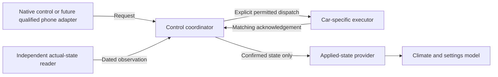

<!--
Author: gautch29
Notice date: 2026-11-23
Provided as is, without warranty. See NOTICE.md.
-->

# Request a vehicle change and publish confirmed state

**Developer guide · Independent vehicle interface · 2 October 2026**

Keep what the driver requested separate from what the vehicle confirmed.
The control coordinator tracks a bounded asynchronous operation; the applied
state provider exposes only dated confirmations to the existing Climate and
settings model. Neither component performs hardware I/O.

This is our original integration API, not an Apple protocol or a description
of the car's wiring. Hardware selection, bus messages, permissions, physical
interlocks and Apple's asynchronous write-response integration remain separate
qualification work.

## Understand the ownership



One owner thread owns `vehicle_control::Coordinator`. It accepts an immutable
catalogue of 1–32 semantic target policies and retains at most 64 command
records. Its operations are bounded and perform no physical writes or automatic
retries. A hardware worker must communicate with this owner through its own
bounded transport; it must not call the coordinator concurrently.

The target key names a car integration binding, such as
`bench.climate.driver.temperature_target_c`. It is independent of Apple's
connection-local characteristic IDs and any sensor or actuator bus address.
Keys are case-sensitive ASCII, 1–128 characters, begin with a letter and use
letters, digits, `.`, `_` or `-`. Empty dot segments are invalid.

## Configure target capabilities

Load a target catalogue with `vehicle_control::load_configuration(path)`.
The file declares capabilities and bounds, not initial state or a hardware
backend. The supplied [example](../config/vehicle-controls.example.json) uses
explicit bench names and disables every write.

```json
{
  "schemaVersion": 1,
  "targets": [
    {
      "key": "bench.climate.driver.temperature_target_c",
      "kind": "real",
      "writable": false,
      "max_age_ms": 500,
      "minimum": 16.0,
      "maximum": 30.0,
      "step": 0.5
    }
  ]
}
```

Scalar `kind` is exactly `boolean`, `integer` or `real`.
SchemaVersion **2** additionally accepts `ambient_light`, an atomic RGBW,
permille-brightness and fade value. It forbids numeric min/max/step and admits
only 0–1000 intensity / 0–5000 ms transitions; actual confirmations require
transition zero. SchemaVersion 1 remains scalar-only. The bounded nine-byte
payload and separate requested/current/UI contract are in
[ambient lighting](AMBIENT_LIGHT.md); the existing lifecycle/interlock rules below
apply unchanged. The Climate scalar provider withholds this composite. `writable` defaults to false.
Numeric kinds require finite `minimum`, `maximum` and positive `step`;
Boolean targets must omit those three fields. Integer bounds and step use
integer JSON values and lie within the exactly representable ±(2⁵³−1) range.
Real controls also use that numeric bound. Requested values must lie on the
grid anchored at minimum; confirmed actual values retain their original
precision within the type/range bounds. There is no silent rounding or clamp.
For a non-singleton real range, the step must advance the minimum in its numeric
representation and the finite grid count must be at most 2⁵³−1. Request-grid
comparison tolerates representation error capped at one millionth of a step;
it does not treat an arbitrary fraction of a step as an allowed command.

`max_age_ms` is an integer from 1 to 86,400,000. It is the age limit of an
actual confirmation, independent of the command deadline. These example
limits do not calibrate a sensor or establish physical car capabilities.
Unknown/duplicate fields, duplicate target keys, invalid types, empty or
oversized catalogues and files over 64 KiB are rejected.

Semantic units remain part of the car-specific binding contract. A target
ending in `_c`, for example, must actually use Celsius; changing a phone's
display units must not reinterpret the executor's numeric value. Enumerated
text commands, calibration conversions and actuator bus addresses are not
supplied by this catalogue.

## Start a provider generation

Use the qualified host `Clock` domain for request, receipt, confirmation and
deadline times. A controller's raw ticks require a qualified mapping before
use. The coordinator starts disconnected. Call
`begin_generation(generation, started_at, now)` for a positive provider
generation; later generations strictly increase. The start cannot precede the
last owner operation or be in the future.

Disconnect or restart immediately makes applied state unavailable and fails
still-active accepted/pending commands with `provider_lost`. A deadline already
reached takes precedence and retains its original timeout date. The command identifier
watermark survives: reconnect is not permission to reuse a physical operation's
identity. A new coordinator instance needs an integration-owned epoch and
identity policy that prevents old traffic from matching new requests.

## Submit and dispatch one operation

A `Request` carries:

| Field | Contract |
| --- | --- |
| `identifier` | Positive monotonically new identifier for this coordinator lifetime |
| `provider_generation` | The addressed active provider generation |
| `target` | A declared stable semantic key |
| `requested` | Exact Boolean, integer or real value satisfying the target's request policy |
| `requested_at` | Original request time, no earlier than this provider generation |
| `deadline` | After receipt and no more than 60 seconds after request time |

`submit` returns a `Snapshot`. `accepted` means the coordinator retained an
operation; it does not mean hardware received or applied it. A target already
holding an accepted/pending operation returns a new rejected/busy outcome.
A nonwritable target returns rejected/not-writable. No implicit coalescing,
superseding operation or physical retry is performed.

Before `dispatch(id, now, true)`, the executor must check that exact target's
current authority and physical interlocks. Permission defaults to false;
denial returns no work and records rejected/interlock. The coordinator does
not implement those car-specific interlocks or treat a static writable flag
as current physical permission. Permitted dispatch changes accepted to pending
and returns the operation once. Repeating dispatch returns no operation.
This prevents duplicate dispatch by this owner; it is not a hardware
exactly-once guarantee after power loss or uncertain delivery.

An exact retained duplicate request returns its current outcome without
enqueueing another operation. A changed request using the same ID, or an old
ID whose terminal record has been evicted, is rejected. Only terminal records
can be evicted; accepted/pending work never disappears to make room. Capacity
failure does not consume the new identifier.

## Acknowledge what actually happened

`Acknowledgement` carries the exact command ID, target and provider generation,
a positive sequence and original report time. Sequence and report time are
ordered per command. Status may be pending, applied, rejected or failed.
Only applied includes `ConfirmedState` with actual value, original confirmation
time and an explicit measured/calculated/simulation origin.

The confirmation must belong to the same target/generation and fall between
dispatch and report; reports cannot be later than receipt. The actual value
may differ from the requested value. The coordinator must publish that actual
value, not pretend that the request succeeded exactly as written.

| Result | Effect on actual state |
| --- | --- |
| Pending | Retains the previous fresh confirmation; publishes no requested value |
| Applied before deadline | Publishes the supplied actual confirmation with its original date |
| Rejected / failed | Records the outcome; does not manufacture another actual value |
| Timed out | Remains timed out; a later reply cannot turn it into success |
| Exact duplicate reply | Returns retained history without renewing any confirmation |
| Conflicting/reversed reply | Rejects the candidate atomically |

At receipt **≥ deadline**, a valid late reply may be retained for diagnostics,
including a late actual confirmation. It cannot change timed-out status or
publish that confirmation. A physical reader may separately report current
state. An already completed applied/rejected/failed result cannot be replaced
by a different terminal reply.

If an independent physical observation is newer than the acknowledgement's
confirmation, completing the command preserves that newer state. An equal-date
value/origin contradiction rejects the candidate. None of these policies stamp
an old confirmation with receipt time.

## Read actual state independently

`observe(ConfirmedState, now)` accepts independent applied-state observations.
It does not complete a pending command just because a readback happens to
equal its requested value. The source must qualify its value, generation,
original date and origin. Acquisition ordering and equal-date conflicts apply;
an old identical observation cannot revive a lost or expired state.

`read(target, now)` returns only a current confirmed observation. `poll` and
`snapshot` expire commands at **now ≥ deadline** and actual state at
**age ≥ maximum age**. Polling, reading an outcome and duplicate delivery never
renew physical confirmation time. Missing state is an absent optional, not
zero, false or the most recent request.

## Expose confirmations to Climate and settings

`theme::vehicle::confirmed_state_provider(coordinator, owner_clock)` adapts confirmed
Boolean/integer/real values to the existing `Provider::read` interface.
Use matching semantic `binding` keys in the Climate/settings configuration.
The provider uses the original confirmation date coarsened to service
milliseconds; it never labels a poll or a queued request as an acquisition.
Source and characteristic age limits both apply.

Supply a bounded, nonblocking callback returning the genuine fine-resolution
host operation time on the coordinator's owner thread. Production may supply
`[] { return Clock::now(); }`; deterministic tests use a controlled clock.
The coarse service tick must not be in the future or move backwards. Reading
after a confirmation within that same millisecond uses the fine owner time,
not a reconstructed timestamp earlier than the confirmation. A confirmation
whose millisecond date is later than the service tick is withheld until that
tick catches up. Distinct confirmations within the same service millisecond
withdraw that binding until a distinguishably later acquisition; no invented
timestamp resolves the collision. Invalid time calls leave the provider's
confirmation frontier unchanged.

The current phone writer is synchronous: `Provider::apply` returns an already
confirmed value and the phone service dates it at handling time. This new
provider therefore **rejects synchronous writes without submitting commands**.
It must not queue a physical request and then return a success-shaped value
or encourage retries after an error. A qualified deferred phone-response path
is required before wiring those writes to the asynchronous coordinator.
The live simulator and receiver's `none`/`simulation` backend choices are unchanged. The source-only
[deferred owner confirmation foundation](VEHICLE_STATE_GUIDE.md#deferred-owner-confirmation--14-october-source-only)
now supplies bounded original-channel response plumbing and an actual camera
Off owner adapter; it does not bind this physical coordinator or qualify
phone response compatibility/interlocks.

## Qualification

Ten affected portable CTest suites pass, including the existing core,
acquisition, Climate configuration and script/service checks. The three new
suites cover nine coordinator scenarios, ten strict-configuration cases and
nine actual parsed Climate/settings provider scenarios. Each new suite also
passes isolated AddressSanitizer/UndefinedBehaviorSanitizer checks. The core's
valid lifecycle operations perform zero allocations after construction in the
focused allocation check; this does not measure a future hardware executor.

The provider tests include immediate fine-time observation/acknowledgement
reads within the same service tick, invalid-clock recovery, next-tick eligibility,
alias consistency, precision, expiry/loss, same-millisecond collisions and
phone write errors without command creation. No physical phone test or CM5
deployment occurred: SSH still times out, and its existing receiver/profile
was not changed.

Keep fake-actuator lifecycle, strict configuration and actual Climate/service
publication checks separate from physical I/O and live phone response evidence.
No backend, configuration, actuator or service is enabled by this component.
It does not complete hardware interlocks, persistent operation identity,
physical delivery/rollback or asynchronous Apple write responses.

[Vehicle adapter plan](VEHICLE_ADAPTER_PLAN.md) ·
[Climate configuration](VEHICLE_CONFIGURATION_GUIDE.md) ·
[Read-only acquisition](VEHICLE_OBSERVATIONS.md).
