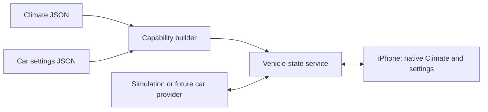

<!--
Author: gautch29
Notice date: 2026-11-23
Provided as is, without warranty. See NOTICE.md.
-->

# Configure Climate and car settings

Describe the controls available in a vehicle, connect them to a value provider,
and let the iPhone compose its native CarPlay Ultra pages.

This is original documentation for this receiver, based on observed protocol
behavior. It is not Apple documentation or an official compatibility promise.

## Overview

A capability file answers **what controls exist**. A provider answers **what
their values are and whether a requested change was applied**. The receiver
translates the capabilities into numeric accessories, services and
characteristics. Apple renders the Climate and automaker-settings interfaces.



Omit a feature to omit its service. Omitting `seat_fan`, for example, does not
advertise a ventilated-seat control. An initial value of zero still advertises
that control in its off state. Do not use `false` or `null` instead of omitting
a capability object.

The public Apple presentation describes this capability/state arrangement.
The numeric mapping in this project comes from separately recorded framework
observations. [Apple: Meet the next generation of CarPlay architecture](https://developer.apple.com/videos/play/wwdc2024/10111/),
[capability evidence and remaining gaps](VEHICLE_CAPABILITIES.md).

## Get started

### One vehicle definition

The software is generic; no make/model is selected in code. The user's current
example is a **1998 Land Rover Defender 110 with no drive modes**, not a physical
car that has been fitted or qualified. Start with
[`vehicle-defender-1998.example.json`](../config/vehicle-defender-1998.example.json).
It declares only identity. It infers no HVAC, cruise control, transmission,
gauge limits, readings or actuators from that identity.

[`configure_vehicle.py`](../tools/configure_vehicle.py) compiles one editable
vehicle JSON into the existing runtime inputs. Provision the private receiver,
display, authentication and installed signed-UI configuration separately, then:

```sh
python3 tools/configure_vehicle.py \
  --definition config/vehicle-defender-1998.example.json \
  --receiver /private/headunit/receiver.json \
  --checker build/headunit-vehicle-config-check \
  --output /private/headunit/vehicle-defender-generation-1
```

The output directory must be new. The compiler changes no service, radio,
display, selected binding or sealed release. It invokes the matching production
C++ parsers before publishing the directory and removes staging on failure.
Generated profiles disable inherited native and signed gauge simulation;
capability simulation remains separately explicit in the definition.
Their executable directory is the matching checker's build, rather than an
older directory inherited from the base receiver. The new optional identity and
native-gauge fields require that source generation; V27 is not changed by
compiling a definition.
Use its `receiver.json` for the existing launcher preflight; for release
publication, supply its receiver/Ultra/vehicle-profile/capability files through
the existing typed release roles. The archived definition is the edit source,
not an additional runtime input that can change a sealed generation.

The definition has `schemaVersion: 1` and these fields:

| Field | Meaning |
| --- | --- |
| `vehicle` | Required local `make`, `model`, `year`. Retained by the local profile; never substitutes the head-unit discovery/pairing identity or claims a phone-facing VehicleInformation service. |
| `ultraSignals` | Explicit signed-artwork bindings using the local-profile signal schema, without IIDs. The compiler allocates local IIDs. Units, gauge constants, paths, conversions, bounds and freshness are declared here; it supplies no bench defaults. A `vehicleField` is an existing typed observation key, not a hardware address. |
| `driveModes` | Optional ordered `{id, assetIdentifier}` entries. Omit entirely for a car without modes. The compiler supplies the immutable authored identifiers and timed semantic-to-index mapping, never a fixed active mode. Use the verified identifiers for the selected signed pack. |
| `nativeCluster` | Optional object with required explicit `speedUnit` (`kmh`/`mph`), `speedMaximumKmh`, `rpmMaximum`, `rpmRedline` and Boolean `showRpm`. Independent optional display-only `temperatureUnit` (`celsius`/`fahrenheit`, default Celsius), `distanceUnit` (`kilometers`/`miles`, default kilometers) and `fuelConsumptionUnit` (`liters_per_100km`/`us_mpg`/`imperial_mpg`, default L/100 km) configure native Standard/fallback text. Optional `temperaturePrecision` (`whole`/`one_decimal`, omitted means whole) independently controls existing coolant/oil numbers. [Consumption semantics](NATIVE_CLUSTER_PAGES.md#native-consumption-units--14-october-source-only) preserve canonical trip data and original freshness. Limits and units are display parameters, not measurements or applied receipts. |
| `capabilities` | Optional inline `climate`, `settings` and `camera` objects using the existing capability schemas. Omitted families disappear from the generated graph, including old base-profile capability paths. |
| `capabilityBackend` | `simulation` must be explicit when capabilities are supplied. A physical executor is not installed; `hardware` is rejected. Otherwise omit or use `none`. |

[`vehicle-generic-modes.example.json`](../config/vehicle-generic-modes.example.json)
demonstrates configurable Comfort/Sport, native gauge parameters, a signed gauge
constant, a timed fuel binding
and simulated single-zone climate. It is a fictional schema example, not a
Defender specification. Provider acquisition remains separate: it must publish
the configured semantic mode identifiers with original dates through HVO3/HVO4.
Changing vehicle/configuration requires a new process/connection generation;
editing JSON is not a live capability notification.

In the earlier combined-unit predecessor, native unit options were independent of speed.
The generated six required fields and optional temperature/distance fields keep
their original byte format; the existing runtime `drive_mode_profiles_file` can
coexist as the third optional field in the combined-unit predecessor. The
consumption extension adds independent `fuel_consumption_unit` as the fourth
optional field; that consumption predecessor admitted at most ten fields
within the unchanged 4096-byte bound. The read-only manager projection reports
all declared unit enums through the [native configuration status contract](NATIVE_CLUSTER_PAGES.md#native-instrument-configuration-status--14-october-source-only),
without exposing that private path or claiming applied units.

Native unit options remain independent: optional `temperatureUnit`, `distanceUnit`,
`fuelConsumptionUnit`, `speedPrecision`, `pressureUnit` and `temperaturePrecision`
may coexist in
`nativeCluster`. Pressure accepts exactly `kpa` (default), `bar` or `psi`, changing
only native Vehicle/Full Gauges oil-pressure text and labels. Omission preserves
the original generated bytes. The existing runtime `drive_mode_profiles_file`
remains private and can coexist. Temperature precision accepts `whole` (default)
or `one_decimal`, independently of temperature units. Native parsing admits at
most thirteen distinct fields within the unchanged 4096-byte bound. The exact
eleven-field readonly manager
summary excludes that path and reports static intent, never applied units. See
[native oil-pressure units](NATIVE_CLUSTER_PAGES.md#native-oil-pressure-units--15-october-source-only)
and the [configuration status contract](NATIVE_CLUSTER_PAGES.md#native-instrument-configuration-status--14-october-source-only).

These are local-profile and launcher capabilities. They do not implement the
missing phone-facing DriveState/VehicleInformation contracts, infer fitted
equipment, add unknown provider fields, or configure all native-cluster gauge
artwork. A signed pack may require additional declared inputs to render a
particular layout. Native gauge options reach Standard/fallback and are included
in the sealed release graph; omission preserves the older bench presentation,
not a car-specific specification. Full native-page units/layout policies and
physical adapter configuration remain integration work. Portable checks cover both examples, reordered mode
mappings, omission, preserved device identity, production parser rejection and
failed staging cleanup, configured gauge rendering, unavailable values, launcher
environment cleanup and sealed role relocation. All 136 portable suites and
three focused AppleClang ASan+UBSan checks pass; no phone or car qualification
follows. The restored complete CM5 receiver build, 15 affected checks and
encrypted smoke pass with 637 matched inputs at `c81afbf`; both headless Standard
preview fixtures exercise configured gauges and invalid-file rejection. The
release fixture passes after a private-process umask correction. Final compiler
build-binding/path guards have separate macOS, sanitizer and CM5 checks at
`0d60915`; [control](AIRPLAY_CONTROL.md#protocol-repair-source--9-october-2026)
owns the exact private receipts. No selected release is changed.

### Separate capability files

Copy these examples into the directory containing your private receiver file:

- `config/climate.example.json`: the single-zone temperature/fan model.
- `config/car-settings.example.json`: the previously tested lighting switch.

Add these fields to `receiver-appliance.json`:

```json
{
  "vehicle_state_profile": "none",
  "climate_config": "climate.json",
  "car_settings_config": "car-settings.json",
  "vehicle_state_backend": "simulation"
}
```

This is a fragment, not a complete receiver file. Relative paths resolve beside
that file. You may supply either capability file or both. Capability files
require Ultra negotiation. `vehicle_state_profile` is the legacy bench selector;
it cannot be combined with file-driven capabilities.

Validate before starting the receiver:

```sh
build/headunit-vehicle-config-check climate.json car-settings.json
sudo python3 tools/run_lab_receiver.py --config /path/to/receiver-appliance.json --dry-run
```

Pass `-` to the checker for an absent file. The checker uses the same builder as
the receiver, constructs the service and checks the `/info` representation. The
launcher runs it before changing radio services. Files remain immutable during
a phone session: restart the receiver and reconnect after changing capabilities.

The simulation backend starts from `initial` values, confirms writes in memory
and retains them across phone sessions within the same receiver process.
Restarting the receiver resets them. It does not operate physical hardware.
For fan and seat level controls with an `on` descriptor, simulation keeps level
and power consistent: a nonzero level turns the control on; switching it off
sets a zero-capable level to zero; switching it back on restores the last
nonzero level. These are simulator relationships, not extra commands sent to
future physical equipment. A hardware provider must report its own related
applied states.
The existing `simulate_vehicle` setting separately simulates cluster gauges;
it does not select the Climate provider.

## Define Climate capabilities

The root object contains `version: 1`, optional `cabin`, optional `zones`, and
optional `steering_wheel`. Additional research controls require
`experimental: true`; see the capability catalogue before enabling them.

```json
{
  "version": 1,
  "cabin": {
    "power": { "initial": true },
    "ac": { "initial": false }
  },
  "zones": [
    {
      "id": "driver",
      "layout": "seat_front_left",
      "temperature": {
        "units": "celsius",
        "minimum": 16,
        "maximum": 30,
        "step": 0.5,
        "initial": 21,
        "on": { "initial": true }
      },
      "fan": { "initial": 40, "on": { "initial": true }, "auto": {} }
    }
  ]
}
```

`id` gives the zone a stable provider namespace; `layout` identifies its physical
position in the asset's vehicle layout. Common seat keys include
`seat_front_left` and `seat_front_right`. These are physical left/right positions,
not a promise that left always means driver. The accepted asset and iPhone also
determine placement and artwork; configuration does not add missing artwork.

Zone IDs and layout keys must each be unique. Up to eight zones are accepted.
Only declare zones and functions actually available when connecting real hardware.

### Common signal fields

Every value descriptor accepts:

| Field | Meaning |
| --- | --- |
| `binding` | Optional stable provider key, replacing the generated key |
| `initial` | Simulation startup value; never used as a fabricated physical reading |
| `writable` | Defaults to true for controls; false removes write authority |
| `max_age_ms` | Reading freshness, 100–60000 ms; default 1000 ms |
| `minimum`, `maximum`, `step` | Numeric controls only; advertised and enforced on writes and readings |

For Boolean descriptors use true/false. Integer controls require integer JSON
values. Temperature and float settings accept JSON numbers and are converted
to floating-point protocol values. Numeric writes must match the configured
step relative to the minimum. Out-of-range requests are rejected before calling
the provider. Provider confirmations must satisfy the same policy.

Do not edit generated IIDs: they are local to a profile and may change when
capabilities change. Bind hardware using the named `binding`, never an IID.
Two controls cannot write the same binding. Read aliases are allowed only when
their initial values and policies agree.

Provider bindings are read once per refresh, so aliases see the same value,
source timestamp and availability. An absent or invalid reading clears the
phone-facing value immediately. That poll is not a new measurement: it retains
the last accepted source timestamp. A newer measurement that arrives after a
later absence poll can recover while still fresh; replaying the last accepted
measurement cannot restore a withdrawn value. Sensor timestamps and refresh
times share the provider's monotonic clock domain.

### Cabin controls

Each of `power`, `ac`, `max_ac`, `max_defrost` is an optional Boolean descriptor.
Default simulation state is false. They map to HVAC power, compressor power,
maximum A/C and maximum defrost. The provider must implement any interlocks and
resulting changes to other readings; the capability layer does not invent them.

### Zone controls

| Field | Model and defaults |
| --- | --- |
| `temperature` | Setpoint, current applied temperature and optional `on`; Celsius 16–30 by 0.5, initial 21 |
| `fan` | Integer level 0–100, initial 40; optional `on` and `auto` |
| `recirculation` | Required `on` descriptor; optional `auto` |
| `power` | Zone power; required `on` descriptor |
| `sync` | Zones synchronized; required `on` descriptor |
| `automatic` | Automatic-climate level 0–3, initial 0; range may be configured |
| `defrost` | Research: level, range defaults 0–1, and required `types: ["air"]`, `["filament"]` or both |
| `vents` | Research: index into named vent combinations; optional `on` and `auto` |
| `seat_heating_cooling` | Research: signed integer level, default 0–3; optional `on` and `auto` |
| `seat_fan` | Seat ventilation fan, integer level; optional `on` and `auto`; default range 0–100, initial 0 |
| `temperature_level` | Research: relative heating/cooling level for a zone without an absolute setpoint |

Temperature units can be `celsius`, `fahrenheit` or `kelvin`. Fahrenheit defaults
to 60–86 by 1, initial 70; Kelvin defaults to 289.15–303.15 by 0.5, initial 294.15.
Supply explicit calibrated bounds when appropriate.

In the minimal simulation, `CurrentTemperature` aliases the applied setpoint.
It is **not** an ambient cabin sensor. To supply an independent applied reading,
add a `current` descriptor inside `temperature`, with `binding`, optional
`initial`, `max_age_ms`, `minimum`, `maximum` and `step`. Its units come from
`temperature`; its bounds and precision default to the setpoint's unless
overridden. It always remains read-only. For example, a separate sensor can
report temperatures outside the adjustment range and in finer increments:

```json
{
  "binding": "hvac.driver.temperature",
  "minimum": -40,
  "maximum": 85,
  "step": 0.1,
  "initial": 5.3
}
```

This fragment belongs inside `temperature.current`. These are example Celsius
calibration limits; choose limits and increments for the actual provider. The
simulation initial value is not a fabricated reading for a hardware provider.
Use a separate binding when the measurement policy differs from the setpoint:
two aliases for the same binding must agree on value kind, bounds, precision
and initial value. Configuring a measured reading does not authorize writes to
it. Independent measured-temperature bounds pass offline checks; their iPhone
presentation has not yet been qualified.

### Heated, cooled and ventilated seats

```json
{
  "version": 1,
  "experimental": true,
  "zones": [
    {
      "id": "driver",
      "layout": "seat_front_left",
      "temperature": { "initial": 21 },
      "seat_heating_cooling": {
        "minimum": 0, "maximum": 3, "step": 1, "initial": 0,
        "on": {}, "auto": {}
      },
      "seat_fan": {
        "minimum": 0, "maximum": 3, "step": 1, "initial": 0,
        "on": {}
      }
    }
  ]
}
```

Heating/cooling and the seat fan become services in **Seat accessories**, rather
than additional cabin fans. Each zone with seat controls gets its own accessory.
An initial level of zero does not remove the control. If the car has heating only,
omit the seat fan and use a nonnegative level range. Negative levels can be
configured for a cooling experiment, but the meaning of signed levels and the
iPhone's resulting presentation still need live qualification. The expanded
example is a capability experiment, not a physical equipment recommendation.

Steering-wheel heating uses the root `steering_wheel` level descriptor, with
optional `auto`. Its observed service has no separate `on` characteristic; an
`on` field is rejected.

Declare each physical function once. The expanded example uses the fan's
`auto` characteristic rather than also adding a separate `automatic` level
control for that same function. Steering-wheel heating is manual in that
example. Apple chooses the layout; advertising more services is not a way to
request more space or fix overlapping artwork.

### CM5 bench profile and airflow placement

Use these files together for the current reference-pack bench:

- [Climate bench profile](../config/climate.cm5-bench.example.json)
- [Car-settings bench profile](../config/car-settings.cm5-bench.example.json)

```json
{
  "climate_config": "climate.cm5-bench.example.json",
  "car_settings_config": "car-settings.cm5-bench.example.json",
  "vehicle_state_backend": "simulation"
}
```

The expanded Climate profile produced overlapping glyphs in the top driver
button. The defect is present in the original iPhone video, before our GPU
composition. Removing zone power or steering-wheel heating did not clear it;
omitting only the Vent service did. The user confirmed separate icons with
power, steering-wheel heating and the seat controls restored. Keeping Vent
but omitting its optional `on` characteristic still reproduced the overlap.
This is a measured profile-compatibility limit, not a complete diagnosis of
Apple's UI internals.

The bench therefore omits `zones[].vents` from the Climate page. Car settings
offers **Driver airflow**, bound to the same `climate.driver.vents.index`
provider key. Choices 0–3 mean upper, upper+lower, lower, and windscreen+lower.
The car adapter must translate that applied index to its own flap/actuator
commands. Climate power, fan, temperature and seat capabilities remain in the
Climate model. Steering-wheel heating also remains configured.

After reconnecting with these paired files, the user confirmed that Climate's
icons remain separate and changing **Driver airflow** retains the selection.
This verifies the simulated applied-state exchange within the session; it does
not verify a physical actuator or persistence across receiver restarts.

The [full Climate example](../config/climate.full.example.json) retains Vent
as an experimental capability reference. It is not a guarantee that every
advertised combination renders correctly in this asset/iOS arrangement. Do not
enable a feature merely to expose an icon; declare the physical capabilities
and qualify their combination on the actual phone. Switching these capability
files requires a new CarPlay session.

The next isolated diagnostic is
[climate.vent-isolation.example.json](../config/climate.vent-isolation.example.json).
It adds only Vent's combinations, current index and layout key to the minimal
temperature/fan profile. It omits Vent's optional On and AutoMode characteristics,
as well as seats and steering-wheel/cabin controls. All four index writes and
rejection of invalid indices pass offline checks. The profile has **not** been
installed or tested with the phone; it is not a replacement for the compatible
bench files. See [the comparison plan](CLIMATE_QUALIFICATION.md#restore-airflow-inside-climate).

### Vent combinations

```json
{
  "combinations": [["upper"], ["upper", "lower"], ["lower"], ["window", "lower"]],
  "initial": 0,
  "on": { "initial": true },
  "auto": {}
}
```

Place this object under a zone's `vents`. Supported direction names are `window`,
`upper`, `lower`, `neck`, `middle`. The value is a zero-based combination index,
not a direction mask. Only advertise combinations the hardware can apply.
Duplicate/empty combinations and out-of-range indices are rejected.

## Define car settings

Settings are organized into named sections. A setting has a stable `id`, a
`section`, a user-visible `label`, and a `kind`. Its generated binding is
`settings.<id>` unless overridden. Sections and settings accept `order` 0–255;
otherwise file order is used.

```json
{
  "version": 1,
  "sections": [{ "id": "comfort", "label": "Comfort" }],
  "settings": [
    {
      "id": "comfort.lighting", "section": "comfort",
      "label": "Interior lighting", "kind": "boolean", "initial": false
    }
  ]
}
```

Section fields: `id`, `label`, optional `footer`, optional `order`.
Setting presentation fields: optional `description`, `symbol` (an iPhone symbol
name), `hidden`, `disabled`. A disabled setting is not writable, even if
`writable` is true. A hidden setting still exists in the capability model.
Labels are UTF-8 strings up to 128 bytes without control characters.

| Kind | Value and options | Qualification |
| --- | --- | --- |
| `boolean` | Boolean switch | Original minimal switch passed a live test |
| `float` | Number; explicit min/max, optional step | Research, requires `experimental: true` |
| `integer` | Signed int32; explicit min/max, optional integer step | Research |
| `select` | One choice index | Research |
| `multi_select` | Array of unique choice indices | Research |
| `text` | Read-only string; provider may update it | Research |

Numeric settings accept `minimum_symbol` and `maximum_symbol`. Integer settings
also accept `hide_stepper`. Selection settings require 1–16 `choices`; each has
`label` and optional `description`, `symbol`, `disabled`. Writes selecting a
disabled choice, duplicate index, wrong type or absent index are rejected.
Choice ranges are derived from the list; custom min/max/step are rejected.

Button actions, deep links, image selections, notification payloads, prominence,
restriction categories and custom resource packs are identified but not exposed
as configurable controls yet. See [the complete researched inventory](VEHICLE_CAPABILITIES.md).
Unknown fields and setting kinds are rejected rather than ignored.

## Connect a future car provider

`Provider` in `vehicle_configuration.hpp` is the integration boundary:

```cpp
std::optional<Sample> read(std::string_view key, std::uint64_t now_ms);
opack::Value apply(std::string_view key, const opack::Value& requested,
                   std::uint64_t now_ms);
```

`read` supplies a value and its original sample time in the receiver's monotonic
clock domain. Missing, stale, future, out-of-order or invalid samples become
unavailable; they are never refreshed just by rereading them. `apply` must return
the confirmed state, which may differ from the requested state. Exceptions
produce a write error. Invalid requests never reach it.

During a refresh, each unique binding is read once. Characteristics sharing a
binding receive that same value and sample time, including an unavailable or
failed read. Each characteristic still applies its own freshness limit. This
keeps aliases coherent and avoids asking a physical adapter for the same reading
twice during one refresh; it does not make unrelated bindings an atomic car-wide
snapshot.

Callbacks run on the receiver thread and must be bounded/nonblocking. A CAN,
serial or I²C adapter should maintain a cache updated by its own I/O owner. If
the adapter cannot confirm a command without waiting, it must reject the write
or use a separately designed asynchronous acknowledgement mechanism. It must
not pretend that queued commands have already been applied.

The original [asynchronous control interface](VEHICLE_COMMANDS.md) now tracks
requests, outcomes and dated actual confirmations separately. Its
`confirmed_state_provider` can feed read-only Boolean/integer/real bindings
through this model with an explicit owner-clock callback. It rejects `apply`
without submitting a command; a qualified deferred phone-response path is
still needed for physical writes. Target policy files contain no initial state
or installed hardware backend.

Instantiate `ConfiguredModel(configuration, provider)` with that adapter. The
installed launcher currently accepts only the explicit `simulation` backend;
it does not silently fall back from real hardware to simulated values. No
physical provider or transport for these new bindings is installed yet.

Optional `nativeCluster.temperaturePrecision` accepts exactly `whole` or
`one_decimal`. Omission preserves existing generated native bytes; explicit
values append `temperature_precision=...`. This is static display formatting
for existing native coolant/oil numbers, independent of `temperatureUnit` and
`speedPrecision`. It does not change Climate, canonical Celsius, physical
measurement resolution or applied state. The read-only configuration summary
adds `temperaturePrecision` (eleven safe fields); the unchanged version-1,
4096-byte native format admits at most thirteen distinct fields, including the
six required fields and optional private drive-profile path. See the
[native precision contract](NATIVE_CLUSTER_PAGES.md#native-temperature-precision--15-october-source-only).

## Validation and lifecycle

- Files are at most 64 KiB, with bounded nesting and node count. Duplicate
  decoded JSON keys, unknown fields, wrong types and nonfinite numbers fail.
- The shared service additionally limits characteristic count, individual values
  and encoded messages. Large choice descriptions may exceed the value limit
  and are rejected by the checker.
- Each profile has unique generated IIDs. Sections and bindings are checked
  before the profile is exposed to the phone.
- Configuration does not change while connected. Restart and reconnect to apply
  new capabilities; the iPhone may cache its previous UI until a fresh session.
- Standard mode removes the Ultra capability files from its effective receiver
  configuration. Returning to Ultra restores the base files.
- Dynamic readings and subscriptions clear on disconnect. Fixed metadata stays
  fixed; the provider owns persistence independently.

For a write investigation, set `vehicle_trace_writes: true` in the receiver
configuration and restart. The private receiver log records the local IID,
stable binding, numeric/Boolean request and applied reply, including rejection.
Other values are redacted. It does not change write authority or acknowledgement
semantics. Keep this optional diagnostic off for normal operation.

## Related documentation

- [Vehicle-state wire protocol and session API](VEHICLE_STATE_GUIDE.md)
- [Climate/settings capability catalogue](VEHICLE_CAPABILITIES.md)
- [Control and asset qualification matrix](CLIMATE_QUALIFICATION.md)
- [Receiver configuration](CONFIGURATION.md)
- [Research and live-test record](CLIMATE_RESEARCH.md)
