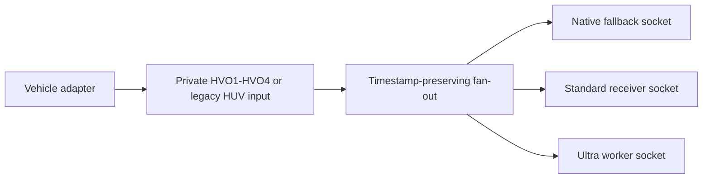

<!--
Author: gautch29
Notice date: 2026-11-23
Provided as is, without warranty. See NOTICE.md.
-->

# Distribute one vehicle source to every cluster

The native fallback, Standard cluster and Ultra script worker need the same
readings. They have separate lifetimes and must not bind the same Unix datagram
socket: that would prevent the second consumer from starting. The optional
vehicle fan-out service gives each consumer a private input while preserving
original HVO1–HVO4 source dates or one legacy Pi ingress timestamp. It does not
read physical car hardware or issue actuator commands.



## Configure the paths

Copy [the example](../config/vehicle-fanout.example.json) into a private
configuration directory owned by the display user. Replace the example home
directory with the actual account's path and set the file mode to `0600`.
All socket parents must already exist with mode `0700`, owned by that user.
Input and consumer paths must be absolute, normalized, distinct and at most
107 encoded bytes. Symlinked directories and consumer socket files are rejected.

The `consumers` object requires `backup` and `receiver`. Add `ultra` when an
installed Ultra UI is configured, and optional `hud` for the independent native
HUD's `--vehicle-socket`. Unknown names, duplicate JSON keys, identical
paths and unbounded configuration files are rejected.

Configure the corresponding existing profiles:

- Receiver JSON: set `vehicle_socket` to the `receiver` path. Omit
  `simulate_vehicle` or explicitly set it to `false`.
- Installed Ultra UI profile: set `vehicleSocket` to the `ultra` path and
  `simulateGauges=false`.
- The boot installer assigns the `backup` path to the native fallback. The
  phone manager accepts the same `--vehicle-fanout-config` option and assigns
  its persistent fallback this separate path; the appliance service supervises
  the broker independently of that manager's receiver children.

The installer checks these exact bindings before replacing any service files.
It rejects a configured physical input shared by concurrently running backup
and receiver processes. Simulation is a separate explicit choice: without a
source or `simulate_vehicle=true`, the boot fallback displays unavailable values.

```sh
sudo python3 tools/install_cm5_appliance.py \
  --user pi --repo /home/pi/ultra-headunit \
  --receiver-config /home/pi/.config/headunit/receiver.json \
  --vehicle-fanout-config /home/pi/.config/headunit/vehicle-fanout.json \
  --install
```

For a direct receiver checkout with four core services, this adds an optional
**fifth** `headunit-vehicle.service`. A configuration with the resident Home page
already has five services and would have **six** with the broker. The currently
selected V3 release has five services and does **not** deploy this broker or a
physical vehicle provider. The broker runs as the display user. The fallback
starts after the broker service has been requested; absent consumers are allowed
and receive their first snapshot only when a fresh adapter packet arrives.
Installation enables the services but does
not start or restart an existing session.

## Publish snapshots

An acquisition-aware adapter sends [HVO1–HVO4](VEHICLE_OBSERVATION_PROTOCOL.md)
to the configured `input` path. Each complete snapshot carries original
acquisition/publication dates, age limits, availability, provenance and source
generation. Versions have exact schemas:

- HVO1: 34 original reading/indicator records.
- HVO2: 35 records, including coherent transmission.
- HVO3: 36 records, including observed drive mode and its immutable ordered
  catalogue header.
- HVO4: the same header and 38 records, adding current trip and qualified
  heading with independent acquisition/expiry policies.

The broker forwards these bytes unchanged; each C++ consumer validates the
complete model and ordering before applying anything.
Legacy adapters can still send ordinary `HUV1` or `HUV2` snapshots. Missing
legacy fields clear earlier values. See [vehicle input](VEHICLE_INPUT.md) for
keys, units and validity limits.

The broker runs on 64-bit Linux and obtains a kernel receive timestamp through
`SO_TIMESTAMPNS`. It rejects packets more than 250 ms old in its own queue,
future timestamps, missing/invalid timestamp metadata, truncated packets,
packets larger than 8192 bytes for HVO1–HVO4 or 2048 bytes for legacy snapshots,
and nested broker envelopes. All observation versions are forwarded unchanged.
Only legacy packets have accepted ingress time converted to the host monotonic
clock and forwarded as:

```text
HUF1 <Pi-ingress-monotonic-nanoseconds> <original HUV1 or HUV2 packet>
```

The consumer preserves that time as `VehicleSample.sampled_at`. Receiving a
packet after a rendering pause does not renew its age. Older broker packets
cannot replace a newer sample; existing freshness policy hides expired warnings
and marks expired readings unavailable. A future or nested envelope is rejected
before any fields are applied.

**This is Pi ingress time, not the car sensor's measurement time.** HUV1/HUV2
carry no sender timestamp. A future hardware adapter must publish new snapshots
promptly and represent unknown/stale hardware readings as unavailable. A stopped
adapter must not keep retransmitting an old measurement as a new snapshot.
HVO1–HVO4 avoid this legacy renewal by retaining per-signal dates, even through
heartbeats and consumer polls. Cross-device sensor time and actuator
acknowledgements require their own future interface; this broker does not
claim either.

## Keep validation in each consumer

The broker forwards a bounded packet; it does not parse the compound model or
maintain trip history. Each `VehicleObservationReceiver` independently validates
schema, chronology and replay before applying a complete snapshot. Its first
accepted observation version and ordered mode catalogue—including catalogue
absence—stay fixed across source generations. Changing either requires a new
consumer instance; sending an older version is not a downgrade mechanism.

Current-trip identity, reset generation and dated distance/elapsed/moving
watermarks survive missing components, withdrawal and source restart. A higher
reset permits smaller counters only at a genuinely newer acquisition. Loss,
receipt/poll expiry or restart also requires a newer trip acquisition before
recovery, including after an honest new-generation empty snapshot. The broker
does not revive those values by replaying a cached packet or replacing source
dates with ingress dates.

Chronology matters for partial counters: a newer elapsed reading must cover
already known moving time; an older elapsed watermark is not substituted for
current unavailable elapsed time. These history checks are shared with the
source cache and commit only when every field in the snapshot succeeds.
Heading retains explicit north reference and source, and expires independently
of trip, speed or other signals. See the [protocol](VEHICLE_OBSERVATION_PROTOCOL.md)
for canonical values and recovery rules.

## Lifetime and failure behavior

- One turn processes at most 64 input packets, and there are at most four
  explicitly named consumers. Forwarding is nonblocking with no retained
  application queue or last-value cache.
- Before each send, the current consumer and its parent are checked for owner,
  socket type and private permissions. Missing, replaced, unsafe or congested
  consumers are skipped without delaying healthy ones.
- Consumers that bind or restart later get no replay. They stay unavailable
  until the adapter supplies a new packet. Samples already queued at a consumer
  retain their original age.
- An owner-only advisory lock rejects a second broker. A live input socket is
  never reclaimed. A dead input socket can be reclaimed only after the lock is
  acquired and its private ownership/type checked.
- Shutdown removes only the input inode created by that broker. It does not
  unlink a replacement socket or any consumer path. Systemd can restart a
  failed broker without stopping the native fallback; values expire meanwhile.
- Each C++ consumer also holds a private endpoint lock. After a killed consumer,
  a replacement reclaims only an owned dead socket. Active locks, older live
  endpoints, non-socket files and replacement inodes remain protected; new
  consumers begin unavailable and receive only new packets.
- These are trusted local IPC boundaries, not authenticated automotive messages
  or a safety-certified monitoring system.

## Validation and remaining qualification

Portable tests cover configuration/ownership rejection, identical private-path
requirements, kernel-time conversion, stale/future/truncated/nested input,
bounded turns, configured boot geometry, explicit simulation and consumer
matching. C++ tests preserve envelope time and reject old/future input without
refreshing the source.
Portable HVO1–HVO4 checks verify unchanged bytes and the separate size limits.
Actual Mac Unix-socket/Ultra-service checks verify schema, replay, mixed-rate
expiry, coherent transmission and mode state. The dedicated codec and receiver
suites also pass strict builds and focused AddressSanitizer/UndefinedBehaviorSanitizer
runs for HVO4 trip/heading history, chronology, size bounds and recovery.

The [broker suite](../tests/vehicle_fanout_test.py) passed **sixteen tests on
the actual CM5 Linux kernel on 4 October 2026**. Those checks exercise kernel
timestamps, HVO2/HVO3/HVO4 byte-preserving delivery, late-consumer no-replay
and the HVO4 fixture with a coherent current trip and qualified zero heading.
Portable Mac checks remain useful for configuration and parser behavior, but
the Linux-only cases are no longer pending for this tested build.

Linux tests exercise two actual consumer sockets, identical forwarded timestamps,
absent-consumer recovery without replay, paused broker input, unsafe consumer
paths, duplicate/live input ownership and cleanup after input replacement.
The C++ socket regression kills a real child consumer, rebinds its dead endpoint
and verifies that queued old values do not reappear; it also protects independent
live endpoints and replacement files. The CM5 broker tests ran without
activating a vehicle service. Real kernel timestamps preserve source acquisition
bytes and refuse old queued input. The production CLI also passes
SIGKILL/dead-endpoint recovery and graceful SIGTERM cleanup in a private
fixture. This tests distribution and process ownership, not physical sensor
acquisition, typed HVO parsing, calibration or deployment. Physical car sampling,
power loss, a faulted Ultra worker with a healthy main panel, and repeated
real-phone Standard/Ultra transitions remain separate acceptance checks.
