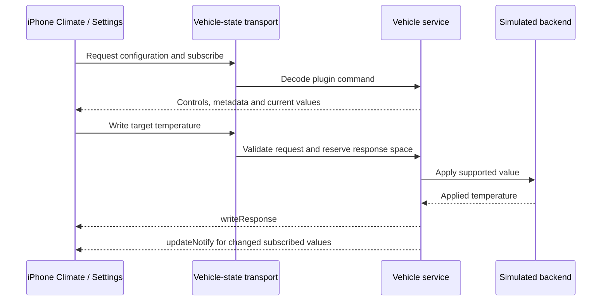

<!--
Author: gautch29
Notice date: 2026-11-23
Provided as is, without warranty. See NOTICE.md.
-->

# Integrating Climate and vehicle settings

**Developer guide · Independent CarPlay Ultra receiver · 30 September 2026**

Provide vehicle capabilities and current values to the iPhone, handle requested
changes, and let Apple's Climate and Settings interfaces present the controls.

This guide describes this project's implementation. It is original,
reverse-engineered documentation, not an Apple or MFi specification. The
simulated profile below was verified with a connected iPhone on the CM5.
Unverified capabilities are identified explicitly. No Apple implementation,
signed asset package, pairing material or private phone logs are distributed
with the source.

## Overview

The iPhone draws the Climate page. The head unit supplies its model through the
vehicle-state protocol: which controls exist, where they belong, their units
and limits, and their current values. A user action becomes a write request.
The head unit validates it, applies it to its backend, and returns the applied
value. Subscriptions keep the phone's view synchronized afterward.

This is separate from the Ultra UI channel that synchronizes the cluster's
signed Lua scene, and from the video streams carrying the phone's pixels.
Showing a Climate icon alone does not demonstrate a working vehicle model.



### Verified behavior

On 30 September 2026, with the existing accepted reference Ultra pack and
`vehicle_state_profile: "bench"`:

- Apple's Climate page opened and displayed temperature and fan controls.
- The user changed both controls and confirmed their displayed values stayed
  changed. The receiver recorded control-write requests on the vehicle channel.
- Apple's settings interface displayed **Headunit bench → Comfort lighting
  (simulation)**. The user toggled it and confirmed it stayed changed.
- Both priority channels opened; the phone requested configuration and
  registered subscriptions. The receiver reported no vehicle-channel failure
  during these checks.

The backend is memory-only. This verifies a small simulated profile, not
physical HVAC, all Climate features, every iOS version, or every asset package.
Durable settings across process restarts are not implemented.

## Configure the vehicle

New integrations should use the semantic Climate and car-settings files in
[Configure Climate and car settings](VEHICLE_CONFIGURATION_GUIDE.md). That guide
covers zones, capability presence, ranges, seat controls, settings families and
the provider interface. [The capability catalogue](VEHICLE_CAPABILITIES.md)
separates live results from implemented research controls and unmapped options.

The wire examples below describe the original minimal bench fixture. They remain
useful for diagnosing the transport; their fixed IIDs are not the generated
IIDs used by file-driven profiles. Both paths use the same vehicle-state service.

## Enable the legacy simulated profile

Start from a working native Ultra receiver with its private identity, MFi
authentication hardware, accepted installed asset and matched display geometry.
See [CarPlay Ultra integration](CARPLAY_ULTRA_GUIDE.md) for that setup.

Add this field to the private receiver JSON file:

```json
{
  "vehicle_state_profile": "bench"
}
```

The snippet shows an additional field, not a complete receiver configuration.
The existing profile must also enable `ultra_negotiate` and the installed UI.
Restart the receiver and establish a fresh CarPlay session. Configuration is
fixed for that session; editing a file cannot change an already running model.

| Profile | Advertised model |
| --- | --- |
| `none` | No legacy fixture; capability files may independently enable the channel |
| `empty` | Protocol transport with no accessories; diagnostic control |
| `climate-bench` | Simulated front-left temperature and fan |
| `settings-bench` | Simulated Boolean setting and its menu section |
| `bench` | Climate and automaker settings together; live-verified profile |

The two individual profiles use the same builders as `bench`, but were not
separately live-qualified in this test. No profile connects a car actuator.

## Describe the vehicle model

Configuration has three levels:

```text
accessories[]
  services[]
    characteristics[]
    controls[]
```

An **accessory** groups a system, such as Climate. A **service** represents a
capability, such as a temperature control. A **characteristic** supplies one
value, such as the target temperature or the zone's layout key.

Every item has an `iid`, a locally assigned instance identifier, and a `type`,
a numeric semantic identifier understood by the phone. IIDs must be unique
throughout the model. Changing an IID does not change what a control means;
changing its type can. This profile advertises no separate `controls` objects.

### Climate model

| Item | IID | Type | Value / purpose |
| --- | --- | --- | --- |
| Climate accessory | 100 | `0x01000001` | Climate system |
| Temperature service | 101 | `0x11000002` | Front-left temperature control |
| CurrentTemperature | 102 | `0x31000019` | Applied bench setpoint; read-only |
| TargetTemperature | 103 | `0x31000017` | Requested setpoint; writable |
| Temperature On | 104 | `0x30000002` | Boolean; writable |
| Temperature VehicleLayoutKey | 105 | `0x36000065` | Fixed `seat_front_left` |
| Fan service | 111 | `0x11000007` | Front-left fan control |
| FanLevel | 112 | `0x31000012` | Integer percentage; writable |
| Fan On | 113 | `0x30000002` | Boolean; writable |
| FanAutoMode | 114 | `0x3000005f` | Boolean; writable |
| Fan VehicleLayoutKey | 115 | `0x36000065` | Fixed `seat_front_left` |

Both services identify the same zone. The layout key is a semantic string,
not a pixel coordinate. The working model has one front-left zone; it does
not define passenger/rear zones, vent direction, recirculation or defrost.

### Characteristic metadata

| Field | Meaning in this implementation |
| --- | --- |
| `format` | Numeric representation: Boolean `0`, UInt8 `1`, floating-point `9`, String `10` |
| `mutable` | Value can change during a session; this does not authorize writes |
| `writable` | The phone can request a change; must have a matching writer |
| `supportsInvalid` | Whether unavailable state can be represented as null |
| `minimumValue`, `maximumValue`, `stepValue` | Numeric bounds and advertised increments |
| `units` | Numeric unit identifier; Celsius is `1082` in this profile |
| `maximumLength` | Maximum string length advertised to the phone |
| `initialValue` | Current initialized value included in the configuration snapshot |

Temperature uses format `9`, unit `1082`, range **16–30 °C**, and **0.5 °C**
steps. Fan level uses format `1` and range **0–100** in steps of one. Defaults
are **21 °C**, **40% fan**, both controls on, and fan auto mode off. These are
bench choices, not universal Apple requirements. The current temperature
mirrors the simulated applied setpoint; it is not a measured cabin temperature.

For example, an initialized target-temperature characteristic is represented
as this dictionary inside the configuration:

```json
{
  "iid": 103,
  "type": 822083607,
  "format": 9,
  "mutable": true,
  "writable": true,
  "supportsInvalid": false,
  "minimumValue": 16.0,
  "maximumValue": 30.0,
  "stepValue": 0.5,
  "units": 1082,
  "initialValue": 21.0
}
```

This is readable JSON notation for the decoded dictionary. The actual model
travels as a binary plist in `/info` and as OPACK on the vehicle channel.
Preserve numeric value kinds when constructing the model: this service's real
policy requires a floating-point value, rather than the integer `21`.

### Automaker settings model

The model supplies a built-in menu section and a Boolean control; it does not
install a custom iPhone app.

| Item | IID | Type | Value / purpose |
| --- | --- | --- | --- |
| AutomakerSettings accessory | 200 | `0x05000001` | Automaker menu |
| BooleanSetting service | 201 | `0x16000001` | Simulated switch |
| On | 202 | `0x30000002` | Boolean; writable; initially false |
| UserVisibleLabel | 203 | `0x30000001` | `Comfort lighting (simulation)` |
| Identifier | 204 | `0x30000019` | `headunit.bench.comfortLighting` |
| SectionIdentifier | 205 | `0x36000028` | `headunit.bench` |
| SortOrder | 206 | `0x30000003` | Integer `0` |
| SettingsSection service | 211 | `0x16000020` | Menu section |
| Identifier | 212 | `0x30000019` | `headunit.bench` |
| UserVisibleSectionName | 213 | `0x36000004` | `Headunit bench` |
| SortOrder | 214 | `0x30000003` | Integer `0` |

The setting's `SectionIdentifier` matches the section's `Identifier`. Labels,
identifiers, sort order and layout keys are fixed values. The switch state is
dynamic. Category, prominence and additional settings types are not advertised
because their complete contracts remain unverified.

## Negotiate the vehicle-state channel

The server adds `vehicleStateProtocolInfo` to the locally generated `/info`
dictionary. Its protocol version is `"1.0"`. It describes one plugin named
`"Communication Plug-in"`, with plugin ID `0`, a matching `pluginMapping`,
and the initialized accessory tree in `pluginConfigs`.

`AirplaySessionSetup` registers both service UUIDs before stream SETUP and
enables `vehicleStateProtocol` only if the phone offers it:

| Priority channel | Service UUID |
| --- | --- |
| Ordinary | `3E2F3C61-AAD0-42CB-A8AA-BF22186DA62E` |
| High | `FF4A6720-F2BE-4F56-A3E1-DB3B4E37D634` |

These use the authenticated encrypted DataStream socket implementation,
requested through stream type `130`. Both sockets share one connection-owned
vehicle model. The configuration returned over the channel uses the same
builder as `/info`, avoiding conflicting capability declarations.

### Encode a command

The payload has two OPACK layers:

```text
OPACK dictionary:
  pluginID: 0
  pluginData: bytes containing another OPACK dictionary:
    command: "writeRequest"
    transactionID: 7
    values: { integer IID 103 → floating-point 22.5 }
```

`pluginData` is encoded bytes, not a nested dictionary. `transactionID` is an
application transaction, distinct from the outer DataStream token. The keys
inside `values` and `errors` are **integer IIDs**, not JSON string keys.
`encode_outgoing` and `decode_incoming` own this representation.

Incoming DataStream command labels `comm` and `cmnd` are accepted. A synchronous
message receives an outer `rply` receipt with the same group/token, followed
by a separate asynchronous `cmnd` application response when applicable.
Outgoing envelopes carry `pluginID` and `pluginData`; this implementation does
not put a priority selector in its outbound OPACK dictionary.

### Supported exchanges

| Request | Values | Application response |
| --- | --- | --- |
| `configRequest` | Not required | `configResponse`; without a transaction, `configNotify` |
| `readRequest` | Array of integer IIDs | `readResponse` with current values or per-IID errors |
| `registerRequest` | Array of integer IIDs, or `"*"` | `registerResponse` with initialized readings |
| `unregisterRequest` | Array of integer IIDs, or `"*"` | `unregisterResponse` |
| `writeRequest` | Dictionary containing 1–32 unique integer IIDs/values | `writeResponse` with independent applied values and per-IID errors |
| No request: changed subscribed state | — | `updateNotify` with changed values or per-IID errors |

Read, registration, unregistration and write requests need a transaction and
values. `"*"` is a subscription selector, not a supported read selector.
Notifications omit the transaction. Write batches validate their complete
structure before callbacks run: wrong key types, duplicate IIDs and oversized
batches have no side effects. Valid batches execute in dictionary order and
report independent not-found, unsupported or invalid-value errors; an error for
one IID does not roll back another applied value. Requested values are validated
before a callback, and the callback's actual applied value is validated before
publication. The default simulator/model remains synchronous. The opt-in source-only
confirmation contract below defers responses with original completion dates;
physical executor admission remains separate work in [vehicle commands](VEHICLE_COMMANDS.md).

Transport reserves application-response capacity before executing writers, so
backpressure retries do not repeat a write. Component checks cover two applied
writes, mixed applied/error results, malformed later keys, duplicates, the
32-entry bound, subscriber readback and reconnect. Real-phone batch/error
compatibility and physical atomicity are unqualified.

## Apply a requested change

`vehicle::Service` owns validation, subscriptions and published readings.
`WriteBinding` connects a writable IID to a backend callback:

```cpp
WriteBinding {
  103,
  [](const opack::Value& requested) -> opack::Value {
    // Type and range were checked by Service before this callback.
    // Apply the supported setpoint and return the value actually applied.
    // The bench also checks its half-degree increment here.
    return apply_supported_setpoint(requested);
  }
};
```

The example's `apply_supported_setpoint` is an integration callback, not an
existing public function. The runnable in-memory bindings are in
`src/theme/vehicle_bench.cpp`.

Before applying a writer, the transport reserves enough bounded queue space
for its receipt and response. If the queue is full, it retains the request
intact. Retrying after backpressure must not apply the same write twice.

The service validates the returned value as well, updates its current reading,
and answers with that value. The periodic pump publishes related measured
state, and `updateNotify` carries changes to subscribed characteristics. In
the bench, a target-temperature change is reflected in CurrentTemperature on
the next sampling pump.

A physical provider must return confirmed applied state. If an actuator is
asynchronous, add an explicit pending/acknowledgement design before connecting
it; this synchronous callback is not a complete actuator command protocol.
Do not report the requested value as applied merely because a bus write was
queued. The existing cluster `VehicleSource` is a separate reading interface;
physical HVAC and vehicle-command integration is future work.

### Deferred owner confirmation — 14 October, source only

`ConfirmationBinding` is an alternative to `WriteBinding`, bound to an exact
writable characteristic and an actual completion owner. `ConfiguredModel` uses
it only when a writable signal's explicit provider reports
`supports_confirmation(key)`. Providers default to false; existing synchronous
and read-only profiles are unchanged. `start_confirmation(key, value, now_ms,
deadline_ms)` returns a bounded `PendingWrite` with nonblocking `poll` and exact
`cancel` callbacks, or rejects without returning an operation. The constructor
rejects absent, duplicate, fixed or overlapping synchronous/confirmation bindings.
Callbacks stay on the receiver thread and may exchange only bounded copied state
with the existing owner, never VM/GPU work or hardware waits.

`PendingWrite` is move-only and owns exact cancellation from the moment start
returns it. Destruction and explicit retirement disarm before calling cancellation;
move transfers ownership, and move assignment retires any previous operation.
A local batch or model validation-wrapper exception therefore cannot strand work
before response-owner registration. The camera adapter allocates its callback
and identity storage before creating owner intent, then records the actual fine
request time and transfers ownership without another allocation. An allocation
failure after a mixed batch's synchronous member leaves that actual result intact
while retiring unregistered camera intent; it does not promise transaction rollback.
The regression uses the existing scoped test allocator with production camera/
service/transport, plus callback-storage and configured-wrapper failure paths.

A `WriteCompletion` is local pending/applied/rejected/retired status. Applied
requires the actual validated value and original `sampled_ms`, between dispatch
and the current service tick. There is no new wire status, opcode or guessed
error constant: failure uses the existing per-IID parameter error. Pending
publishes no requested value and returns no application response. The outer
DataStream receipt continues to mean transport acceptance only.

| Bound / lifetime | Behavior |
| --- | --- |
| Two response owners | One per existing authenticated priority transport; identities monotonically increase and retired identities are not reused. |
| One pending batch per owner | Existing 1–32 unique IID limit; each IID has at most one active operation across both channels. Additional conflicting operations reject without dispatch. |
| Five-second local completion limit | A new opt-in provider deadline, not an extension of any existing deadline. At service receipt `now >= deadline`, completion fails even if a result was produced earlier. No automatic retry or supersession. |
| Existing 32-message/2 MiB transport queue | Reserve one maximum application response while deferred. Traffic cannot spend that reservation. The conservative full-response reservation pauses further origin input while pending; the sibling stays available. Backpressure before dispatch retries the intact request once. |
| Mixed synchronous/deferred/error batch | Synchronous outcomes apply immediately; retain their results and per-IID errors until pending members finish. No transaction rollback promise. |
| Original response channel | `Session::pump` polls before output dispatch. Only the originating transport sends that batch's original transaction reply; no migration to a sibling/replacement. |
| Retirement | Selective origin loss, complete disconnect, transport/service destruction invoke exact cancellation. Old completion cannot mutate state or replay on reopen. |

Policy and configured enum/grid validation apply to actual completion values.
An independent newer observation retains current-state authority, even when a
command returns its earlier actual result. An equal-date conflicting result
fails without replacing current state. Polling cannot renew confirmation age;
missing/future/predispatch/invalid completion dates or values fail. Providers
must match their own generation/operation identity before reporting completion;
the camera adapter performs those checks against `CameraStateSnapshot` and
requires an accepted current-scene Off presentation receipt.

The camera factory's optional `owner_now_ns` callback enables only this C++
completion seam. The service tick is sampled before decode/provider dispatch
and is only a coarse lower bound, not the actual request time. The adapter
samples the supplied real nanosecond clock at dispatch and retains that exact
date in the camera request. Crossing one or several milliseconds is valid when
actual time remains before `deadline_ms * 1,000,000`; that deadline remains
anchored to the original service tick and is never reset to dispatch plus five
seconds. Multiplying the deadline expresses its boundary in nanoseconds; no fine
request or receipt timestamp is reconstructed from the service tick.

A service tick whose millisecond lower bound exceeds actual sampled time fails
closed. The adapter also rejects actual clock reversal against its last valid
fine observation across polls, cancellation and replacement operations;
`CameraStateSnapshot` additionally rejects requests predating its owner
observation/request frontier. Equal actual clock samples are allowed. Invalid
future/reversed samples do not advance the fine frontier. Clock observations
stay with the existing receiver owner thread; the bounded shared frontier creates
no clock, thread or acquisition owner. Actual time at or beyond the original
deadline rejects both admission and completion, even with an earlier coarse
poll tick and a cached already-applied receipt.

`Batch::service_tick_ms` bounds coarse completion dates and the original deadline;
it cannot authenticate an operation or distinguish finer dates in that same
millisecond. `PendingWrite::poll` must report the exact operation created at start,
not independent readback. Camera generation/sequence, actual request/withdrawal
and accepted current-scene receipt dates establish that stronger identity. A
preceding Off observation or preceding operation's receipt cannot confirm a new
request even if its coarse date meets the batch lower bound. Completion uses the
actual presentation date coarsened to milliseconds; polling cannot renew age.
Parsed camera On remains read-only and all unsatisfied controls stay unadvertised.
No native GTK/view-model/action changes are supplied for native UI integration. Physical vehicle
command coordination and hardware interlocks are not wired by this foundation.

`vehicle-confirmation` uses production camera provider/model/transport with
explicit synthetic receipts, plus production-service controlled-owner fixtures.
It covers pending versus actual, mixed results/actual different from requested,
malformed and oversized batches, busy, queue reservation/retry, late/rejected/
retired/type/date failures, exact cancellation and independent observations.
The Linux `vehicle-session` fixture additionally uses real encrypted loopback
sockets for origin routing and selective loss. These are component checks;
phone deferred-response compatibility, actual GPU/physical receipts and all
camera UI/focus acceptance remain open. Exact source/test/retirement receipts
are retained privately in `20261014/codex-camera-confirmation`.

### Connection coverage

`vehicle::Coverage` is receiver-thread, content-free evidence shared by the two
priority channels. It maps up to 512 validated profile characteristic IIDs to
service IID/type, pins known entries and rotates 32 unknown IIDs. It counts reads,
registrations, unregistrations, writes, returned values/errors, transferred
values/errors and service-confirmed writes independently for each channel.
Configuration values, labels, requested values and transaction IDs are absent.
Counters saturate and survive channel retirement/reopening; backpressure retries
are separate from accepted requests and cannot double-count an applied write.

“Service-confirmed” means that the service returned a
validated synchronous value or consumed an actual owner completion, including explicitly simulated bindings. It does not establish
physical confirmation. “Transferred” means accepted by the AirPlay socket queue,
not a peer receipt. Wildcard registration counts only IIDs in its result;
wildcard unregistration has no per-IID result and is counted at channel level.
Other plug-ins and unknown/control payloads cannot establish an IID selector.

The final connection report prints two channel summaries and at most 64 resource
rows, prioritizing unknown IIDs; it reports omitted rows, unknown evictions and
diagnostic errors. The bounded API snapshot retains all observed known entries
for an explicit reporter. Optional diagnostic failure cannot change command or
retirement semantics. Portable protocol and actual encrypted CM5 session tests
cover both channels, reopen, mixed write outcomes, overload and bounded unknowns.

### C++ service API

The public interface is `include/headunit/theme/vehicle_service.hpp`, in
`headunit::theme::vehicle`. Construct `Service` with the accessory tree,
`SignalPolicy` entries, fixed configuration values and optional `WriteBinding`
callbacks. The constructor rejects duplicate IIDs, mismatched policies and a
writable declaration without a matching callback.

| Operation | Purpose |
| --- | --- |
| `configuration_snapshot(now_ms)` | Return the immutable model with fresh initialized values |
| `publish(iid, value, sampled_ms, now_ms)` | Supply a typed, timed backend reading |
| `snapshot(iids, now_ms)` | Read current values/errors for a local consumer without consuming phone notifications |
| `invalidate(iid, sampled_ms, now_ms)` | Mark one dynamic reading unavailable |
| `invalidate_dynamic(now_ms)` | Invalidate dynamic readings after provider loss; retain fixed metadata and subscriptions |
| `handle(encoded_plugin_command, now_ms)` | Process a decoded-transport payload and return an optional encoded application response |
| `updates(now_ms)` | Produce a coalesced notification for changed or expired subscribed readings |
| `disconnect()` | Clear subscriptions and dynamic readings; retain fixed configuration |

Use one monotonic millisecond time domain throughout. Dynamic publish calls
reject future or non-increasing sample timestamps. A fixed configuration value
cannot be overwritten through `publish`. Handle expiration on a timer as well
as on new readings: a silent provider still needs to become unavailable.

The configured provider model retains the last accepted value and its original
acquisition date after withdrawal. Identical equal-date reads do not renew age
or revive a withdrawn value. A conflicting value at that same date withdraws
the characteristic immediately; reverting to the original sample still cannot
revive it. Recovery requires a newer valid acquisition. Component and sanitizer
checks cover conflict, replay and delayed fresh recovery. The existing camera
owner retains its explicit same-millisecond OFF decision exception. This is
provider truth handling, not physical settings persistence or asynchronous
actuator confirmation.

`Service` performs no socket or car I/O. `Transport` reserves response capacity
and encodes receipts; `Session` pumps authenticated sockets and retains pending
notifications until a transport accepts them. Use that owner when integrating
with the receiver, rather than sending arbitrary bytes from a backend thread.

### Freshness and connection lifetime

The bench samples dynamic values every **100 ms** and gives them a **1,000 ms**
maximum age. Fixed labels and layout keys do not expire. Missing or stale
readings become per-IID errors, or null only when the characteristic advertises
invalid-value support. Sampling uses one monotonic clock.

A vehicle-channel reopen within the same control connection keeps simulated
settings but clears old readings/subscriptions when all channels have closed.
A new control connection creates a fresh model with its defaults. No values
are persisted to disk. An optional vehicle-channel failure does not close the
video or Ultra UI channel.

The implementation currently has shared subscription ownership across the
two priority sockets and sends updates through ordinary priority when present,
falling back to high priority. Per-characteristic priority routing and separate
channel subscription ownership remain unqualified.

## Validate an integration

1. Establish a fresh Ultra session and confirm both screens and main touch.
2. Open Apple's Climate page; verify actual controls, not just its icon.
3. Change temperature and fan. Confirm applied values remain displayed and
   the receiver counts write requests without a channel failure.
4. Open the automaker menu, toggle the simulated setting and verify its state.
5. Exercise reads, subscription updates, invalid ranges and backpressure in
   component tests before adding physical providers.

Receiver diagnostics report channel/request counts, command categories and
simulated backend state. With installed-UI `diagnostics=true`, the first 16
physical touch-down samples also show surface size and the fitted rectangle.
Phone archives and packet captures stay private and outside version control.

### Troubleshoot common symptoms

| Symptom | Check |
| --- | --- |
| Climate icon absent | Fresh session; Ultra negotiation; vehicle-state capability and initialized numeric model |
| Page stays loading | Characteristic types/metadata, initialized values, zone keys and phone-side initialization logs |
| Controls display but do not change | Writable metadata, matching IID binding, write-response errors and subscription updates |
| Taps select the wrong control | Physical output mapping, fitted scene rectangle and advertised HID dimensions |
| Optional vehicle channel closes | Bounded parser failure or stalled output; inspect the recorded reason |

The dual-display bench needed a fallback labwc touch rule **without a
`deviceName` attribute**, mapped to `HDMI-A-1`. The installed input library
appended a USB-port suffix to the device name. An unmatched rule mapped touch
across both outputs; an explicit empty-string name also failed to select the
fallback. Omitting the attribute restored aligned touch in a live test.

Vehicle artwork/resources are a separate concern. The tested minimal profile
opened both Apple pages without adding a VehicleResources accessory or a
custom artwork archive. Startup logs contained resource-resolution warnings;
those warnings did not prevent this verified page from working. This does not
establish the requirements for richer multi-zone layouts or another asset.

## Implementation map and further reading

| Owner | Responsibility |
| --- | --- |
| `vehicle_bench.hpp` / `vehicle_bench.cpp` | Numeric model, defaults, sampling and simulated writer bindings |
| `vehicle_configuration.hpp` / `vehicle_configuration.cpp` | Semantic JSON capabilities, generated metadata, provider bindings and configured model |
| `vehicle_service.hpp` / `vehicle_service.cpp` | Typed policies, freshness, configuration snapshots, requests and subscriptions |
| `vehicle_data.hpp` / `vehicle_data.cpp` | Plugin and command OPACK representation |
| `vehicle_transport.hpp` / `vehicle_transport.cpp` | Receipts, bounded application queues and `/info` augmentation |
| `vehicle_session.hpp` / `vehicle_session.cpp` | Two authenticated channels sharing one model; connection lifetime |
| `airplay_session_setup.cpp` | Capability negotiation and encrypted service sockets |
| `control_probe.cpp` | Receiver integration and optional diagnostics |
| `vehicle_protocol_test.cpp` / `vehicle_session_test.cpp` | Applied writes, validation, bounded retries and encrypted dual-channel tests |

- [Research evidence and remaining gaps](CLIMATE_RESEARCH.md)
- [Receiver and display configuration](CONFIGURATION.md)
- [Code architecture](ARCHITECTURE.md)
- [CarPlay Ultra integration guide](CARPLAY_ULTRA_GUIDE.md)
- Apple's [WWDC vehicle integration session](https://developer.apple.com/videos/play/wwdc2024/10111/) explains the intended capability/state/control model; it does not publish the full wire identifier table.
